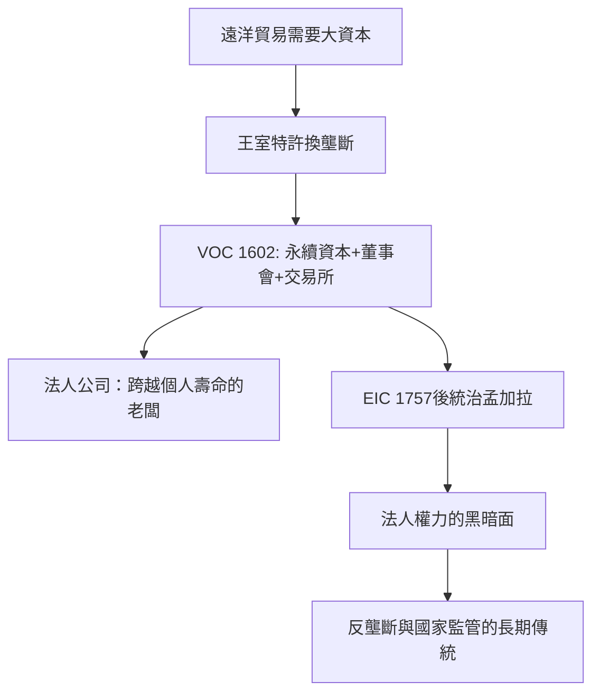

# 2.2 行會大師與東印度公司法人

## 行會：前工業時代的老闆行會

在美第奇的錢之外，中世紀歐洲大部分的「老闆」是行會大師（Meister / maître / master）。行會（guild）自11–12世紀起在歐洲城市興起，控制三件事：技術（誰能學徒、學多久）、品質（產品規格與檢驗）、定價（禁止同業惡性競爭）。一名學徒（apprentice，通常7年）滿師後成為幫工（journeyman，法語 journée 指按日計酬），再提交「傑作」（masterpiece）獲大師資格，才有資格開自己的作坊、帶學徒。

行會大師是「老闆」與「熟練工匠」的合體：他既擁有生產資料（作坊、工具），也親自勞動，且受行會規章約束——不能無限擴張、不能隨意壓價、不能僱超過限額的幫工。這個制度保證了品質與穩定，也為後來的工業革命設置了障礙：它天然反對規模化。

幫工的處境展示了行會的另一面。14世紀起，城市人口增長使大師席位緊張，幫工「滿師即失業」成為普遍現象；幫工組織自己的兄弟會（compagnonnage，法國）抗議工時與待遇，1233年巴黎的紡織幫工起義（Etienne Marcel 之前的老前輩們，1358年馬賽爾起義的社會背景）與佛羅倫斯1378年的梳毛工起義（Ciompi——底層羊毛工要求成立自己的行會，一度成功，旋遭鎮壓）是資本與勞動衝突在中世紀的高峰案例。行會大師與幫工的矛盾，預演了工業時代勞資關係的所有基本母題。

## 特許公司：老闆與王權的交易

1500年後，兩個因素催生了新型老闆：遠洋貿易需要遠超個人身家的資本，以及王室需要壟斷收入。於是出現了特許公司（chartered company）——國王授予壟斷特權（如某海域貿易獨占權），換取商人集資與分利。

- 英國東印度公司（EIC）：1600年12月31日由伊莉莎白一世頒布特許狀，218名股東、7.2萬英鎊初始資本，獲得與東印度貿易十五年壟斷權。
- 荷蘭東印度公司（VOC）：1602年3月20日由荷蘭議會（荷蘭共和國執政奧蘭治的毛里茨支持）特許成立，合併六個前進出荷的遠洋貿易公司，獲得好望角至麥哲倫海峽之間的貿易壟斷權、締約權、築城與駐軍權——它不是貿易公司，而是一個準主權實體。

VOC 的制度創新改寫了商業史：

1. 阿姆斯特丹證券交易所：1602年成立（部分學者將1609年視為常設交易所之年），VOC 股票成為最早公開交易的股票之一——股份可以轉讓，投資者不必等到船回來。
2. 永續資本：與此前「一次航程一集資」的臨時公司不同，VOC 的資本是永久性的，公司成為跨越個人壽命的法人。
3. 董事會治理：17位紳士（Heeren XVII）組成董事會，決定貿易與軍事政策——「所有權與經營權分離」以董事會形式制度化。
4. 全球化經營：VOC 巔峰期（17世紀中）擁有上百艘船、數萬員工（包括士兵）、在巴達維亞（今雅加達，1619年建城）設亞洲總部，荷蘭在台灣的熱蘭遮城（1624–1662）是其分支。它以公司名義發動戰爭、簽條約、發行自己的貨幣。

## 法人的黑暗面

東印度公司的歷史同時展示了法人老闆的危險。EIC 在18世紀中葉成為孟加拉的實際統治者（1757年普拉西戰役、1764年布克薩爾戰役後獲得孟加拉的迪萬尼徵稅權），1770年孟加拉大饑荒（死亡人數估計在百萬至千萬級），公司税吏照徵不誤——這是法人「責任有限、權力無限」的第一個大案例。1784年英國《皮特印度法案》開始由國家監管公司；1858年英國政府直接接管印度（Raj 成立），1874年 EIC 正式解散。亞當·斯密在《國富論》（1776）中對東印度公司的批判成為此後一切「法人權力過大」論述的源頭。

## 小結

中世紀的行會大師是「小而受約束」的老闆，東印度公司是「大而不受約束」的老闆。現代資本主義的老闆史，大致就是這兩極之間的擺動：資本需要規模（法人、上市、壟斷），社會需要約束（行會規章、反壟斷法、公司治理）。1780年代，一項新技術讓老闆的規模潛力再上十倍——蒸汽機與工廠制度，催生了一個新名詞：資本家。
