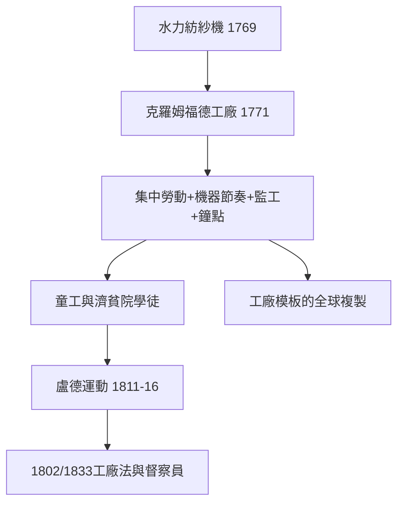

# 3.1 阿克萊特與工廠紀律

## 第一個現代老闆

理查·阿克萊特（Richard Arkwright，1732–1792）通常被視為「現代工廠老闆」的原型。他出身蘭開夏的裁縫學徒，與發明家約翰·凱伊、鐘錶匠托马斯·海斯合作，於1769年取得水力紡紗機（water frame，可紡出強韌的經紗）專利，1771年與傑迪戴亞·斯特拉特（Jedediah Strutt）合夥，在德比郡克羅姆福德（Cromford）的德文特河畔建立水力紡紗廠。

克羅姆福德工廠的意義在於它是一個全新的生產組織：

1. 集中化：數百名工人在同一屋頂下、按機器的節奏同時工作——此前紡紗在農戶家中進行（putting-out system，外包制），工人自己安排時間。
2. 機器定節奏：不再是人用紡車，而是機器設定速度，人配合機器。
3. 分工與專職監工：工廠設有監工（overseer），工人按工序與班次分工。
4. 鐘點紀律：阿克萊特以鐘聲與工時表管理考勤，遲到扣薪。

阿克萊特的規模效應驚人：克羅姆福德廠鼎盛時僱工約三百人，1770年代他在多處建廠，被稱為「棉業之王」（Cotton King）。1792年去世時，他的遺產估計約50萬英鎊——當時英國最富有的非貴族之一。他甚至發明了配套的社會基礎設施：克羅姆福德鎮本身是為工人規劃的住宅區（工人住房、市集），是「公司鎮」的先驅。

## 工廠紀律的社會阻力

把農民與手工業者變成工廠工人，是艱難的文化工程。阿克萊特同時代的紀錄顯示了幾個策略：

- 童工：因成人不願放棄家戶工作的自由，早期紡織廠大量使用7–12歲童工（部分由濟貧院「學徒」供應）；阿克萊特廠中童工占比一度過半。
- 濟貧院供應的「學徒制度」：教區把孤兒「學徒」送工廠，工廠提供食宿——這是契約束縛勞動的最黑暗形態之一。
- 鎮壓反抗：1811–1816年的盧德運動（Luddites，紡織工人搗毀織機）是工人對紀律化與失業的直接反抗；1812年國會通過《搗毀機器罪處死法》。拜倫勳爵在上議院為盧德派辯護的演說（1812年2月）是當時的著名反對聲音。

這些現象催生了最早的勞動立法：《1802年學徒健康與道德法》（規定學徒每日工時12小時、禁止夜工——英國第一部工廠法）、《1833年工廠法》（設立工廠督察員、限制童工年齡與工時）。老闆的權力第一次被國家以「督察員」的物理存在加以限制。

## 工廠主作為新階級

阿克萊特代表了一個新的社會類型：非貴族、非地主、憑技術與資本起家的工業家。他們與舊精英的緊張關係（阿克萊特曾以巨大代價爭取騎士頭銜與上層社交圈認可，1786年受封爵士）正是19世紀中產階級崛起的縮影。經濟史學者（如 Joel Mokyr 對工業革命的技術解釋）指出：阿克萊特的天賦不在發明（water frame 的技術來源有爭議），而在把技術、資本、紀律與法律（專利）組合成一個可複製的組織模板——後來的德比、曼徹斯特、新英格蘭的工廠都是這個模板的複製品。

## 小結

阿克萊特完成了「老闆」的第一次現代化：從擁有土地或奴隸，到擁有機器與紀律系統。這個新權力結構（資本對工資勞動的支配）立即催生了它的理論批判者——馬克思。那是下一節的主題。
