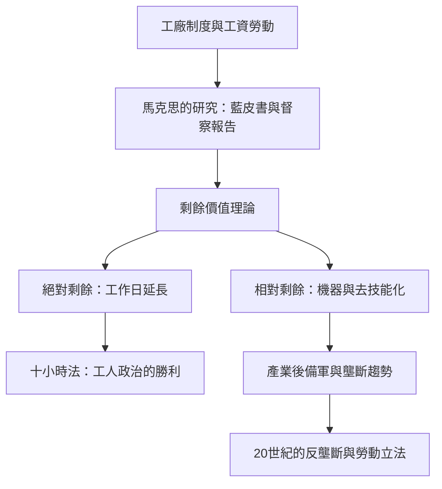

# 3.2 馬克思視角下的資本家

## 剩餘價值：老闆權力的理論解剖

卡爾·馬克思（1818–1883）於1867年在倫敦出版《資本論》第一卷（第二、三卷死後由恩格斯依其手稿整理，1885、1894年出版）。他寫作的核心對象，正是阿克萊特們創造的那個世界：他在大英博物館閱覽室研究了工廠督察報告、藍皮書（Blue Books，英國議會的官方調查文件，含童工、女工、工時的第一手數據）。

馬克思對「老闆」的核心診斷是剩餘價值（Mehrwert）理論：工人出賣的是勞動力（而非勞動），其日工資只補償勞動力再生產所需的部分工時；其餘工時創造的價值被資本家無償占有。他用工作日的劃分來表達：

$$W = c + v + m$$

其中 $c$ 是不變資本（機器與原料的轉移價值）、$v$ 是可變資本（工資）、$m$ 是剩餘價值。剝削率即 $m/v$。馬克思用以表達資本增殖的基本公式是貨幣的循環：

$$M \rightarrow C \rightarrow M'$$

資本家用貨幣 $M$ 購買商品（勞動力與生產資料）$C$，賣出產品換回更多貨幣 $M' = M + \Delta M$。老闆的本質被定義為這個循環的人格化：「資本家只是資本的人格化。」

## 提高剝削的兩條路

馬克思分析了老闆提高剩餘價值的兩大方法，並用歷史材料佐證：

1. 絕對剩餘價值：延長工作日。他以英國工廠督察報告為證——19世紀中葉的紡織工人日工時常達12–14小時，夜工普遍；他指出工人階級的抗爭（爭取十小時工作日，1847年英國《十小時法》通過）是「勞動對資本的第一次大規模政治勝利」。
2. 相對剩餘價值：提高生產力、縮短必要勞動時間。機器化既是文明進步，也是新的壓榨工具——大工業使工人的技能貶值（去技能化，deskillling），使婦女兒童被捲入工廠，使失業後備軍（產業後備軍，industrial reserve army）壓低工資。

他對「工廠專制」（despotism of the factory）的描述——鐘聲、監工、罰款、機器的節奏——與上一節阿克萊特的故事嚴絲合縫。他還分析了資本家之間的競爭如何迫使每個老闆提高資本有機構成（$c/v$ 上升）、導致利潤率趨降，以及小老闆如何被大資本吞併——這為壟斷資本主義理論（希法亭、列寧）埋下伏筆。

## 剝削之外的洞見

馬克思的分析並非只剩控訴，它有三個被後世反覆借用的洞見：

1. 所有權與管理的分離預告：股份公司被馬克思視為「資本主義生產方式內部對私有財產的揚棄」（《資本論》第三卷），他指出股份制使資本從個人所有權轉向組織化的支配——這在五十年後的斯隆與摩根身上應驗。
2. 組織與協作創造生產力：他承認資本家階級的歷史角色是組織社會化大生產——「資本家階級的歷史使命是組織協作與大工業」，這一承認常被忽略，卻是馬克思與後來純粹道德批判的區別。
3. 制度演化的動力論：他不是把老闆當壞人，而是把「老闆—工人」當作一對互相定義的結構位置，其矛盾驅動制度變遷（工廠法、工會、合作社、乃至社會主義嘗試）。

## 影響與反駁

《資本論》對「老闆」形象的影響是空前的：從此「資本家」不僅是社會描述，更是政治陣營的標籤。20世紀的回應有兩大支流：

- 修正與實證：德國學派（桑巴特《現代資本主義》，1902）與韋伯（《新教倫理與資本主義精神》，1904–05）把老闆的起源歸於文化與宗教動力（天職觀、預定論的救贖焦慮），而非單純剝削；經濟史學界（如 Engerman 對美國奴隸經濟、Maddison 的長期數據）則檢驗資本主義與生活水準的長期關係，對馬克思的絕對貧困化預測提出修正。
- 繼承與發展：壟斷資本學派（Baran 與 Sweezy 1966《Monopoly Capital》）、世界體系理論（Wallerstein）、以及21世紀的皮凱提（《21世紀資本論》，2014，以 $r > g$ 重述財富集中）構成這條線的當代延伸。

## 小結

馬克思把「老闆」從一個職業描述升格為一種結構分析對象：不論個人品德如何，凡在競爭中求存的資本都必須榨取剩餘。這個理論塑造了整個20世紀的勞資政治。而在它的故鄉英國與其新傳承地美國，資本家正走向另一個極端——鍍金時代的寡頭。那是下一章的主題。
