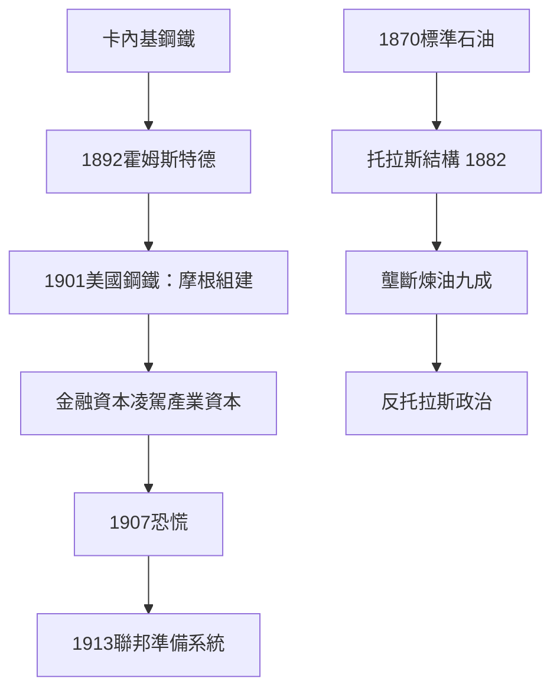

# 4.1 洛克斐勒、卡內基與摩根

## 標準石油：效率與壟斷的雙面神

約翰·D·洛克斐勒（John D. Rockefeller，1839–1937）於1870年與合夥人創立標準石油（Standard Oil）。他沒有發明煉油技術，他的發明是成本會計與談判：他把每加侖煉油成本壓到競爭者之下（運費談判是關鍵——他從鐵路公司拿到秘密回扣，這成為後來訴訟的核心指控），收購競爭對手，到1879年標準石油控制美國煉油產能約九成。

1882年，他的律師薩繆爾·多德發明了托拉斯（trust）結構：各公司股東把股票信託給九名受託人，受託人統一指揮旗下的數十家公司——這繞開了當時各州禁止跨州持股的法律。標準石油托拉斯成為美國史上第一個大托拉斯，其結構被糖業、威士忌、鉛等行業迅速模仿。1880年代起，「托拉斯」成為美國政治的頭號咒語。

## 卡內基：效率鋼鐵與暴力

安德魯·卡內基（1835–1919）的帝國建立在兩個支柱上：技術與成本控制（1880年代他在霍姆斯特德鋼鐵廠等處引進貝塞麥轉爐與最佳成本管理，使卡內基鋼鐵成為世界最有效率的鋼鐵生產者）；以及無情的勞資策略——1892年霍姆斯特德罷工（Homestead Strike）：公司與平克頓偵探社的衝突造成十餘人死亡，工會（Amalgamated Association）被瓦解，卡內基（當時人在蘇格蘭）讓合夥人亨利·克萊·弗里克（Henry Clay Fricker）充當劊子手。此後卡內基鋼鐵的工資與工時全面倒退。

1901年，卡內基把鋼鐵公司以約4.8億美元（當時相當於GDP的約2.5%）賣給摩根，組成美國鋼鐵（U.S. Steel）——世界第一家市值超過十億美元的公司。卡內基此後的下半生用於慈善（《財富的福音》1906，主張富人應以「不受干擾的智慧」在生前散財），資助了兩千多所圖書館、卡內基基金會、國際和平基金等。

## 摩根：金融資本的老闆

J·P·摩根（1837–1913）是鍍金時代第三種老闆：不擁有工廠，而擁有資本的組織能力。他透過投資銀行重組鐵路（1880年代起多次接管破產鐵路，被稱為「摩根化」）、1901年組建美國鋼鐵、1907年金融恐慌中在自家圖書館召集銀行家緊急紓困（以個人信用穩住銀行體系）——此次危機直接促成1913年聯邦準備系統的設立。摩根證明了金融資本可以凌駕於產業資本之上：他決定誰能上市、誰能收購、誰必須合併。

## 雙面評價

鍍金時代的巨頭同時是三種人：效率革命家（把美國變成世界最大工業國，鋼產量從1870年的約77萬長噸增至1900年的逾1,000萬長噸）、壟斷者（托拉斯操縱價格、扼殺競爭者）、以及慈善家（洛克斐勒資助芝加哥大學、根除鉤蟲病運動，卡內基的圖書館、洛克斐勒基金會1913年成立）。這種矛盾正是下一節的焦點——「強盜資本家」與「產業巨人」的稱號之爭。

## 小結

洛克斐勒、卡內基與摩根展示了資本權力的三種形態：工業壟斷、工業效率、金融組織。他們的財富創造與壟斷暴力不可分離，這個矛盾逼出了美國政府對「老闆權力」的第一次正面反擊——反壟斷法。
