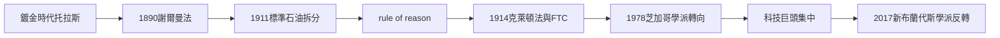

# 4.2 托拉斯與謝爾曼反壟斷法

## 公眾憤怒的政治化

19世紀末的美國，托拉斯成為大眾政治的靶心。1890年代的農民運動（Populism）把「華爾街與鐵路」列為頭號敵人；記者與小說家的揭黑文學（muckraking）提供了情感燃料：Ida Tarbell 1902–1904年在《McClure's》連載的《標準石油公司史》詳細揭露洛克斐勒對她父親所在石油業的打壓（她的父親正是被標準石油擠垮的獨立煉油商之一），Upton Sinclair 1906年的《屠場》（The Jungle）揭露芝加哥肉類加工的條件與壟斷。老羅斯福總統（1901–1909）把「托拉斯克星」（trust buster）做成執政品牌。

## 謝爾曼法：模糊但致命

1890年7月2日，哈里森總統簽署《謝爾曼反托拉斯法》（Sherman Antitrust Act）。其核心條款僅兩條，卻足以支撐此後一世紀的執法：

- 第1條：禁止「限制州際或外國貿易的契約、聯合或共謀」。
- 第2條：禁止「壟斷或試圖壟斷」。

該法最初的執法對象甚至包括工會（1890年代最高法院以「限制貿易」為由裁定工會罷工違法，是該法著名的反諷階段；1914年《克萊頓法》第6條才明確豁免勞工組織）。

## 標準石油的肢解

決定性戰役是標準石油案。1906年司法部起訴；1911年5月15日，最高法院在 Standard Oil Co. v. United States 中裁決標準石油違法，下令拆分為34家獨立公司（今日的埃克森美孚、雪佛龍等皆是其後裔）。此案確立了「合理原則」（rule of reason）：單純規模不違法，非法的是不合理地限制貿易的行為。同年，美國菸草公司也被判拆分。

1911年的拆分在經濟上堪稱黑色幽默：被拆分的標準石油各子公司股價在拆分後反而暴漲——壟斷者的財富沒有被沒收，只是被切開。這促使20世紀的反壟斷思考從「拆分」轉向「行為規制」：1914年《克萊頓法》禁止搭售與排他性交易、《聯邦貿易委員會法》設立 FTC。20世紀後半的關鍵戰役包括：1945年鋁業公司案（Alcoa，確立「壟斷本身」即違法的新解釋）、1969–1982年的 IBM 反壟斷案（13年訴訟後撤訴，但深刻改變了 IBM 的商業行為）、1998–2001年的微軟案（法院裁定微軟非法維持壟斷並企圖壟斷瀏覽器市場，後以和解告終——多數評論認為此案為2000年代 Google 等新公司的崛起掃除了障礙）。

## 反壟斷的理論兩極

反壟斷法的哲學基礎本身經歷了大轉向。早期（1911–1970年代）以「大即壞」與保護競爭過程為主；1970年代末起，芝加哥學派（Robert Bork 1978《The Antitrust Paradox》是最重要的理論著作）主張：反壟斷的唯一目標應是消費者福利（主要看價格），效率與規模本身不是罪。這個轉向使美國反壟斷執法在1980–2020年代明顯寬鬆，伴隨的是科技巨頭的集中化。2010年代末，新布蘭代斯學派（以 Lina Khan 2017年的《Amazon 反壟斷悖論》為代表作，她於2021年出任 FTC 主席）發起反轉：主張平台時代不能用「價格」衡量壟斷傷害（亞馬遜低價但殺死競爭生態），應回到「競爭過程與市場結構」的傳統關切。

## 小結

反壟斷史證明：老闆權力的上限由社會（透過國家）決定，而非由資本決定。從托拉斯的黃金年代到芝加哥學派的寬鬆再到新布蘭代斯的復興，這個鐘擺還在擺動。下一章我們轉向老闆權力的另一面：不是壟斷，而是福特式的「對勞動者做什麼」的重新發明。
