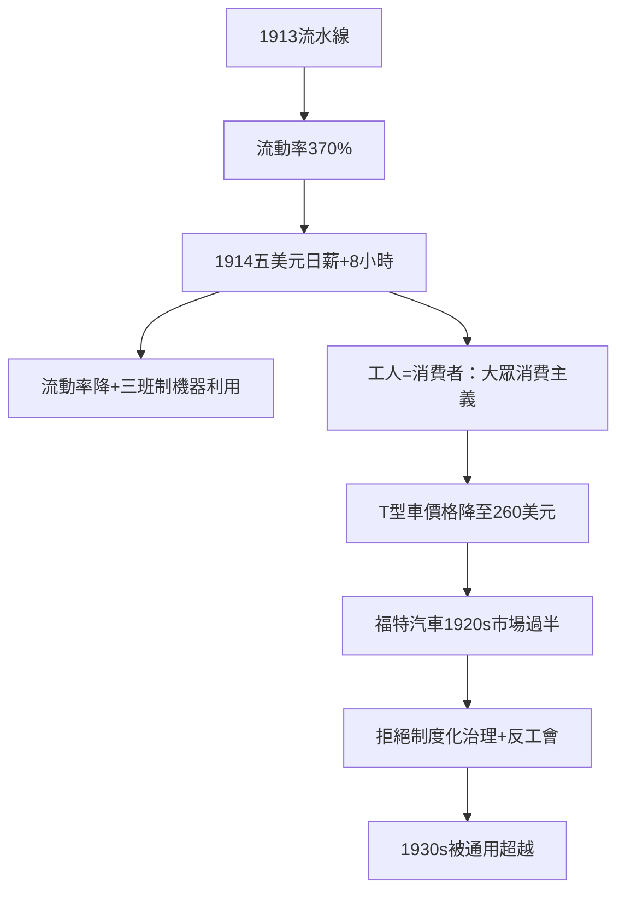

# 5.1 福特與五美元工資日

## 流水線與它的代價

亨利·福特（1863–1947）於1903年創立福特汽車公司，1908年推出 T 型車（定價從初期的825美元一路降到1925年的約260美元）。1913年，福特在海蘭德公園廠引入移動裝配線（借鑑芝加哥屠宰場的吊掛傳送與泰勒制的時間研究），把 T 型車的組裝時間從約12.5小時壓到93分鐘。到1920年代中期，福特汽車占全球汽車產量的過半。

流水線的社會代價同樣驚人：工人的動作被細分到重複幾秒的單元，窒息感強烈，流動率爆表——1913年福特廠的年度勞工流動率達370%（需要僱用五萬多人才能維持一萬四千個崗位），單日出勤率僅約七成五。

## 五美元工資日：1914年1月5日

1914年1月5日，福特宣布革命性措施：最低日薪從約2.34美元提高到5美元（當時行業日薪約2–2.5美元），同時把工作日從9小時縮到8小時，實行三班制。數千人在廠門前排隊應徵。

這不是慈善，而是有明確經濟計算的效率投資：

1. 降低流動率與訓練成本：日薪翻倍後，流動率大幅下降，出勤率上升。
2. 縮短工作日配合三班制的機器利用率：流水線必須24小時運轉才划算，8小時×3班正是為了機器不閒置。
3. 創造消費者：福特公開主張——工資不能只是成本，必須讓工人買得起自己造的車。他說他的工資政策不是發善心，是把利潤的一部分變成明年的顧客。這是大眾消費主義的商業宣言：老闆的角色從壓低工資的剝削者，轉變為製造購買力的引擎。
4. 社會控制：5美元日薪附帶「社會部」的入職審查（家訪確認生活節儉、不酗酒），福特把福利與「道德合格」捆綁——企業對員工私生活的干預的早期形態（該計畫於1919年前後取消）。

## 福特的黑暗面與衰落

五美元日薪不能掩蓋福特的另一面：他是史上最強烈的反工會老闆之一，其服務部門（由哈利·貝內特領導）以暴力與間諜對付工會組織者，1937年「戰橋之戰」（貝內特的手下在行人橋上毆打 UAW 組織者 Walter Reuther）成為著名公共事件；1941年福特才在罷工壓力下與 UAW 簽約——是最後一個承認 UAW 的三大車廠。他還是著名的反猶分子（1920年代透過自辦的《迪爾伯恩獨立報》連載反猶文章，1927年被迫公開道歉）。

同時，福特的個人專斷毀掉了公司：1927年 T 型車已被通用的多樣化產品打敗（見下一節），福特本人拒絕現代化管理（長期不編制正式的組織圖與預算系統）、否決兒子埃茲爾的改革，福特汽車在1930–40年代從行業第一滑落到第三。福特的完整教訓是：五美元工資日與流水線是天才，但拒絕制度化治理是災難。

## 小結

福特證明了一個全新老闆邏輯：高工資可以是資本的投資，員工同時是勞動力與市場。但他也證明：天才老闆若拒絕現代治理，個人意志會毀掉帝國——這正是把所有權與經營權分離、讓職業經理人接管的歷史理由。那是下一節斯隆的故事。
