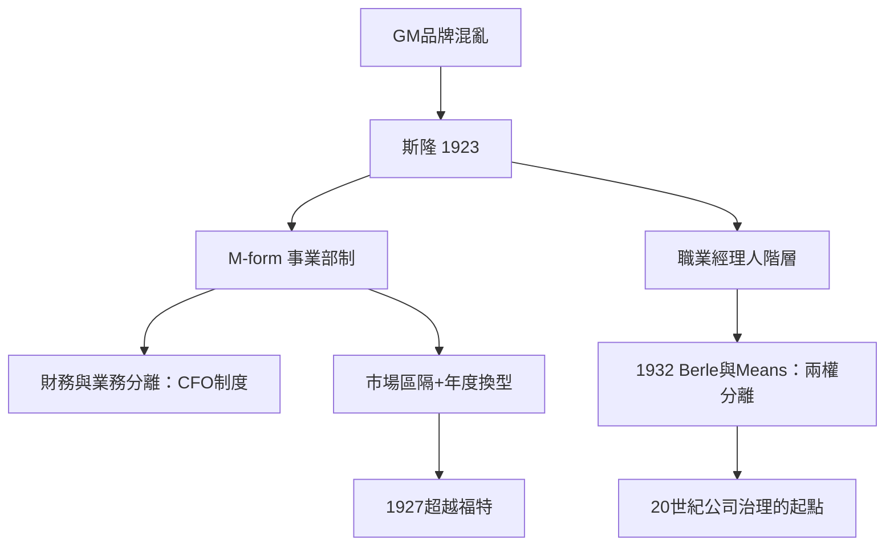

# 5.2 斯隆與現代 CEO 制度

## 通用汽車的困局與斯隆的答案

阿爾弗雷德·斯隆（Alfred P. Sloan，1875–1966）於1916年帶著自己的軸承公司併入通用汽車（GM），1923年出任總裁。他接手時的通用是一團混亂：杜邦家族控制的控股公司下，各品牌（雪佛蘭、別克、奧茲莫比、奧克蘭、凱迪拉克）獨立為政、內部互相殘殺，財務無法統一。

斯隆的解決方案成為此後大企業的標準模板：

1. 事業部制（M-form）：各品牌按市場區隔獨立經營（雪佛蘭對大眾市場、凱迪拉克對頂級市場，著名的口號是「a car for every purse and purpose」），總部只管戰略、財務與資源分配。
2. 分權經營、集權控制：事業部有自己的總經理與盈虧責任，總部設立財務委員會統一審核——財務與業務分離，CFO 制度由此定型。
3. 市場區隔與年度換型：每年改款、價格階梯、顏色與選配——把福特「任何顏色只要黑色」的單一產品邏輯反轉為差異化邏輯。
4. 依賴市場研究與統計：GM 成立了行業最早的市場統計部門，預測需求、規劃產能。

結果：1927年 GM 銷量超過福特，此後近八十年（除少數年份）保持美國汽車業第一。斯隆的《我在通用汽車的歲月》（My Years with General Motors，1964）成為管理學經典——彼得·杜拉克1946年的《公司的概念》（Concept of the Corporation）正是以 GM 為樣本、由 GM 委託而寫，把斯隆體系理論化為「組織的科學」。豐田、IBM 等此後的大企業管理結構，都直接或間接繼承 M-form。

## 職業經理人的誕生

斯隆代表的是一個歷史性的身份變化：老闆不再是所有者。這個變化的法律與金融基礎由兩條線構成：

1. 股份公司的成熟：1920年代的證券市場擴張（通用是上市公司的模範生），使大企業的資本來自千百萬匿名股東，創辦人家族不再是絕對控股方（杜邦家族在1917–1920年間對通用的大投資，隨後在1960年代逐步淡出）。
2. 學術的確認：伯利（Adolf Berle）與米恩斯（Gardiner Means）1932年的《現代公司與私有財產》（The Modern Corporation and Private Property）統計了美國兩百家最大企業，發現多數已由專業管理層而非大股東控制——他們稱之為「所有權與控制權的分離」，這是20世紀公司治理理論的起點（皮凱提2014年對「管理者資本主義」的描述正是接續此線）。

職業經理人的文化形象也在此定型：不是車庫裡的天才，而是組織人（第七章男性篇所述灰色西裝男——斯隆與通用正是組織人的原型母體）、受過商學院教育（哈佛商學院1908年創立、GM 是其早期案例教材的最大供應者）、以公司為終身事業。

## 斯隆制度的暗面

這個體系也有其代價：層級與官僚化（杜拉克批評 GM 的集權傾向）、對創新的保守（GM 對小車與安全技術的反應遲鈍，1960年代起被日本車企追擊）、以及財務至上主義（斯隆把財務指標置於產品之上的傾向，被批評為1980年代「股東價值至上」的遠因）。管理學者錢德勒（Alfred Chandler）在《戰略與結構》（1962）與《看得見的手》（1977）中把 M-form 命名為「管理革命」的核心，同時也指出其官僚化的長期風險。

## 小結

斯隆完成了一次權力的抽象化：老闆權力不再來自擁有資產，而來自組織設計與財務控制的能力。職業經理人成為20世紀的老闆標準像。但這個「組織人」形象，在1970年代被另一群拒絕穿西裝的人打破——矽谷的車庫創業者。那是下一章的主題。
