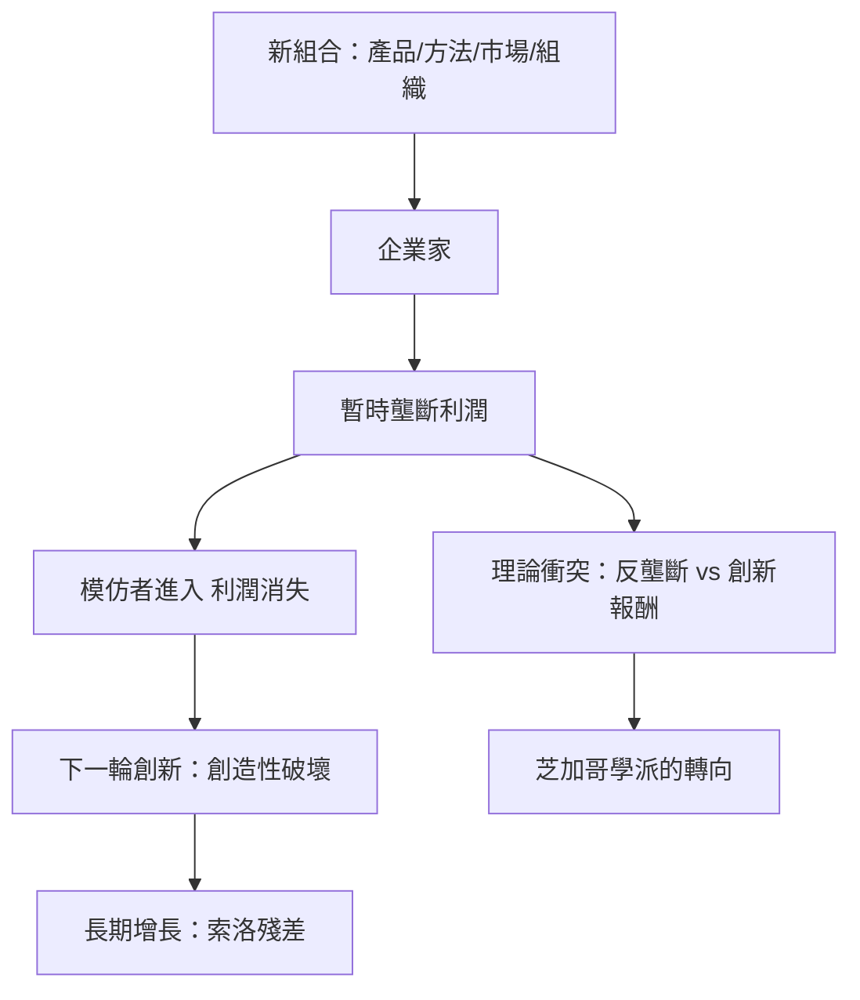

# 6.1 熊彼得與破壞性創新

## 企業家作為經濟的心臟

約瑟夫·熊彼得（Joseph Schumpeter，1883–1950）在1912年（德文原版，英文1934年《經濟發展理論》）提出了一個與馬克思完全不同的老闆理論：企業家（entrepreneur）不是剝削者，而是經濟變遷的主體——他把「新組合」（new combinations）引入生產，包括：新產品、新生產方法、新市場、新供應來源、新的產業組織。

熊彼得的企業家不等於資本家或管理者：企業家是「執行新組合的人」，可以是借款創業的窮人（企業家不需要擁有資本，銀行信貸使創新者得以動員他人的資源——這是對現代創業融資的精準預言）。企業家的動機不是滿足需求，而是「建立私人王國」、征服的意志、創造的喜悅——熊彼得稱之為「企業家精神」（Unternehmergeist）。

## 創造性破壞

1942年的《資本主義、社會主義與民主》提出了他最著名的概念——創造性破壞（creative destruction）：

「資本主義的本質過程，是恆常的內部變革，它不斷從內部破壞舊結構、創造新結構。這個創造性破壞的過程，是資本主義的本質事實。」

熊彼得的顛覆性結論是：長期來看，經濟的活力不在於競爭價格，而在於創新者製造的暫時壟斷。每個創新者靠新產品或新方法獲得暫時的超額利潤——這種「壟斷利潤」是創新的報酬，會被下一輪創新摧毀。因此「托拉斯式的大企業」未必是壟斷的罪人，而常是創新的引擎（他稱之為「完全競爭不僅不可能，而且不是理想狀態」）——這個觀點與反壟斷的傳統直覺正面衝突，成為芝加哥學派反壟斷理論的思想源頭之一（見第四章第二節）。

## 對企業家精神的實證檢驗

熊彼得的理論被20世紀的經濟史與增長理論反覆檢驗：

- 索洛殘差（Robert Solow 1957）顯示，經濟增長的大部分不能用資本與勞動解釋，必須歸於技術進步——「創新是長期增長的主體」獲得實證支持。
- 内生增長理論（Romer 1986、1990）把熊彼得的創新內生化為模型。
- Aghion 與 Howitt 1992年的「熊彼得增長模型」直接以創造性破壞為核心：新產品使舊產品過時，創新的預期回報驅動研發——熊彼得的散文變成了可計算的數學。
- 實證層面，Foster、Haltiwanger 與 Krizan 等人的生產力分解研究顯示，美國製造業生產力增長的主要來源不是既有企業的改善，而是新進入者與退出者的更替——這正是熊彼得的「進入—退出」機制。

## 企業家精神的制度條件

熊彼得晚年在哈佛的教學與《商業週期》（1939）中強調：企業家精神需要特定的制度土壤——信貸市場（讓無產者動員資本）、破產法（容許失敗者再來）、知識產權（暫時壟斷的保護）、以及對失敗的文化容忍。這些洞見後來成為創業生態研究（如全球創業觀察 GEM、矽谷研究）的標準框架。

## 小結

熊彼得把老闆的定義從「擁有資本的人」改寫為「實現新組合的人」。這個重構為20世紀後半的創業文化提供了正當性：創業者不需要繼承、不需要階級，只需要一個新組合與籌錢的能力。當矽谷的車庫創業者在1970年代登場，他們並不知道自己正在把熊彼得的理論變成生活方式。那是下一節的故事。
