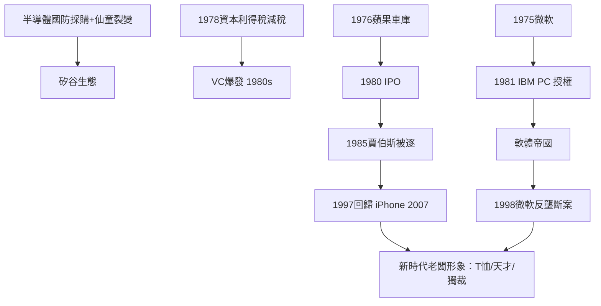

# 6.2 賈伯斯、蓋茲與車庫創業

## 兩個車庫與一個時代

1976年4月1日，史蒂夫·賈伯斯與史蒂夫·沃茲尼亞克（及羅恩·韋恩，後退出）在洛斯阿爾托斯賈伯斯家的車庫創立蘋果公司（Apple Computer），資金來自賈伯斯賣掉的小貨車與沃茲尼亞克賣掉的計算器，約1,300美元。第一件產品是沃茲尼亞克手工組裝的 Apple I 電路板；1977年的 Apple II（塑膠外殼、彩色圖形、內建 BASIC）成為個人電腦革命的引爆點。1980年蘋果上市，創下了當時自1956年福特以來最大的 IPO 之一，賈伯斯25歲時的身家已上億美元。

比爾·蓋茲與保羅·艾倫1975年在新墨西哥州阿布奎基創立微軟（Micro-soft，為 Altair 8800 編寫 BASIC 直譯器），1981年與 IBM 簽約為其 PC 提供作業系統（買下 QDOS 改名 MS-DOS，並保留了向其他廠商授權的權利——這個「非排他授權」的談判細節成為微軟帝國的基石），1986年上市後，蓋茲在1990年代中期成為世界首富。

兩個車庫定義了新的老闆形象：

- 年齡：二十多歲，而非五十多歲的斯隆式經理。
- 著裝：T 恤與牛仔褲（賈伯斯的黑色高領衫與牛仔褲、蓋茲的針織衫），對抗灰色西裝（第七章男性篇的組織人形象）。
- 起點：自籌資金與業餘時間（Homebrew Computer Club 與 Altair 愛好者社群），而非繼承或大公司內部晉升。
- 產品：自己動手做的東西（沃茲尼亞克的電路、蓋茲與艾倫的直譯器），而非管理報表。

## 矽谷的制度土壤

車庫創業能成為可複製的模板，依賴幾個此前二十年形成的制度條件：

1. 研究基礎設施：史丹佛（特曼教授1950年代推動的工業園區，後來的矽谷之名——仙童半導體1957年成立於此）與国防部的採購（惠普、仙童的早期客戶）培育了半導體產業；仙童的「叛逃」文化（1957年八人叛逃創業、其後不斷裂變）是創業公司連鎖反應的起點。
2. 風險資本的誕生：1946年成立的 American Research and Development（ARD，DEC 的投資者是里程碑）與1972年成立的紅杉資本、KPCB，提供了專為高風險新創設計的融資制度（第七章將展開）。
3. 資本利得稅：1978年美國將資本利得稅率從49.5%降至28%，1981年進一步降為20%——直接刺激了1980年代風險投資的爆發。
4. 當年12月成立的 IBM PC（1981年8月）意外地把個人電腦變成標準品，使軟體授權成為一個巨大的產業——微軟是最大受益者。

## 老闆形象的重構

賈伯斯與蓋茲也展示了新時代老闆的兩種問題模式。賈伯斯1985年在蘋果內鬥中被自己請來的 CEO 斯卡利（John Sculley）趕出公司（他1985年離職創辦 NeXT，並於1986年以1,000萬美元收購盧卡斯影業的動畫部門，改名皮克斯——1995年《玩具總動員》使其翻身，2006年迪士尼以74億美元收購皮克斯），1997年以 NeXT 被蘋果收購的方式回歸，帶領蘋果推出 iMac（1998）、iPod（2001）、iPhone（2007）。他的領導風格（現實扭曲力場、極致的產品控制、殘酷的直言）成為「天才型獨裁老闆」的文化原型——被無數創業者模仿，也被無數員工痛恨。

蓋茲則展示了另一面：從車庫少年到1980年代起以鐵腕商業手段（與 IBM 的授權談判、壓制競爭對手、捆綁銷售）建立壟斷，最終撞上反壟斷的牆（1998–2001年微軟案，見第四章第二節）。車庫的浪漫形象與壟斷的現實，在蓋茲身上完成了一次循環——從熊彼得的創新者到標準石油式的壟斷者，只用了二十年。

## 小結

車庫創業把熊彼得的企業家精神變成了大眾神話：老闆可以年輕、可以穿 T 恤、可以自己動手、可以靠一個好點子與一筆風險資本改變世界。這個神話在2000年代達到頂點——風險資本與獨角獸的黃金時代。那是下一章的主題。
