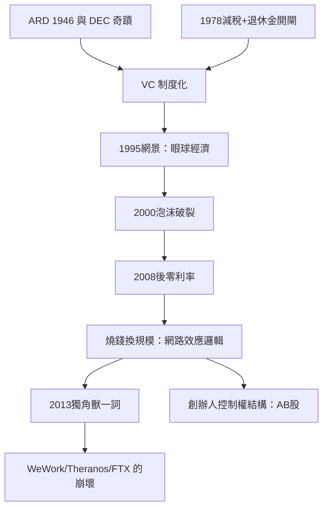

# 7.1 VC 時代與獨角獸神話

## 風險資本的制度化

車庫創業能成為產業，靠的是一種為失敗率極高的投資設計的金融制度：風險資本。其制度化路徑：

- 1946年：American Research and Development（ARD）成立（喬治·多里奧特創立），1957年對 Digital Equipment Corporation 投資7萬美元，DEC 上市時該筆投資價值逾3.5億美元——回報逾五千倍，成為行業創世神話。
- 1972年：紅杉資本與 Kleiner Perkins 在門洛帕克成立，投資對象包括 Apple、Cisco、Google、Amazon 等。
- 1978年：美國資本利得稅率從49.5%降至28%（1981年降至20%），同時退休金獲准進入 VC——資金閘門打開，1980年代 VC 募資額以十倍級增長。
- 有限合夥結構（LP 出資、GP 管理、2%管理費+20%分成）成為行業標準，激勵設計使基金經理追求極端回報。

## 燒錢換規模：網路效應的邏輯

1995年網景上市（首日股價從28美元飆至75美元，公司尚在虧損）宣告眼球經濟時代：網路公司的估值邏輯從利潤轉向用戶與網路效應。這個邏輯在2000年網路泡沫破裂（納斯達克指數從2000年3月的5048點跌至2002年的1114點）中破產，卻在2008年後以更極端的形式復活。

原因是零利率與行動互聯網：2010年代，VC 可以用極低的資金成本押注贏家通吃的市場——補貼用戶搶占規模，網路效應鎖定市場後再變現（Uber 2015–2017年每年燒錢數十億美元補貼乘車；Amazon 長期以近零利潤換市場份額）。燒錢換規模成為新常態。

## 獨角獸的誕生

2013年11月，Aileen Lee 在 TechCrunch 發表文章，把估值達10億美元的私人新創公司命名為 Unicorn——她統計的2003年以來達成此成就的美國科技公司僅39家，故稱罕見如獨角獸。這個比喻迅速失控：到2015年底，全球獨角獸已逾百家；到2020年代中期，全球獨角獸超過一千家，獨角獸從稀有象徵變成融資路線圖的標配里程碑。

獨角獸的崛起伴隨估值文化的問題：WeWork（2019年估值470億美元的軟銀投資案例，IPO 檔案揭露巨虧與治理缺陷後估值崩落，同年9月撤回上市）、Theranos（2018年被揭發血檢技術造假，創辦人 Elizabeth Holmes 2022年被定罪）、FTX（2022年11月破產，創辦人2023年被定罪）——估值先於盈利、敘事先於產品的模式反覆崩壞，使2010年代末的創業文化被稱為增長至上的泡沫。

## 創辦人崇拜

VC 時代同時造就了一種新型老闆形象：創辦人作為英雄。Paul Graham 的 Y Combinator（2005年成立，把創業孵化標準化為三個月批次+種子資金+Demo Day）與 Peter Thiel 的文化輸出，使創辦人優於職業經理人成為矽谷信條。制度工具是雙重股權（AB 股：Google 2004年上市即採用；Snap 2017年上市時公開發行股完全無投票權）——創辦人可以融資而不放棄控制。扎克伯格（2004年創立 Facebook）、馬斯克（2002年 PayPal 被 eBay 以15億美元收購後轉向 SpaceX 與 Tesla）成為2000–2010年代最著名的創辦人形象。

## 小結

VC 時代把老闆的權力來源從「資本擁有」轉移到「敘事與融資能力」：一個二十幾歲的創辦人可以在五年內融資數十億美元、控制一家估值百億的公司，而不擁有工廠、利潤或正現金流。當這個模式延伸到勞動市場本身，就出現了下一節的主題——演算法作為隱形老闆。
