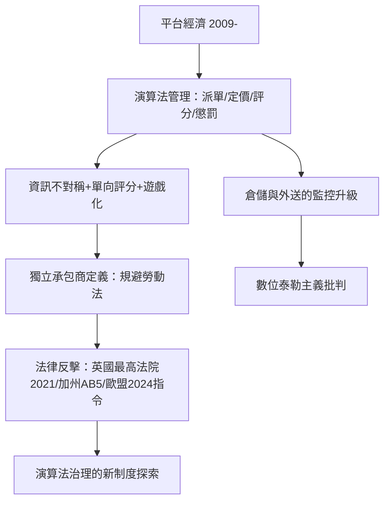

# 7.2 演算法作為隱形老闆

## 平台把管理外包給代碼

2010年代，平台經濟把「老闆」的角色部分轉移到了代碼上。Uber（2009年成立）的司機沒有上司、沒有排班經理，但其每一單的接單、路線、定價、評分、接單率懲罰、地區熱圖的推送，全部由演算法決定。學者把這種現象稱為演算法管理（algorithmic management）：由軟體系統執行傳統上由人類管理者完成的功能——分配任務、評估績效、施加懲罰、決定收入。

研究的關鍵發現（包括 Rogers 2016年對紐約 Uber 司機的民族誌、Wood 等人2019年對英國 Uber 司機的研究、ILO 2021年數位勞工平台報告）：

1. 資訊不對稱：平台知道乘客需求與競價，司機只知道自己的螢幕。
2. 評分的單向性：乘客評分直接影響司機收入與帳號存續，司機無申訴機制（早期）。
3. 遊戲化與心理誘導：接單率獎勵、顛峰時段獎金、目標進度條——把勞動設計成遊戲，使工人「自願」延長工時。
4. 就業身分的模糊：平台以「獨立承包商」（independent contractor）定義工人，規避最低工資、加班費、社保與集體談判權——這是平台商業模式的核心成本優勢。

## 法律戰場：到底誰是老闆

平台與工人的身分之爭成為2010年代勞動法的主戰場：

- 英國：2016年 Uber 司機 Aslam 等人提起訴訟，英國最高法院2021年2月裁定 Uber 司機是 worker（勞動者，享有最低工資與帶薪休假），不是獨立承包商。
- 加州：2019年 AB5 法案以三叉測試推定零工為僱員；平台出資推動2020年22號提案（Prop 22）豁免平台工人，2021年法院曾裁定其違憲，2024年加州最高法院又維持其有效性——立法與司法的拉鋸戰至今未決。
- 歐盟：2024年通過《平台工作指令》，要求平台透明化演算法管理，並設立僱員推定（rebuttable presumption of employment）的舉證規則。

與此同時，亞馬遜倉儲展示了演算法管理的另一形態：倉庫工人被穿戴式設備與掃碼系統追蹤（每小時揀貨件數、time off task 的秒數記錄），系統自動發出警告甚至觸發解僱程序——亞馬遜2019年被報導稱其系統可自動發出解僱通知。亞馬遜也使用生產力演算法為物流司機規劃路線與監控（2021年美國參議員對其司機監控的調查信函）。快遞平台（Amazon Flex、Foodpanda、Meituan）的外送員被路徑演算法設定時限，誤差以分鐘計罰——2019年中國的外賣騎手困在系統裡一文（《人物》雜誌，2020年9月）引發全國討論，美團與餓了麼隨後調整了時限與罰則。

## 演算法管理的理論定位

演算法管理並非全新事物，而是泰勒制（科學管理，1911）的數字化升級：泰勒用秒錶分解動作，平台用 App 記錄每一次觸控；泰勒的工頭被替換為推播通知。區別在於規模與不可見性：一個監工管五十人，一個演算法管百萬人；監工可以抗議，代碼無法協商。這引出了學界對「數位泰勒主義」的批判，以及對新制度回應（演算法審計、數位勞動權、平台工會——2021年美國拜登政府支持加州、紐約的零工權益立法）的討論。

## 小結

演算法管理證明：老闆權力可以脫離人形而存在於代碼中，且其精細度與規模超過任何人類管理者。但社會的回應也遵循歷史規律——從漢摩拉比的工資條款到工廠督察員，再到平台指令：當管理技術改變，法律與制度必須重新談判權力的邊界。而在管理技術的另一端，2010年代的企業也開始重新談判自己對社會的責任——那是下一章的 ESG 故事。
