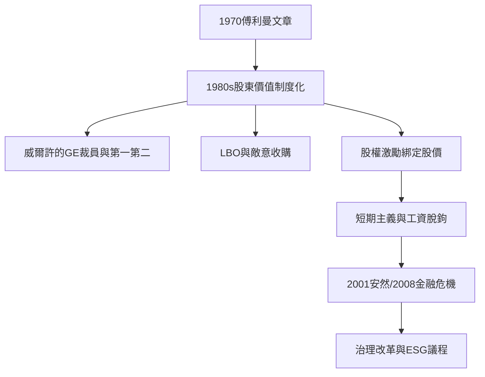

# 8.1 傅利曼模式與其退潮

## 股東價值的教義

米爾頓·傅利曼（Milton Friedman）1970年9月13日在《紐約時報雜誌》發表〈企業的社會責任是增加利潤〉（A Friedman Doctrine），成為20世紀後半最影響商業界的一篇文章。其論點：企業高管是股東的代理人，花股東的錢去追求社會目標（環保、公益、社會正義），是未經授權的花別人的錢——形同徵稅；企業的唯一社會責任是在法律與道德習俗範圍內，以資源從事增加利潤的活動。

傅利曼的立場有三個理論根基：

1. 產權：股東擁有公司，管理者受託於股東。
2. 代理成本：管理者的社會冒險缺乏問責，容易成為自我授權的藉口（Jensen 與 Meckling 1976年《公司理論》把這個問題形式化，成為代理理論的奠基文獻）。
3. 市場的紀律：社會問題應由民主政治與市場解決，不應由不被問責的企業高管裁量。

## 從理論到實踐：股東價值主義

傅利曼的觀念在1980年代被金融市場制度化了。三個關鍵事件：

1. 1981年8月，GE 新任 CEO 傑克·威爾許（Jack Welch）在紐約的 Pierre 飯店演說，主張公司應該只做市場上第一或第二的業務，否則賣掉——成為股東價值主義的操作宣言。
2. 1980年代的敵意收購潮（槓桿收購 LBO，Kohlberg Kravis Roberts 1988–89年對 RJR Nabisco 的250億美元收購是史上最著名的案例，Bryan Burrough 的《門野的野蠻人》1990年使其不朽）：市場用收購威脅懲罰低效率的管理層，股東價值成為保命的紀律。
3. 1990年代的高管激勵改造：股權激勵（stock options）成為高管薪酬的主要形式，管理層的個人財富直接綁定股價——傅利曼的代理人理論被裝進了薪酬委員會的公式。

實踐結果有兩面：正面是效率與資本配置的改善（GE 的市值從1981年的約140億美元增至2001年威爾許退休時的約4,000億美元）；負面是短期主義（季度財報的統治）、裁員正當化（威爾許的裁員被稱為「Neutron Jack」——房子還在，人沒了）、投資縮減、以及員工與社區成為純粹的變數。2001年後，威爾許模式受到廣泛批判——他本人2010年代也承認「股東價值是結果，不是戰略」（2009年 Financial Times 訪談中的著名說法）。

## 退潮的開始

2010年代末，股東價值模式開始面臨系統性挑戰：

1. 財富集中與工資停滯：股東回報與工資增長的脫鉤成為政治議題（皮凱提2014年 $r > g$ 的實證；美國 CEO 與普通工人薪酬比從1965年的約20:1升至2020年代的300:1上下，EPI 等機構的長期統計）。
2. 短期主義的實證批評：多方研究（如 McKinsey、FCLT Coalition、Harvard Business Review 的系列文章）指出季報導向的資本配置傷害長期創新。
3. 氣候與社會風險的不可迴避：2015年巴黎協定、2019–2020年極端氣候與疫情，使「外部性」變成企業自身的營運風險。
4. 法律與監管的推進：法國2019年《PACTE 法》把企業使命與員工、環保納入公司章程考量；英國2018年《公司治理準則》要求董事考慮利益相關者。

2001年的安然（Enron）與世通（WorldCom）破產、2008年金融危機，是股東價值模式治理失靈的兩大標誌性事件，直接催生了《薩班斯-奧克斯利法》（2002）與《多德-弗蘭克法》（2010），也催生了 ESG 治理議程（下一節）。

## 小結

傅利曼模式把老闆的目標函數簡化為一個變數：股東回報。它有效率，也有代價。2010年代起，這個簡化開始退潮——但退潮的方向不是回到前工業時代的老闆慈善，而是一種更制度化的責任框架：ESG 與利益相關者資本主義。
