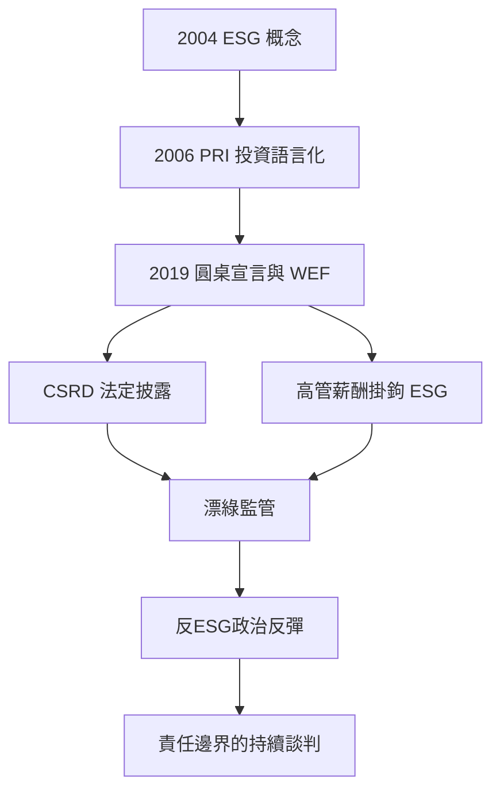

# 8.2 利益相關者資本主義

## 從宣言到指標

2019年8月19日，美國商業圓桌會議（Business Roundtable，近200家美國最大企業的 CEO 組織）發布新的《企業目的宣言》（Statement on the Purpose of a Corporation），宣布放棄1997年以來「股東至上」的表述，承諾為所有利益相關者創造價值：客戶、員工、供應商、社區與股東。181位 CEO（包括蘋果的庫克、摩根大通的戴蒙）簽署——這是傅利曼模式退潮的標誌性時刻。

同年，世界經濟論壇的達沃斯宣言重寫，明確主張利益相關者資本主義（stakeholder capitalism，施瓦布1970年代初即提出的概念，2019年正式成為 WEF 的核心議程）。2020年疫情期間，「利益相關者」的必要性被疫情本身驗證：企業的供應鏈韌性、員工健康、社區信任，都成為直接影響股東回報的變數。

## ESG：責任的量化

ESG（環境 Environmental、社會 Social、治理 Governance）這個詞由聯合國全球契約組織2004年的報告《Who Cares Wins》首次系統提出；2006年聯合國責任投資原則（PRI）成立，把 ESG 從道德語言轉為投資語言。

ESG 對老闆的實際影響是使責任可被評分、比較與定價：

- 披露義務擴張：歐盟2022年通過《企業永續報告指令》（CSRD，分階段實施），要求大型企業按統一準則（ESRS）披露環境與社會數據，並附第三方保證——ESG 從自願報告變成法定披露。
- 資本的連結：主權與退休基金的 ESG 授權（挪威主權基金2015年起排除煤炭公司）、黑色洛克（BlackRock，拉里·芬克2018年起每年公開信以「目的」與永續為主題）與貝萊德的投票政策，使 ESG 表現直接影響融資成本。
- 主管薪酬掛鉤：歐洲大型企業的高管獎金普遍將 ESG 指標（碳排、員工滿意度、安全）納入 KPI——責任從宣言變成薪資結構。

## 批評與現實

ESG 的制度化也催生了它的批判：

1. 漂綠（greenwashing）：企業誇大或選擇性披露 ESG 表現；2020年代起各國監管者（美國 SEC、歐盟）開始查處漂綠案例與基金名稱誤導（2023年 SEC 對多家基金公司因 ESG 稱謂罰款）。
2. 反彈政治：美國2020年代出現明確的反 ESG 政治運動（德州與佛州等地立法禁止州基金使用 ESG 標準；2022–2024年美國「反 ESG」議案成為選舉議題），顯示 ESG 已成為文化戰爭的一部分。
3. 衡量難題：ESG 評級機構（MSCI、Sustainalytics）之間相關性低（MIT 2012與2022年的研究顯示不同評級的一致性差），「何謂好的 ESG」本身缺乏共識。
4. 效益證據爭議：學術界對 ESG 與財務績效的關係爭論不休（部分元分析顯示正相關或中性，但因果難以確定）——ESG 更像風險管理框架，而非利潤魔法。

## 治理結構的實質變化

ESG 時代也改變了董事會與高管的面貌：

- 董事會多元化與技能要求：加州2018年通過的董事會性別配額法（2022年被加州法院判違憲，但歐盟、挪威、德國的配額法仍具效力）、英國 FCA 的 ESG 技能披露要求。
- 「義務的重塑」：英國2019年修訂的公司治理準則、2020年英國《公司（救濟與治理）法》、以及各國董事義務中對利益相關者的明示，正在緩慢地把「董事對誰負責」從純粹股東擴展到更廣泛群體。
- 氣候訴訟：荷蘭殼牌案（2021年海牙地方法院命令殼牌2030年前減排45%，2024年上訴法院部分推翻但確認企業有減排義務）開啟了把氣候目標變成法律義務的路徑——ESG 從自願到強制的邊界仍在移動。

## 小結

利益相關者資本主義沒有消滅傅利曼模式的邏輯——它只是把「股東回報」放進了更複雜的函數：長期股東價值需要員工、社區與環境的可持續性。這場關於老闆責任的談判尚未結束，而2020年的疫情將以遠比任何宣言更急迫的方式，重新談判老闆與員工之間的另一層關係：在哪裡工作、如何監督、憑什麼被信任。那是第九章的主題。
