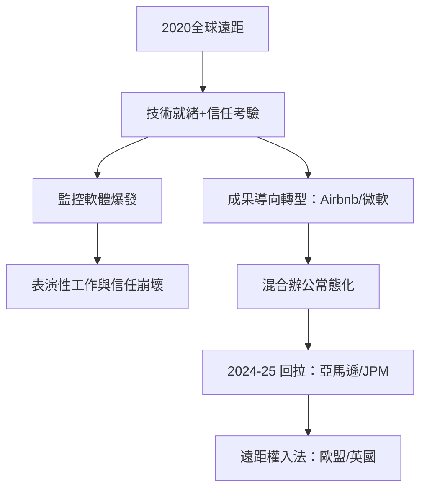

# 9.1 遠距與混合辦公的大考驗

## 史上最大的辦公室實驗

2020年3月，COVID-19 迫使全球數億知識工作者瞬間離開辦公室。美國的遠距工作比例從疫情前的約百分之七躍升至2020年5月的逾六成（斯坦福的 Nicholas Bloom 與 Barrero、Davis 等人的 SWAA 調查數據是主要來源）；台灣、日本、韓國、歐洲同步發生。這是人類歷史上最大規模的工作組織方式突變。

疫情前的遠距技術與文化已經就緒（Zoom、Slack、VPN、雲協作），疫情只是按下了執行鍵。Bloom 與其合作者在疫情前的研究（2015年中國攜程的隨機對照實驗）已顯示：居家工作使員工績效提升約13%、離職率下降——但這項實驗在疫情前推廣遇冷，因為老闆們「不相信看不見的員工」。

## 老闆的監控本能與信任轉型

遠距時代對老闆的最大考驗不是技術，是權力：沒有工位、沒有走動管理，如何知道員工在做事？

監控產業在疫情中爆發：員工監控軟體（如 ActivTrak、Teramind、Hubstaff）的使用量劇增，功能包括螢幕截圖、鍵盤活動、攝影頭監督、滑鼠移動偵測；2021年《紐約時報》報導多家企業安裝「工作場所分析」軟體追蹤員工（其中巴克莱銀行的案例——在員工不知情下使用追蹤軟體——被 BBC 揭發後中止）。監控帶來的反效果同樣明顯：信任崩壞、表演性工作（performative work，員工以機械操作欺騙監測指標）、法律風險（歐盟 GDPR 對監控的嚴格限制）。

同時，一批企業走出了相反路徑：微軟2020年將混合辦公制度化（2020年10月宣布允許員工每周部分遠距），Google 2021年推混合模式，Airbnb 2022年2月宣布員工可在全球遠距工作且薪酬不因地調整，Spotify 的 Work From Anywhere（2021年）。成果導向（OKR、交付物）取代打卡成為治理語言——這是斯隆式科層與福特式監控在知識經濟中的真正鬆動。

## 混合的均衡與回拉

疫情退潮後，市場尋找新的均衡。到2024–2025年，出現明顯的回拉：亞馬遜2024年9月宣布2025年起每周五天到崗；JP Morgan、特斯拉、迪士尼等大公司相繼加強返崗要求；英國《金融時報》與斯坦福數據顯示美國平均辦公室出勤率在疫情後穩定在疫情前的約七成上下。老闆返崗的理由包括：協作與學徒式學習（新人培養）、文化傳承、以及（批評者的說法）對已投入的商業地產與管理控制權的維護。

法律也跟進：歐盟2024年通過《遠距工作框架協議》（基於歐洲社會夥伴的協議，2026年前成員國須落實）；英國2024年《僱員權利（彈性工作）法》使彈性工作成為從入職首日即可請求的權利。

## 小結

遠距辦公的考驗暴露了一個老問題：老闆權力的基礎究竟是「看得見的勞動」還是「信任與成果」。這場考驗尚未結束，但它的方向已清晰——當監控的邊際成本趨於零而其反效果同樣上升，成果導向的信任管理成為老闆的生存技能。而信任危機的另一面，是員工的用腳投票——大離職潮與雇主品牌的崛起。
