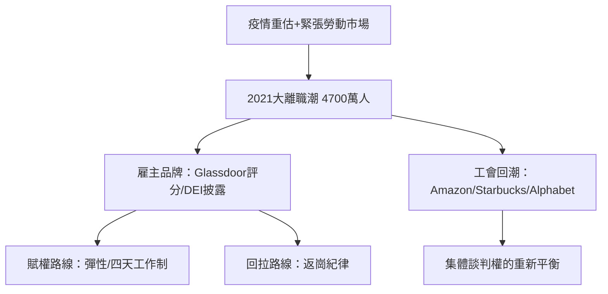

# 9.2 大離職潮與雇主品牌

## 2021年：四千七百萬人辭職

2021年，美國約四千七百萬人自願辭職（美國勞工統計局的 JOLTS 數據），創下有統計以來的最高紀錄；2022年約五千萬人。媒體將其命名為大離職潮（Great Resignation，這個詞由德州 A&M 的安東尼·克洛茨 Anthony Klotz 於2021年5月在 Bloomberg 訪談中提出）。

離職潮的原因不是單一因素：疫情引發的人生重估（死亡與封控使人重新排列優先級）、儲蓄與資產增值（股市與房市）提供的經濟緩衝、遠距辦公擴大了可接受的工作地理範圍、以及勞動市場的緊張（2021–2022年美國職位空缺一度超過失業人數，史上首見）使離職成本下降。WHO 與蓋洛普的數據顯示，倦怠（burnout）與工作意義的缺失是離職者的高頻理由。

## 雇主品牌：老闆的反向競爭

當員工比職位多（或者說，當好員工的選擇比以往多），「老闆」第一次不得不作為「品牌」被行銷。雇主品牌（employer branding）在1990年代由顧問界提出，疫情後成為人力資源戰略的核心：

- Glassdoor（2008年上線）與 Indeed 的匿名評價使企業的內部管理成為公開評論對象——老闆的名聲第一次有了大眾評分機制。
- LinkedIn 的透明化使挖角與比價常態化。
- 「安靜離職」（quiet quitting，2022年7月由 TikTok 使用者 zaidleppy 提出後爆紅）——員工不辭職但只做份內最低限度——成為雇主品牌失效的流行指標。
- 企業被迫公開員工福祉、DEI（多元、公平、包容）數據、薪酬帶（部分國家立法強制——歐盟2023年《薪酬透明指令》要求企業在2026年前實施薪酬透明與同工同酬報告）。

## 回應的策略與極化

面對大離職潮，老闆的策略出現明顯分化：

1. 賦權路線：微軟、Spotify、Airbnb 等以彈性、心理健康假、自我選擇團隊為賣點；四天工作制試驗（2022年英國非營利組織4 Day Week Global 與劍橋大學、波士頓學院合作的試驗，61家企業參與，多數選擇繼續）成為賦權路線的旗艦案例。
2. 回拉路線：亞馬遜、馬斯克（2022年收購推特後立即要求員工回到辦公室、並以高強度長工時文化著稱，信件中要求每周至少40小時在辦公室）為代表的「回歸紀律」路線，以效率與文化純度為由收緊遠距。
3. 工會的回潮：亞馬倉庫（2022年4月紐約斯塔滕島 JFK8 倉庫工人投票成立亞馬遜首個工會——Amazon Labor Union）、星巴克（2021年12月紐約州水牛城第一家門店工會成立後，兩年內數百家門店跟進）、矽谷的 Alphabet Workers Union（2021年成立，會員逾千）——大離職潮的深層是集體談判意識的復甦，美國的工會支持率蓋洛普民調在2022年達到71%，為1965年以來最高。

## 小結

大離職潮的本質是勞動市場權力關係的重新定價：當員工擁有更多選項與聲音，老闆的權威必須以品牌、彈性與價值觀來競爭，而非單靠工資與職位。這個趨勢與 AI 時代的到來相遇，把問題推向更根本的一層：如果 AI 能做越來越多的工作，老闆與員工的關係還剩下什麼？那是第十章的主題。
