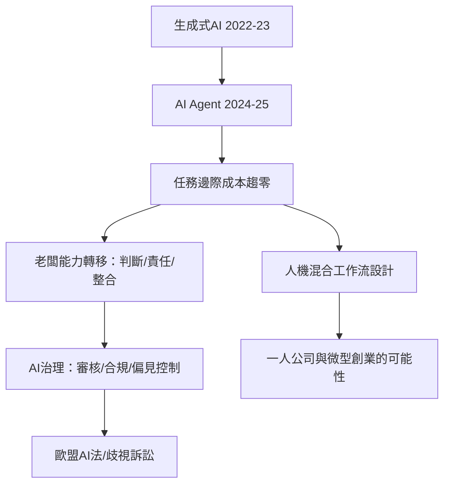

# 10.1 AI 代理與經營者的新能力

## 從工具到代理人

2023–2025年，生成式 AI 從聊天工具進化為代理（AI agent）：能夠自主拆解任務、調用工具、執行多步流程。實際落地的代理場景包括：自動撰寫與分派行銷郵件、客服工單的分診與回覆、程式的編寫與測試、財務報表的初稿編制、招聘流程的簡歷初篩與面試安排。微軟 Copilot（2023年3月起整合於 Office）、Salesforce 的 Agentforce（2024年9月發布，主打客戶服務與銷售流程的自主代理）、OpenAI 的 GPTs（2023年11月）與 Operator（2025年1月）都是這條路線的商業產品。

對老闆而言，這意味著組織的基本單元正在改變：過去一項工作需要「僱一個人」，現在可以「配一個代理」。經濟學者把這稱為勞動的邊際成本趨近於零的第二輪（第一輪是軟體，這一輪是判斷與溝通）。

## 經營者核心能力的重構

當 AI 能做財報、行銷文案、程式碼初稿，老闆的稀缺能力向三處轉移：

1. 判斷與問題選擇：AI 擅長在已定義的問題內生成答案，不擅長決定該問什麼問題。戰略選擇、風險取捨、價值排序仍是人的領域。
2. 責任的承擔：AI 代理的錯誤（幻覺、偏見、法律侵權）最終由誰負責？目前的答案是人類與企業——歐盟《AI 法案》（2024年8月生效，分階段實施）將高風險 AI 系統的義務（風險管理、資料治理、人類監督）分配給提供者與使用者；企業無法把責任外包給演算法。這使得「AI 的審核者」成為新的組織角色（許多公司已設立 AI 治理委員會、AI 政策與審計職能）。
3. 組織與人的整合：AI 時代的老闆必須設計人機混合的工作流——哪些環節交給代理、哪些保留人的判斷、如何培訓員工與 AI 協作（2023年麥肯錫與 WEF 的未來就業報告都把「AI 素養」列為最迫切的技能缺口）。

## 真實案例與邊界

AI 代理在企業中的實際表現有成功也有失敗：客服與內容初稿（如 Klarna 2024年宣布其 AI 客服承接了相當於700名人工客服的工作量，2025年又重新增加人工客服以處理複雜情況——是 AI 代理邊界的著名案例）；軟體開發（GitHub Copilot 自2021年上線，2024年報告稱被數百萬開發者使用，但研究顯示其效益取決於任務複雜度與審核流程）；招聘篩選（亞馬遜2018年放棄了對女性簡歷歧視的 AI 招聘工具，是 AI 偏見風險的教科書案例）。

法律與倫理的邊界正在快速落定：歐盟 AI 法案禁止的社會評分與即時情緒識別（工作場所中）、美國的演算法歧視訴訟（EEOC 2023年對 iTutorGroup 的和解案——AI 招聘系統自動拒絕55歲以上女性與60歲以上男性申請者）、以及各國對 AI 生成內容的版權與標識要求——AI 時代的老闆必須同時是技術使用者與合規管理者。

## 小結

AI 代理把老闆的角色推向一個新的抽象層次：從管理人的工作，到管理「人與代理」的混合系統。這個變化同時打開了一扇門——如果一個人的判斷加幾個代理就能完成一家中型公司的營運，那麼「公司」的最小規模可以被壓到多低？那是最後一節的問題。
