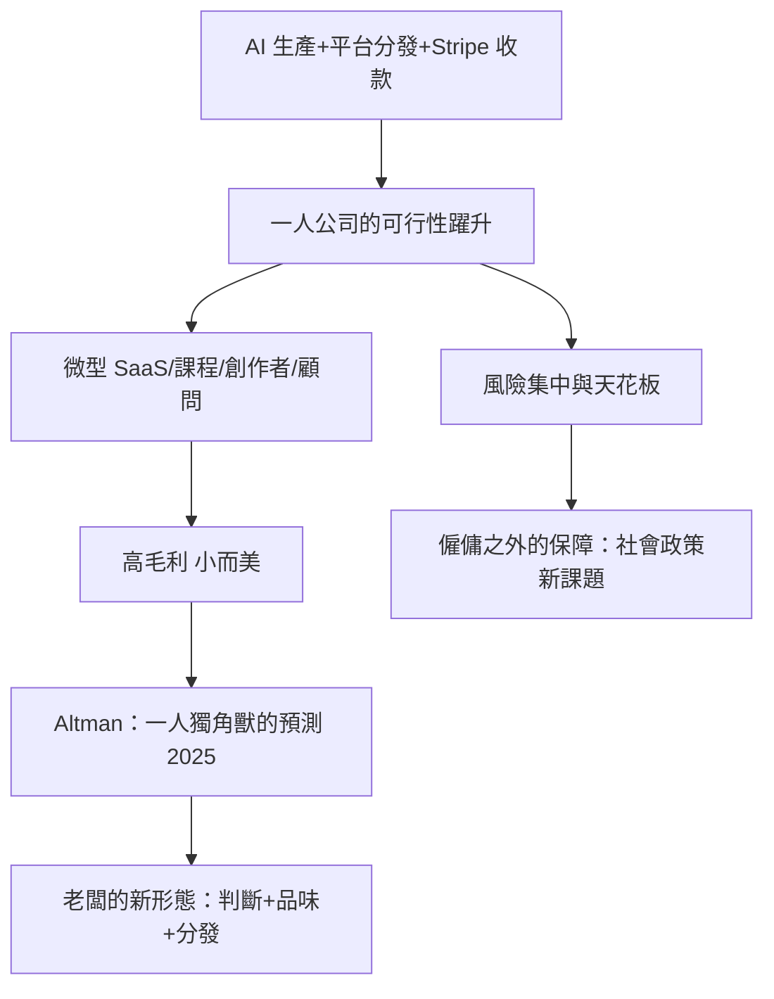

# 10.2 一人公司與微型創業

## 極簡規模的歷史與現在

一人公司的理念早有思想前驅：1998年 Michael Gerber 的《E-Myth Revisited》主張把創業從「有一技之長者的陷阱」中解放；2013年 Paul Jarvis 的《Company of One》把這個概念推向大眾——拒絕為成長而成長，以極小規模、高利潤、可持續為目標。聯合國與經濟學者的統計顯示，全球企業中絕大多數（多數國家九成以上）本就是微型與小型企業；而美國的非僱員企業（nonemployer firms，只有一個所有者、無僱員）從1997年的約1,700萬家增至2020年代的逾3,400萬家——獨資者的人口規模已超過大多數國家的總人口。

AI 與平台生態讓「一人即公司」的可行性躍升了一個量級：

- 生產：AI 撰寫文案、代碼、設計初稿、影片腳本。
- 分發：社群媒體與電商平台（Shopify、Etsy、Instagram、TikTok Shop）使個人可以直接觸達全球市場。
- 後勤：Stripe（2010年成立，使個人幾小時內可以合法收款）、外包平台（Upwork、Fiverr）與 AI 代理處理帳務、客服、排程。
- 知識：YouTube、Substack（2017年成立）、Podcast 使個人可以直接變現專業知識與創作。

## 一人老闆的經濟學

一人公司的財務特徵是高毛利率、低固定成本、以創辦人的獨特能力（品味、專業、信任）為核心資產。典型的商業模式包括：數位產品（課程、模板、軟體訂閱）、顧問與服務、微型 SaaS、創作者經濟的訂閱與贊助。2020年代多家獨立軟體開發者與創作者（如 DHH 的 37signals 雖然不只有一人但長期保持小團隊高利潤，其「拒絕融資、小而美」的哲學、Pieter Levels 的 Nomad List 與 PhotoAI——公開其一人年營收數百萬美元的案例）成為這個路徑的標竿。

與此同時，「創辦人崇拜」的邏輯在反轉：2020年代後期，矽谷開始重新評價「精益創辦人」模式——Sam Altman（Y Combinator 前主席、OpenAI CEO）2025年公開預測將出現史上第一家一人獨角獸（估值10億美元、無僱員的公司）。這個預測背後的條件是：AI 代理可以覆蓋工程、行銷、客服、法務初稿的完整鏈條，而創辦人的價值集中在判斷、品味與分發能力。

## 一人公司的極限與風險

一人老闆的模式有其明確的邊界：

1. 天花板：許多產業（製造、重資產、需要多學科協作的醫療與航太）無法以一人規模經營。
2. 風險集中：一人公司的營運、健康、市場波動都壓在同一個人身上，沒有組織的韌性。
3. 治理與責任：獨資與一人有限責任公司在法律上仍需處理稅務、勞動合規（若有外包者）、消費者保護與 AI 責任——「一個人」不等於「沒有責任主體」。
4. 就業的意涵：一人公司爆發的另一面，是傳統僱傭崗位的替代與再分配——社會保障、健保、失業保險的設計正面臨「僱傭之外的工作」如何被保護的結構性問題（美國的 ACA 與自僱者退休計畫、歐盟的平台工作指令都是這場談判的一部分）。

## 結語：老闆權力的五千年弧線

回到本書的起點：漢摩拉比法典用石柱規定僱工的日薪與作坊主的責任，羅馬莊園主用鞭子與管莊指揮奴隸，美第奇用複式簿記與匯票統治城市，東印度公司用法人與特許狀跨越大洋，阿克萊特用鐘聲與機器節奏紀律化工人，洛克斐勒用托拉斯控制九成煉油，福特用五美元與流水線創造消費者，斯隆用事業部制與財務控制替代個人英雄，賈伯斯與蓋茲用車庫與 T 恤改寫老闆形象，VC 與獨角獸用敘事與股權結構融資百億，平台用演算法派單百萬勞動者，AI 時代的創辦人可能一個人就管理一支代理軍團。

五千年來，老闆的權力來源不斷遷移——從暴力到特許，從資本到組織，從技術到演算法——但每次遷移都伴隨同樣的張力：效率與壓迫、規模與約束、創新與壟斷。社會的回應也從未缺席：法典、行會、工廠法、反壟斷、勞動法、ESG、平台指令。AI 時代的老闆面對的問題，與漢摩拉比時代的老闆並無本質不同：你可以動員多少人的勞動，你對他們負什麼責任，以及——社會允許你走多遠。老闆的故事沒有終章，只有下一輪的重新談判。
