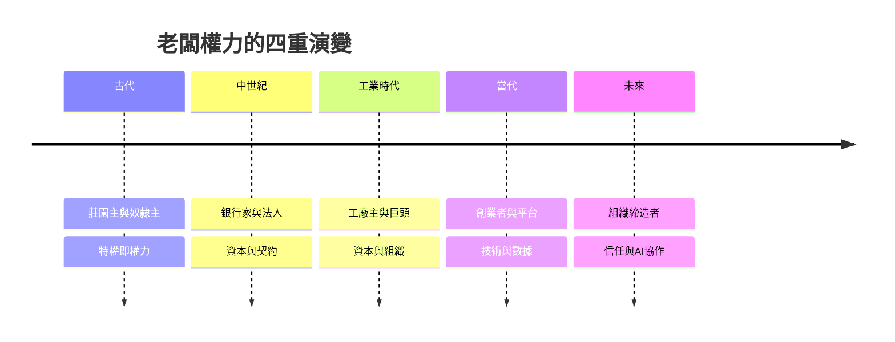

# 老闆的故事：從王室特許、資本巨頭到演算法平台與未來創業者的權力史詩

本書跨越數千年，講述「老闆」這個角色如何從古代莊園主與特權商人開始，經歷大航海時代的股份公司、工業革命的工廠主、鍍金時代的資本巨頭，演變為職業經理人、矽谷創業家、平台演算法管理者，直至 AI 時代的組織締造者。

全書沿四條主線交織：角色與身份、權力來源、對員工的態度、經營與工具。

* 第1章-古代莊園主、奴隸主與私營作坊
    * [1.1-漢摩拉比法典與最早的僱傭契約](01.1-漢摩拉比法典與最早的僱傭契約.md)
    * [1.2-羅馬莊園主與奴隸經濟](01.2-羅馬莊園主與奴隸經濟.md)
* 第2章-美第奇家族、行會大師與特許貿易商
    * [2.1-美第奇：跨國銀行與早期資本控制](02.1-美第奇跨國銀行與早期資本控制.md)
    * [2.2-行會大師與東印度公司法人](02.2-行會大師與東印度公司法人.md)
* 第3章-工廠制度興起與資本家的誕生
    * [3.1-阿克萊特與工廠紀律](03.1-阿克萊特與工廠紀律.md)
    * [3.2-馬克思視角下的資本家](03.2-馬克思視角下的資本家.md)
* 第4章-強盜資本家與鍍金時代帝國
    * [4.1-洛克斐勒、卡內基與摩根](04.1-洛克斐勒卡內基與摩根.md)
    * [4.2-托拉斯與謝爾曼反壟斷法](04.2-托拉斯與謝爾曼反壟斷法.md)
* 第5章-亨利·福特與職業經理人革命
    * [5.1-福特與五美元工資日](05.1-福特與五美元工資日.md)
    * [5.2-斯隆與現代CEO制度](05.2-斯隆與現代CEO制度.md)
* 第6章-矽谷創客、車庫傳奇與企業家精神
    * [6.1-熊彼得與破壞性創新](06.1-熊彼得與破壞性創新.md)
    * [6.2-賈伯斯、蓋茲與車庫創業](06.2-賈伯斯蓋茲與車庫創業.md)
* 第7章-科技新貴、風險資本與獨角獸
    * [7.1-VC時代與獨角獸神話](07.1-VC時代與獨角獸神話.md)
    * [7.2-演算法作為隱形老闆](07.2-演算法作為隱形老闆.md)
* 第8章-公司治理、CSR與ESG時代
    * [8.1-傅利曼模式與其退潮](08.1-傅利曼模式與其退潮.md)
    * [8.2-利益相關者資本主義](08.2-利益相關者資本主義.md)
* 第9章-消失的辦公室與信任管理
    * [9.1-遠距與混合辦公的大考驗](09.1-遠距與混合辦公的大考驗.md)
    * [9.2-大離職潮與雇主品牌](09.2-大離職潮與雇主品牌.md)
* 第10章-生成式AI、微型企業與未來的組織締造者
    * [10.1-AI代理與經營者的新能力](10.1-AI代理與經營者的新能力.md)
    * [10.2-一人公司與微型創業](10.2-一人公司與微型創業.md)

## 全書架構圖

