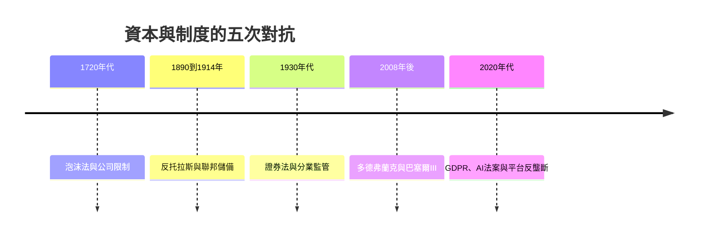

# 10.2 高頻交易與無人資本

2010年5月6日下午，道瓊指數在幾分鐘內暴跌近千點（近百分之九），數兆美元的市值蒸發，又以同樣的速度回升。這就是閃崩（Flash Crash）。事後的調查發現：一個高頻交易公司的演算法與市場的流動性互動，放大了賣壓，而成交量的絕大多數來自機器的自動交易。資本主義的增值邏輯，在這一天第一次明確地不需要人類。

## 高頻交易的技術

高頻交易（HFT）的商業模式建立在速度的邊際收益上：以微秒到毫秒的優勢搶先交易。它的技術基礎是：共置伺服器（把機器放在交易所機房，省下光纖傳輸的微秒）、專用光纖（芝加哥到紐約的微波與光纖網絡競賽，把延遲從13毫秒壓到8毫秒以下）、FPGA與ASIC硬體加速、以及策略模型（做市、統計套利、動量與事件驅動）。

HFT的規模與影響在2000年代擴張：美國股市的成交量中，HFT佔比在2000年代末達到約五成；多數訂單在進入交易所前就被取消（訂單與成交比高達數百比一），市場的短周期結構由機器主導。它帶來了買賣價差的收窄與流動性的增加（對散戶的立即好處），也帶來了新的風險：2010年的閃崩、2012年騎士資本（Knight Capital）的代碼事故（45分鐘虧損四億四千萬美元，公司幾乎破產）、以及做市商在壓力下的撤單（2015年8月24日的第二次閃崩）。

## 監管的追趕

監管的回應始終在追趕。美國2010年後設置了熔斷機制與波動中斷規則；歐盟的MiFID II（2018年）對高頻交易者註冊、算法測試與延遲報告提出要求；各交易所對訂單取消率與最小報價壽命設置限制。但速度競賽的經濟學（軍備競賽的零和性）使批評持續：經濟學家把HFT區分為有價值的部分（做市、價格發現）與純租金的部分（速度套利：在信息到達不同市場的微秒間搶跑——訂單類型與數據饋送的售賣成為交易所的商業模式）。2010年代起，部分市場（加拿大與歐洲的長度性拍賣、美國的IEX交易所，成為電影《大空頭》作者路易斯筆下的主角）以速度公平為賣點，試圖對抗速度競賽。

## 無人資本的哲學

高頻交易只是無人資本的起點。2010年代以來，量化基金（文藝復興、Two Sigma、D.E. Shaw：以統計與機器學習為核心，長期佔據回報榜頂）把投資決策系統化；生成式AI進入交易與研究（2020年代的大型語言模型被用於研報解析與情緒交易）；資產管理的被動化（指數與ETF）使資金流動越來越由規則而非判斷驅動。到2020年代，美股的交易量中，算法與量化策略的占比估計超過七成。

無人資本帶來了馬克思人格化命題（第四章）的極限問題：當資本的運轉不需要人類的意志，責任歸屬與治理如何可能？閃崩沒有肇事者（每個算法都合法），量化基金的模型錯誤沒有道德主體（它是統計），被動基金的持股沒有立場（它複製市場）。監管面對的是系統而非個體，治理的對象是代碼與數據而非人格。

從長時段看，資本的演化呈現一條清晰的路徑：從人格濃郁（實業家本人）到人格稀薄（機構與基金）到無人格（算法與被動資本）。但每一次稀薄，都伴隨著新的治理技術（反壟斷法、證券監管、中央銀行、AI法案）的誕生。資本與制度，仍在互相塑造。

從熱那亞的簿記員到矽谷的演算法，資本家的故事跨越了五個世紀。它的主線始終如一：資本以新的形態尋找新的利潤，制度以新的法律追趕新的風險。每一代人都以為自己面對的資本主義是終點，每一代人都發現它又變了形。資本家的故事，是一個永遠在書寫中的故事。
