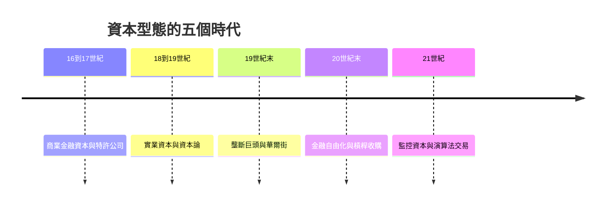

# 資本家的故事：從特許帝國、重工業巨頭到金融工程與演算法黑盒的資本史詩

本書跨越五個世紀，講述「資本」與「資本家」如何從熱那亞與阿姆斯特丹的商業金融網絡，經歷特許公司的殖民掠奪、實業資本家的工廠帝國、鍍金時代的壟斷巨頭、布雷頓森林解體後的金融自由化，一路演變成現代的平台帝國、監控資本主義與演算法交易。它與「老闆的故事」不同：老闆關注組織管理與僱傭關係，資本家關注資本積累、市場壟斷、金融槓桿、風險博弈，以及資本對社會秩序與政治結構的重塑。

全書依循四條交織的線索：

1. 資本型態的演進：商業與海運資本、實業與工廠資本、金融與投資銀行資本、數據與演算法監控資本。
2. 增值與獲利邏輯：殖民掠奪與特許貿易、工廠生產與剩餘價值、兼併重組與金融衍生品、數據壟斷與行為預測。
3. 與國家政權的關係：受王權特許與庇護、被反信託法與監管制約、跨國流動並衝擊國家貨幣體系、太大不能倒與國家救市。
4. 資本家的人格特徵：冒險犯難的大航海商人、鐵血治廠的工業大亨、精明計算的華爾街狼群、矽谷技術新貴與無形的大型機構投資者。

## 目錄

* 第1章-熱那亞與阿姆斯特丹——早期金融資本的誕生（西元16世紀–17世紀）
    * [1.1-熱那亞商人：複式簿記與公債市場](01.1-熱那亞商人：複式簿記與公債市場.md)
    * [1.2-阿姆斯特丹證券交易所](01.2-阿姆斯特丹證券交易所.md)
* 第2章-王權許可下的掠奪——特許公司與泡沫（西元17世紀–18世紀初）
    * [2.1-東印度公司與原始積累](02.1-東印度公司與原始積累.md)
    * [2.2-南海泡沫與密西西比泡沫](02.2-南海泡沫與密西西比泡沫.md)
* 第3章-紡織機、煤礦與實業資本家的崛起（西元1780年代–1840年代）
    * [3.1-從商人資本到工廠資本](03.1-從商人資本到工廠資本.md)
    * [3.2-李嘉圖與資本家對地主的政治博弈](03.2-李嘉圖與資本家對地主的政治博弈.md)
* 第4章-馬克思與《資本論》——剩餘價值與資本異化（西元1848年–1867年）
    * [4.1-資本論與增值公式](04.1-資本論與增值公式.md)
    * [4.2-資本的人格化](04.2-資本的人格化.md)
* 第5章-美利堅鐵路狂潮與Wall Street的誕生（西元1860年代–1890年代）
    * [5.1-鐵路狂潮與華爾街的融資機器](05.1-鐵路狂潮與華爾街的融資機器.md)
    * [5.2-J.P.摩根與Morganization](05.2-J.P.摩根與Morganization.md)
* 第6章-強盜資本家與托拉斯帝國的鼎盛（西元1870年代–1910年代）
    * [6.1-洛克斐勒與標準石油](06.1-洛克斐勒與標準石油.md)
    * [6.2-卡內基與財富的福音](06.2-卡內基與財富的福音.md)
    * [6.3-反信託法與標準石油拆分](06.3-反信託法與標準石油拆分.md)
* 第7章-布雷頓森林體系解體與金融自由化（西元1971年–1980年代）
    * [7.1-尼克森衝擊與金融資本解放](07.1-尼克森衝擊與金融資本解放.md)
    * [7.2-新自由主義與股東價值](07.2-新自由主義與股東價值.md)
* 第8章-華爾街狼群、槓桿收購與對沖基金（西元1980年代–1990年代）
    * [8.1-KKR、垃圾債券與門口的野蠻人](08.1-KKR、垃圾債券與門口的野蠻人.md)
    * [8.2-索羅斯與英鎊狙擊](08.2-索羅斯與英鎊狙擊.md)
* 第9章-2008次貸風暴、量化寬鬆與科技監控資本主義（西元2008年至今）
    * [9.1-金融海嘯與太大不能倒](09.1-金融海嘯與太大不能倒.md)
    * [9.2-祖博夫與監控資本主義](09.2-祖博夫與監控資本主義.md)
* 第10章-VC風險資本、演算法交易與未來的「無人資本」（21世紀至今）
    * [10.1-風投、私募與燒錢獨占](10.1-風投、私募與燒錢獨占.md)
    * [10.2-高頻交易與無人資本](10.2-高頻交易與無人資本.md)
