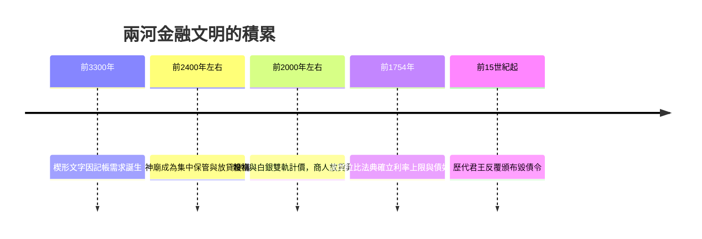

# 1.1 漢摩拉比法典與最早的利息規範（約西元前 2000 年 – 前 4 世紀）

## 一塊泥板上的借據

西元前十八世紀左右，美索不達米亞平原上的兩河流域，人類還沒有紙，也沒有金屬鑄幣。所有的借貸契約，都刻在潮濕的黏土泥板上，曬乾或燒硬後保存。一位農夫若在播種前向商人借了三百升大麥，契約上會記載本金、利息、償還日期，以及雙方的姓名與證人。這些泥板，就是人類歷史上最早的「金融憑證」。

考古學家在烏爾、烏魯克、巴比倫等古城遺址挖掘出成千上萬這樣的商業泥板。其中最著名的例子之一，是西元前十八世紀的烏爾商人杜穆茲-加米爾（Dumuzi-gamil）的借貸紀錄：他向神廟借入銀子，再轉手放貸給農民與工匠，靠著利息差價經營，這幾乎就是最早的「銀行家」原型。

## 利息的誕生

「利息」這個概念，最早來自大自然的隱喻。蘇美語中「利息」一詞 máš，原意是「牛犢」——母牛生小牛，借出的穀物或牲畜也應該「生子」。這個樸素的想法，開啟了人類幾千年的債務文明。

但是利息很快就帶來災難。兩河的農業靠天吃飯，洪水與旱災交替，欠債的農民一旦還不起，就會失去田地、家人甚至自己的人身自由，淪為債奴。債奴問題嚴重到動搖社會根基，於是歷史上出現了一個反覆上演的戲碼：君王宣布「毀債」。

從烏魯克到拉爾薩，多位美索不達米亞君王都曾頒布「清理泥板」（ám-mi-šara，意為「 wiping the tablets 」）的命令，取消農民債務、釋放債奴。這種「毀債令」並不是慈善，而是統治者為了維持軍隊兵源與農業勞動力的政治算計。債務與權力的拉鋸，從文明的第一天就開始了。

## 漢摩拉比法典：把金融寫進法律

西元前 1754 年左右，古巴比倫國王漢摩拉比頒布了人類史上最完整的成文法典之一，刻在玄武岩石柱上。這部以「以眼還眼、以牙還牙」聞名的法典，其實有相當大篇幅是在規範金融活動：

- 借貸銀子的年利率上限為 20%，借貸穀物的年利率上限為 33.3%。
- 若債務人因天災歉收無力償還，該年度利息可以免除，本金順延。
- 債奴的服役期限不得超過三年，第四年必須釋放。
- 訂定抵押品與擔保人的規範，防止債權人無限掠奪。

這是歷史上最早的「利率管制」與「消費者保護」立法。漢摩拉比並不想消滅借貸——商業需要信用，帝國需要貿易——他要做的是在放貸者與弱勢借款人之間畫一條線，讓金融既可用又不至於毀掉國家的根基。

法典也規範了存款與委託經營。商人受託代他人經商、再與出資人分潤的「合夥貿易契約」（tappûtu），已經具備了投資與分紅的雛形，距離現代的「基金經理人」只有一步之遙。

## 法典背後的文明條件

漢摩拉比法典之所以可能，是因為一連串技術與制度的積累：

- 西元前 3300 年左右，楔形文字為了記帳而誕生——文字的發明，最初動機之一就是財務紀錄。
- 銀子成為計價單位，以「舍客勒」（shekel）與「米納」（mina）計算，但流通中大量使用大麥、棗子與銅器，銀更多是用來「記帳」而非實際支付——這正是「貨幣作為記帳單位」的最早實踐。
- 神廟與宮廷集中保管剩餘財富，形成安全的金庫與交易仲裁者。

## 深遠的迴響

兩河的金融傳統，經由貿易路線傳向腓尼基、希臘與波斯。西元前六世紀，新巴比倫王國的伊吉比家族（Egibi）家族留下橫跨數代的商業檔案，經營存款、放貸、房地產與租賃，堪稱古代最完整的「家族銀行」紀錄。

而漢摩拉比面對的老問題——利率上限該訂多少？債務危機來時要不要豁免？金融風暴時誰該救助誰？——往後三千年，將不斷回到每一位銀行家、立法者與中央銀行總裁的桌上。這是本書的第一課：金融的歷史，從一開始就是信用與權力、繁榮與掠奪之間的拉鋸史。

下一章，我們將跟隨貿易與鑄幣的腳步向西轉移，走進雅典市集裡坐在高台後的兌換商，以及羅馬廣場上被稱為 Argentarii 的錢莊業者——「銀行（bank）」這個字，就要在那裡誕生。
