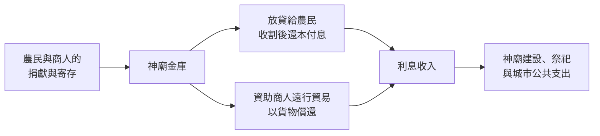

# 1.2 巴比倫神廟與阿卡德商人：最早的保管與放貸機構（約西元前 2000 年 – 前 6 世紀）

## 神廟：城市裡最安全的金庫

在西元前兩千年的美索不達米亞城市裡，最宏偉的建築不是王宮，而是塔廟（ziggurat）。神廟供奉城市守護神，擁有大量田地、畜群與人力，並且享有王室與商人的捐獻。對當時的人來說，把貴重財物放在自己家裡，不如放在神的宅邸——那裡有高牆、守衛與神聖的威懾力。

這就是人類最早的「保管業務」。商人出征或遠行前，把銀子、首飾或契約文書寄存在神廟；神廟的書吏在泥板上登記存入與取出。神廟的祭司與書吏，是最早懂得用文字與印章管理財務的專業人員。

## 從保管到放貸

關鍵的轉變是：神廟發現，閒置的財物可以「工作」。

農民在收割前缺糧、商人在採購貨物時缺銀，他們向神廟借貸，以未來的收成或貨物償還，並附上利息。神廟變成了集合「儲蓄者」與「借款人」的信用中介——這正是銀行最核心的功能，比現代銀行早了三千多年。

神廟的放貸有自己的紀律：

- 貸款以大麥或白銀計價，利率通常略低於民間商人（約 10% 至 20%）。
- 還款多設定在收割季之後，符合農業的現金流節奏。
- 契約泥板上刻有證人姓名與雙方滾印（cylinder seal）印記，作為法律憑證。

## 阿卡德商人：民間金融的興起

神廟並非壟斷者。隨著長途貿易繁榮，民間商人（文獻中常稱 tamkāru）發展出更靈活的金融業務。烏爾出土的泥板顯示，一位名叫杜穆茲-加米爾的商人，西元前十八世紀向神廟與富商借入銀子，再把資金轉貸給織工、漁夫與小商人，收取更高的利息，賺取利差。他甚至與合作夥伴分享利潤——這是文獻可考、最早的「貸款仲介」與「合夥投資」實例之一。

民間放貸的利率彈性大得多，短期借貸年化利率可能高達三成以上，一旦逾期的複利計算，就可能讓借款人陷入泥沼。於是漢摩拉比法典（見前一章）的利率上限與債奴保護，正是針對這個民間市場的亂象而來。神廟的「官方金融」與商人的「民間金融」並存、競爭、互相借貸——這種雙軌結構，我們在往後三千年的東西方都會反覆看到。

## 科技、制度與文化的相互驅動

這套古代金融體系能夠運轉，靠的是幾個相互支撐的條件：

1. 書寫與算術。楔形文字與六十進位制（我們至今沿用的一小時六十分鐘、一分鐘六十秒，就是它的遺產）讓複雜的利率與期限得以精確記載。沒有數學，就沒有金融。
2. 法律與王權。泥板契約在王室法庭可以作為呈堂證據；國王的毀債令則是外部的風險管制。金融制度一開始就是法律制度的延伸。
3. 宗教與信用。神的威懾降低了保管與契約的違約成本——對神的敬畏，是當時最強的「徵信系統」。有趣的是，這種以神聖威權支撐信用的邏輯，與三千年後以國家信用支撐紙幣、以區塊鏈密碼學支撐比特幣，在結構上是同一個問題的不同解答：如何讓陌生人相信一張「憑證」。

## 文明的黃昏與遺產

隨著波斯帝國、亞歷山大征服與希臘化時代的到來，楔形文字與泥板逐漸退出歷史舞台，最後一塊有紀年的楔形文字泥板寫於西元前一世紀。但是兩河的金融基因並沒有消失：

- 計價、記帳、利率、期限、抵押、擔保、合夥分潤——這些概念被希臘與羅馬的商業社會繼承。
- 神廟保管財物的模式，將在希臘神廟（如德爾斐、以弗所）繼續存在，並啟發城邦公共儲蓄制度。
- 「毀債以救社會」的爭論，將在數千年後以不同面目重演：1930 年代大蕭條的債務重整、2008 年金融海嘯後的量化寬鬆，本質上都是現代版的「清理泥板」。

至此，金融的第一塊基石已經鋪好：有人需要資金的時間錯配，有人願意為未來的償付承擔風險，而文明需要一套制度來管理這份信任。接下來，隨著鑄幣與海洋貿易的興起，這門生意將第一次擁有專門的從業人員——他們將坐在雅典的高台後面工作。
