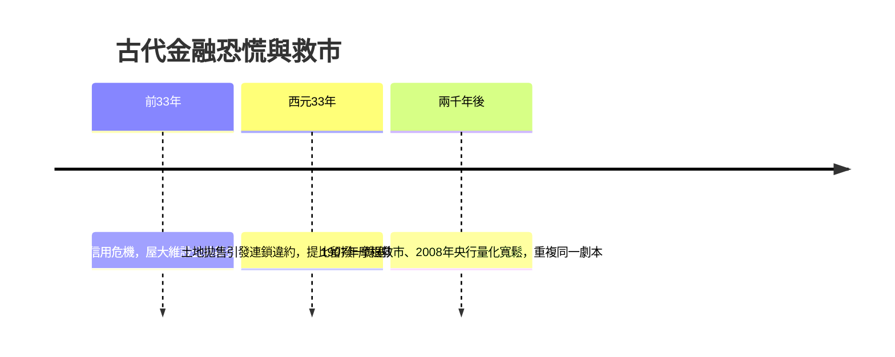

# 2.2 羅馬 Argentarii 與「Banca」字源的誕生（約西元前 3 世紀 – 西元 3 世紀）

## 廣場上的長凳

羅馬人繼承了希臘的金融技術，卻賦予它更大的規模與更明確的制度位置。羅馬廣場（Forum）的一角，坐著一群職業錢莊業者，拉丁語稱為 argentarii（源自 argentum，白銀）。他們在店鋪或攤位後的長凳（拉丁語 bancus，借自古日耳曼語的 bench）上工作，替人兌換錢幣、保管存款、記帳結算、放貸與主持拍賣。

「銀行破產」這個說法，也源自這張長凳：當兌換商周轉不靈、無法償付存戶時，憤怒的群眾會當眾折斷（fractus）他的長凳——bancus ruptus，即「破產（bankrupt）」的字源。一個行業的興衰與信用的崩潰，就這樣凝固在語言裡。

## 四種銀行業務，一次到位

羅馬的 argentarii 發展出驚人完整的業務組合，幾乎是現代商業銀行的縮影：

1. 兌換與鑑定。羅馬帝國疆域橫跨地中海，行省鑄幣、外國金銀幣流通各地，兌換需求巨大。
2. 存款與支付。客戶把錢存在 argentarii 處，透過書面指令（ perscriptio ）即可劃帳付款——債權人不必扛著錢袋，只須到銀行家那裡核銷帳目。法學家甚至討論過「以帳簿劃帳清償債務」的法律效力，這是現代支付清算系統的古典版本。
3. 放貸與仲介。銀行家運用存款放貸，也在借款人與出借人之間牽線賺取佣金——最早的「信用仲介」。
4. 拍賣。主持公共拍賣（auctiones），代買賣雙方收付結算，是羅馬銀行家獨特的法定業務，也是穩定的收入來源。

羅馬法對金融契約的規範遠比希臘精細：海上貸款（pecunia trajecticia）與陸上貸款利率不同；西元前一世紀起，法定利率上限約為年息 12%（百裡挑一的「centesima」月息 1%）；至於存戶資金，法學家烏爾比安等人的論述確立了銀行家對存款的權利義務關係。羅馬法日後成為歐陸民法與商法的根基，現代銀行契約的許多概念可以直接追溯到這裡。

## 帝國經濟：銀行家的黃金土壤

羅馬金融的繁榮，建立在帝國的擴張與和平之上：

- 條條大路通羅馬的道路網與地中海航線，讓長途貿易的資金周轉需求暴增。
- 行省稅收與軍餉匯兌創造了龐大的結算業務——軍團士兵的軍餉發放、退伍金的支付，都需要專業的資金調度。
- 貴族階層的奢華消費與土地投資，催生了抵押放貸市場。西塞羅的書信顯示，羅馬元老院階層普遍透過仲介放貸收息，連他本人也是大債權人。

著名的騎士階層（equites）中，許多人從事包稅（publicani）：先墊付巨款承包行省稅收，再自行徵收賺取差價。這些股份性質的包稅公司已有股東、董事與股票交易，西塞羅曾形容共和國末期的股票市場熱絡景象——這可以說是「證券市場」的遠祖。

## 第一次帝國規模的信用危機

規模越大，危機也越壯觀。西元前 33 年，屋大維（後來的奧古斯都）與安東尼內戰方酣，羅馬卻先爆發了金融恐慌：大量債務人拖欠，土地價格因拋售而崩跌，放貸者緊縮銀根，連貴族都面臨流動性危機。

羅馬的應對展現了驚人的現代感：元首緊急注資——屋大維動用自己與友人掌握的私人資金，設立公共基金無息放貸給需要現金的元老與騎士，以恢復信用；同時延期償債、限制現金外流。這套「央行最後貸款人」式的操作，比英格蘭銀行的誕生早了十七個世紀，比 2008 年的量化寬鬆早了兩千年。

好景不長，西元 33 年（提比留皇帝時代）再度爆發信用緊縮：皇帝打擊放貸業，貴族被迫拋售土地還款，地價崩盤、連鎖違約。提比留的解法與屋大維如出一轍——從國庫撥出一億塞斯特斯（Sesterces）無息貸給銀行家與土地買家，市場才止跌回穩。羅馬史家塔西佗在《編年史》中記下了這場危機，成為古代最完整的金融恐慌史料之一。

## 為什麼羅馬之後，銀行消失了五百年

西元三世紀起，帝國陷入內戰、通貨膨脹與貨幣貶值（銀幣成色一降再降，最後只剩鍍銀的銅幣）。戴克里先於西元 301 年頒布限價令仍無法遏制物價飛漲，經濟退回實物稅賦與以物易物。隨後西羅馬帝國滅亡，城市衰敗、貿易萎縮、貨幣經濟倒退，argentarii 消失了。

這段「金融真空期」告訴我們一個殘酷的事實：金融體系不是自然現象，而是極度依賴政治秩序與貨幣穩定的複雜建築。信任一旦被通膨與戰亂摧毀，重建需要數百年。這也預告了本書的節奏——金融文明會一次次因為過度槓桿、貨幣濫發與信任崩潰而倒下，又一次次因為貿易與科技的復興而重建。

下一次重建，將從中世紀地中海的市集開始：東方的唐朝人會先發明「飛錢」，義大利人則會在長凳上重新坐下來——而這一次，坐著的是美第奇家族。
