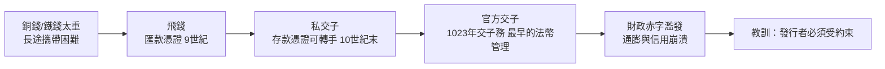

# 3.1 唐代飛錢與宋代交子：紙上信用的東方先聲（西元 9 世紀 – 11 世紀）

## 銅錢太重了

中世紀的西方還在實物交易與錢幣兌換之間摸索時，東方已經率先跨出了關鍵一步：把「信用」從金屬裡解放出來，寫在紙上。

問題始於一個非常實際的困擾——銅錢太重。唐代長安是百萬人口的世界都城，商人從各地販貨至京師，再把售貨所得的銅錢運回故鄉，動輒數百斤、上千斤。一貫錢（一千文）重約五至六斤，攜帶大額銅錢遠行，不僅運費驚人，沿途還有盜匪之虞。

## 飛錢：讓錢「飛」起來

唐憲宗時期（西元九世紀初），一種巧妙的辦法在商人與地方政府之間流行開來，時人稱之為「飛錢」，又稱「便換」。操作方式是：商人在長安把錢款交給某道節度使駐京的「進奏院」（或大的商號），取得一張憑證，憑證一分為二——商人持一半，進奏院寄一半回本道。商人返鄉後兩半相合、核對無誤，即可在本道取錢。

錢沒有真的飛，飛的是信用。這是人類歷史上最早的大規模官方認可的匯兌制度之一。朝廷起初一度禁令，但很快發現飛錢能讓錢幣回流京師、緩解「錢荒」，於是轉為許可經營。飛錢本身不是貨幣，不能轉讓流通，它是純粹的匯款憑證——但「紙上憑證代表遠方的錢」這個觀念，就此確立。

## 交子：世界第一張紙幣

真正的革命發生在四川。宋代蜀地通行鐵錢，比銅錢更重、價值更低——買一匹布要付兩萬文鐵錢，重達百餘斤。於是成都的十六家富商聯合發行一種存款憑證：商人把鐵錢存入鋪戶，換取統一印製的「交子」，可隨時兌回鐵錢，也可直接在交易中轉手使用。

這就是世界上最早的紙幣。交子起初是純民間的信用發行——所謂「私交子」。但私有發行立刻暴露了銀行業永恆的軟肋：有些鋪戶挪用存錢、濫發交子，無法兌現時就引發擠兌與訴訟。宋真宗年間，益州地方政府整頓市場、限定發行資格；到西元 1023 年，宋仁宗時期朝廷設立「益州交子務」，發行官方交子，以鐵錢為準備金，定額分界發行、屆期以舊換新。

從民間信用到官方監管再到國家發行，宋代用幾十年時間，走完了西方直到十七世紀英格蘭銀行才完成的制度演進。

## 好制度如何被財政吃掉

可惜交子的命運預演了此後所有法幣的劇本。宋朝廷與西夏、遼連年征戰，財政吃緊，於是動起了印鈔機的腦筋：交子的發行額度一再擴大、準備金比例不斷降低、舊界未收新界已發。結果是通貨膨脹——交子貶值，南宋的會子、金朝的交鈔、元朝的寶鈔，一路重複濫發、貶值、崩潰的循環。馬可孛羅在元朝看到紙幣通行全國大為驚嘆，但元末的至正寶鈔已經形同廢紙，民間退回以銅錢、白銀甚至布帛交易。

這段歷史給後世留下兩條並行的教訓：

1. 技術上，紙上信用完全可行——中國人比歐洲早六百年證明了這一點。
2. 制度上，發行者若不受約束，紙上信用必然被濫用。這條鐵律貫穿南宋會子、法國約翰·勞的紙幣實驗、威瑪德國的馬克，直到今天的各種央行資產負債表爭論。

## 科技、文化與制度的匯流

紙上信用為何誕生在東方？答案是一組條件的匯流：

- 造紙與印刷術成熟於唐宋，大規模低成本印製防偽票據成為可能——交子使用了多色套印、特殊圖案與官方印記等防偽手段，甚至有記載以特殊的紙張專供印鈔。
- 宋代商品經濟空前繁榮：城市突破坊牆、夜市出現、海外貿易發達，對支付工具的需求遠超前代。
- 科舉與文官制度造就了精於簿記、章程與文書行政的官僚體系，能把民間創新轉為國家制度。

## 東方先聲的深遠意義

飛錢與交子證明：貨幣的本質不是金屬，而是信任與制度。但是宋代的中國沒有發展出持續獨立的民間銀行業——紙幣被收歸財政工具，商人的信用創新始終依附在官府的許可之下。這與稍後歐洲路徑的分歧（民間銀行家反過來資助國家）將產生深遠影響。

而在同一片土地上，另一種更持久、更講究人情與信義的金融組織，正在山西的土地上孕育。明代開中鹽引的商路、清代晉商的萬里茶道，最終將在 1823 年孕育出「匯通天下」的日昇昌票號——那就是下一章的故事。
