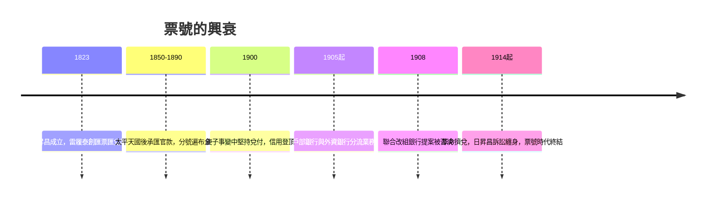

# 3.2 日昇昌票號與雷履泰的匯票帝國：「憑票即付，匯通天下」（1823 – 20 世紀初）

## 從顏料鋪到票號

清道光三年（1823 年），山西平遙城西大街上，一家原本經營顏料生意的商號掛出了新招牌：日昇昌。這個改名背後，是掌櫃雷履泰的一次商業洞察，它將改變此後一百年的中國金融版圖。

故事要從晉商的生意說起。平遙商人達蒲李家在北京崇文門外經營西裕成顏料莊，總號與分號之間經常需要調撥銀錢。同鄉的山西商人看中這一點：與其千里迢迢押運現銀回鄉，不如在北京把現銀交給西裕成，憑一封書信回平遙的分號取錢。起初只是同鄉之間的順路方便，後來請託者越來越多，西裕成乾脆收取一定匯費，把「幫忙」做成了「生意」。

大掌櫃雷履泰看準了這門生意的無限潛力：中國太大，商路太長，白銀搬運的成本與風險太高，而晉商分號遍及南北——這是一張現成的全國匯兌網絡。於是李家東家出資三十萬兩，將西裕成改組為專營匯兌的「票號」，取名日昇昌，寓意「日日升日昌」。雷履泰出任首任大掌櫃，被後世稱為「票號之父」。

## 憑票即付：匯票如何運作

日昇昌的核心業務是匯兌：客戶在甲地把銀兩交給票號，票號簽發匯票，客戶持票到乙地的分號（聯號）兌取現銀，票號收取匯費（時稱「匯水」），匯水依路途遠近、銀根鬆緊與市場行情浮動。

技術的核心是防偽。票號用於匯票的書寫暗號是一套不斷輪換的密押制度，用一句看似不相干的詩句或對聯來編碼日期與金額。流傳下來的範例如：「謹防假票冒取，勿忘細視書章」十二個字對應十二個月份；「堪笑世情薄，天道最公平。昧心圖自利，陰謀害他人。善惡終有報，到頭必分明」三十個字對應三十天；金額則用「趙氏連城璧，由來天下傳」等字序代表數目。匯票上還有筆跡、印章與紙張的多重辨識，密押定期更換。在幾十年間，日昇昌的匯票幾乎沒有被偽冒得逞的紀錄——這是十九世紀的「密碼學支付系統」。

## 制度創新：東家不掌事，掌櫃全權經營

日昇昌最深刻的發明不在匯票，而在治理結構。山西票號普遍採行「東夥制」：東家（出資人）出銀股，掌櫃與夥計持人身股（頂身股），東家平時不干涉經營，三年一個帳期，憑利潤分紅。

- 掌櫃（職業經理人）全權經營，用人、放款、匯率決策皆由其定奪。
- 夥計入號需由殷實鋪保擔保，學徒三年方准上櫃；分紅按銀股與身股同分，資深夥計的身股可傳承子弟或獲得身故後若干年紅利。
- 嚴格的號規：不準攜眷、不準嫖賭、不準私蓄放貸、不準兼營他業。

這實質上是一套「所有權與經營權分離」加「員工持股激勵」的制度，比現代企業的合夥人分紅機制早了一個多世紀。晉商用它解決了金融業最核心的難題：如何讓散布全國、遠離老闆視線的分號員工，在無人監督的地方依然誠實守信。

## 匯通天下

到清末，山西票號的分號遍布全國：日昇昌鼎盛時期分號遠及庫倫、迪化（烏魯木齊）、漢口、重慶、廣州、上海乃至日本、南洋。鼎盛時期全國票號四十餘家、分號數百處，山西平遙、太谷、祁縣成為當時中國的華爾街。

票號的客戶結構也不斷升級：從商號匯兌，到替各省關稅、協餉（省際財政調撥）、賑濟款項解匯，甚至一度經理部分國庫匯款；官員的宦囊、貢士的盤纏、僑民的匯款都在票號的網絡上流動。太平天國戰亂切斷了南方解餉的官道，反而迫使清政府更多依賴票號匯兌——金融網絡在動盪中證明了自身價值。

與此同時，南方的錢莊（寧波、紹興幫為主）則深耕本地存款放貸與莊票貼現，與票號形成「南莊北票」的分工：票號擅遠程匯兌，錢莊擅本地信用。兩者業務有所交疊又互補，共同構成晚清的金融基礎設施。

## 巔峰與黃昏

1900 年庚子事變，北京分號在戰亂中帳簿散失，但日昇昌堅持認票不認人、查帳賠付，信用反而更盛。此後數年正是票號的最後輝煌。

但衰退的種子已經埋下。十九世紀末起，外資銀行（匯豐、麥加利）憑藉電報匯兌與低息貸款搶走大宗業務；大清戶部銀行（1905）與各省官銀號陸續設立，官款匯兌被收回；1911 年辛亥革命帶來擠兌與呆帳的總爆發，貸給官府與官僚的巨額款項化為烏有。更根本的是，票號堅持無限責任的東夥制與總號集權，拒絕改組為有限責任銀行、拒絕集資設立現代銀行——1908 年前後蔚豐厚掌櫃毛鴻翰否決了聯合改組銀行的提案，錯失最後轉型窗口。日昇昌於 1914 年陷入訴訟、1932 年改營錢莊，一代匯兌帝國落幕。

## 晉商留下的東西

日昇昌的故事是東方對「銀行家」的完整定義：他們以信義為資本，以密押為技術，以制度（東夥制、身股制）為骨幹，以全國分號為網絡，做到了「一紙之符信遙傳，萬兩之銀立集」。今天平遙的日昇昌舊址已改為中國票號博物館，門上「輕重平衡」的匾額仍在。

但是票號也留下一個深刻的疑問：為什麼這套精巧的體系沒有演化出中央銀行、股份制銀行與現代金融市場？答案藏在本書反覆出現的主題裡——金融的演化取決於它與國家權力的關係。山西票號最終被排除在國家信用體系之外，而同一時代的西方，銀行家正在做相反的事：他們主動借錢給國家，換取發幣與發債的特權。這條路線的分岔，我們將從文藝復興的佛羅倫斯說起。
