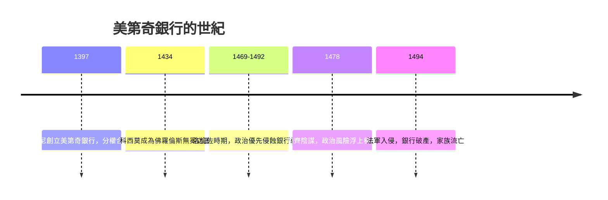

# 4.1 美第奇銀行與匯票上的隱蔽利差（1397 – 1494）

## 一個被教會禁止的行業

中世紀的歐洲，放貸收息是一項危險的營生。《聖經》禁止向弟兄收取利息，教會自十二世紀起明令禁止高利貸（usury），違者可被沒收財產、拒絕葬於聖地。但丁把放貸者放進《神曲》第七層地獄，與瀆神者同列。

但是商業革命正在發生。十字軍東征重新打開了地中海貿易，威尼斯、熱那亞、佛羅倫斯的商人需要資金周轉，香檳市集上的交易需要信用，教廷要從各國收取捐款與什一稅，王公貴族要打仗、要奢華生活。需求無所不在，而合法的供給管道幾乎沒有。

銀行家與教會之間的這場貓鼠遊戲，催生了人類金融史上最精巧的規避設計：匯票。

## 匯票：一次換匯，隱藏一份利息

匯票（bill of exchange）的機制是這樣的：佛羅倫斯的商人甲要把錢匯給在倫敦的商人乙，他不運送現銀，而是把佛羅倫斯金幣交給當地的銀行家，銀行家開出一張票據，指定倫敦的合作銀行家按「議定匯率」以英鎊付款給乙。

巧妙之處在於：利息被藏進了匯率。兩個市場之間的真實金幣比價是一回事，票據上寫的匯率是另一回事，兩者之間的差額就是銀行家賺的錢。表面上沒有人「借錢收息」，只有一次「國際換匯」——教會法學家很難指控一項從中世紀法學觀點看來並非貸款的交易。匯票因此獲得「法律的推定合法」地位，成為穿透教規的通行證。

這項技術還有額外的好處：不搬運現銀，安全且低成本；票據可以背書轉讓，成為流通的信用工具；跨市場的匯率差額還能反映兩地的金銀供需與利率水準——現代外匯市場的遠古祖先就此誕生。

## 美第奇銀行：分權式的家族金融帝國

1397 年，喬凡尼·迪·比奇·美第奇（Giovanni di Bicci de' Medici）在佛羅倫斯創立美第奇銀行。他選擇了一個與前輩不同的組織路線。

此前的銀行（如曾叱吒一時的巴爾迪與佩魯齊家族）採取集中經營，結果在 1340 年代英王愛德華三世賴帳與連鎖倒閉的風暴中灰飛煙滅。喬凡尼記取教訓，把美第奇銀行設計成一個控股式的聯盟：總行在佛羅倫斯，各地的分行（羅馬、威尼斯、米蘭、布魯日、倫敦、日內瓦、里昂等）在法律上是獨立的合夥事業，總行占多數股份，分行經理持少數股份並以自己身家承擔合夥責任。

這個設計一舉三得：各地經理因為自己是股東而勤勉誠實；分行虧損不至於拖垮全局；總行透過定期派駐巡視的查帳員（現場稽核）與統一的密碼簿記掌握全局。分行經理的薪酬多與利潤掛鉤——這與兩百年後山西票號的身股制（見 3.2 章）如出一轍，東西方不約而同地發明了「讓經理人像老闆一樣思考」的機制。

美第奇銀行的客戶名單說明了這門生意的政治含金量：教廷（美第奇長期經管羅馬教廷的存款與匯款）、各國王侯、以及佛羅倫斯自己。銀行替教廷匯兌各國捐款，替羊毛織造業融資，替貴族經管地租。錢流過美第奇的手，也把權力流進美第奇的口袋。

## 從銀行家到統治者

1434 年，科西莫·德·美第奇（Cosimo il Vecchio）以銀行財富與人脈為後盾，成為佛羅倫斯的實際統治者——他從不擔任官職，卻透過債務、選舉操作與恩庇網絡掌控共和國。科西莫的名言是政治的而非法學的：「你不能用錢袋把人送上天堂，但你可以決定他下地獄的方式。」（大意如此，見於後世追記。）

美第奇家族以銀行的獲利供養了一場革命：贊助波提切利、米開朗基羅、利奧納多，資助柏拉圖學院的新柏拉圖主義研究，建立最早的公共圖書館系統之一。文藝復興的輝煌，帳面上有很大一部分是由匯票利差支付的。經濟、文化與權力在此形成一個閉環：金融利潤轉化為藝術贊助與政治合法性，政治權力再回頭保護金融生意。

好景在盛極之後轉衰。洛倫佐「豪華者」（Lorenzo il Magnifico）時期，家族的政治雄心與銀行的商業紀律開始衝突：他挪用公款、放寬授信給政治盟友，分行的壞帳累積；倫敦與布魯日分行因羊毛貿易衰退而失血；1478 年帕齊家族的刺殺陰謀（洛倫佐負傷倖免，其弟朱利亞諾遇害）顯示政治風險已到臨界。1494 年，法王查理八世入侵義大利，佛羅倫斯人趕走美第奇、宣告銀行破產——一個世紀的金融帝國落幕。

## 貢獻與教訓

美第奇留給金融史三件遺產：一是匯票體系的成熟運用，讓「國際結算」成為標準業務；二是分權合夥加稽核的跨國組織架構；三是銀行家與國家權力結合的新模式——不是被掠奪的對象，而是共生的盟友。

但美第奇也示範了這種共生的高風險：銀行的資產負債表禁不起政治的揮霍。當貸款變成忠誠的贖金，壞帳就會以政治倒台的形式集中爆發。兩百年後的英格蘭銀行家將學到相反方向的教訓——不是銀行資助君主的隨意借貸，而是用議會的立法信用做抵押。這一躍，需要先經過下一站的鋪墊：複式簿記，讓銀行家第一次真正看得清自己的家底。
