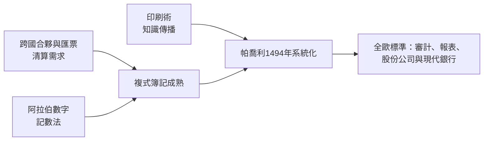

# 4.2 複式簿記法與銀行家的精確之眼（14 世紀 – 16 世紀）

## 一場無聲的會計革命

在美第奇家族的匯票背後，還有一項不那么耀眼、卻更基礎的發明：複式簿記（double-entry bookkeeping）。如果說匯票是銀行家的武器，複式簿記就是他們的眼睛——沒有它，跨國銀行的每一筆帳都是一團糊塗的線頭。

複式簿記的核心思想優雅得驚人：每一筆交易都同時改變兩個以上的帳戶，一邊記「借」，一邊記「貸」，金額相等。錢從哪裡來（貸方），到哪裡去（借方）。任何時點，全部帳目的借貸兩方必須相等——若不相等，一定有錯或帳。這個「平衡」的數學性質，第一次讓人類可以用算術驗證一個組織的全部經濟活動。

## 從地中海市集到印刷術

複式簿記不是一夕發明的。十三世紀末的熱那亞與佛羅倫斯帳簿中已出現雙向記錄的痕跡，1340 年熱那亞公共理財官的帳簿已相當接近現代形式。它是義大利商業社會集體演化的產物：跨國合夥需要清算多方權益，匯票需要對沖的債權債務科目，分期與利潤分成需要精確的損益計算。

把它變成全世界銀行家共同語言的，是兩個人與一項技術：

- 數學家盧卡·帕喬利（Luca Pacioli）。1494 年，這位與達文西結伴的托斯卡尼數學家在威尼斯出版《算術、幾何、比與比例摘要》，其中一章《論帳戶與記錄》（Particularis de computis et scripturis）首次系統總結複式簿記：日記帳、分類帳、借貸平衡、結帳與試算。帕喬利自己說，這是根據威尼斯商人的實務寫成的——他做了知識的編纂者，把街頭智慧變成可以傳授的科學。
- 印刷術。古騰堡活字印刷（約 1450 年代）問世不到半個世紀，會計知識就搭上了這班車。《摘要》以印刷品形式流傳德意志、法蘭西、低地國家，譯本層出不窮。一個佛羅倫斯銀行的內部技藝，在一代人時間內成為全歐洲商人的常識——這是「知識標準化」如何加速制度擴散的完美範例。
- 阿拉伯數字。複式簿記以加減與對沖為核心，而歐洲直到十三至十四世紀才逐漸棄用羅馬數字、改用位置記數的阿拉伯數字（經斐波那契《計算之書》介紹）。沒有這套記數法，縱欄加總與快速驗算幾乎不可能。數學、載體與商業需求三者匯流，革命才告完成。

## 為什麼複式簿記對銀行家至關重要

對一家單店鋪的商號，單式記流水帳也勉強夠用。但美第奇銀行有十餘家分行、數十個合夥人與成千上萬筆匯票，複式簿記解決了三個致命問題：

1. 清算與對帳。分行之間、銀行與客戶之間的往來，可以逐筆核對，權益清清楚楚——這是跨國經營的前提。
2. 防弊。分行經理知道總行稽核員會用平衡法則檢驗帳簿，挪用與做假帳的難度大增。帳目平衡本身成了一種威懾。
3. 計算利潤。收入、費用、資本與負債分列，第一次能算出「我們到底賺了多少、賺在哪裡」——於是才有了資本配置：哪個分行該擴張，哪個該收縮。

可以說，複式簿記是現代企業的作業系統。往後的一切——股份公司的年度報表、央行的資產負債表、審計與證券監管、乃至今日的區塊鏈帳本（它正是「分散式複式帳簿」的當代變體）——都是這個平衡思想的後裔。

## 文化側面：理性、數字與新教倫理

歷史學家長期爭論韋伯的命題：是新教倫理催生了資本主義，還是資本主義另有淵源？複式簿記提供了一個更早的線索：早在宗教改革之前，義大利商人已經把生活組織成可計算、可稽核、可積累的形式。帳簿是一種世界觀——把時間切分成會計期間，把人際關係化為債權債務，把未來折算成現值。

帕喬利在書中告誡商人，帳簿要每年結清，因為「帳戶不會等太久」；他還引用一句商諺：沒有複式簿記的商人，「就像在黑暗中行走」。這種對秩序與精確的信仰，與同時代透視法在繪畫中的勝利（把空間數學化）、與鐘錶在城市中的普及（把時間數學化）屬於同一場認知革命。文藝復興不只是藝術的復興，更是一場「用數字把握世界」的思維方式革命，而銀行家是這場革命最早的職業實踐者。

## 小結：眼睛之後是槓桿

複式簿記讓銀行家看清現在，但十五世紀的銀行還缺兩樣東西：一個能以全國信用為抵押的借款人，以及一套把大眾儲蓄轉化為國家投資的制度。美第奇的教訓表明，依賴君主個人信用的借貸終將崩潰。答案要等 1688 年光榮革命後的英國來給出：議會主權 + 國債 + 中央銀行。在那之前，先讓我們記住帕喬利這位修士的貢獻——他不曾經營銀行，卻讓此後所有銀行成為可能。
