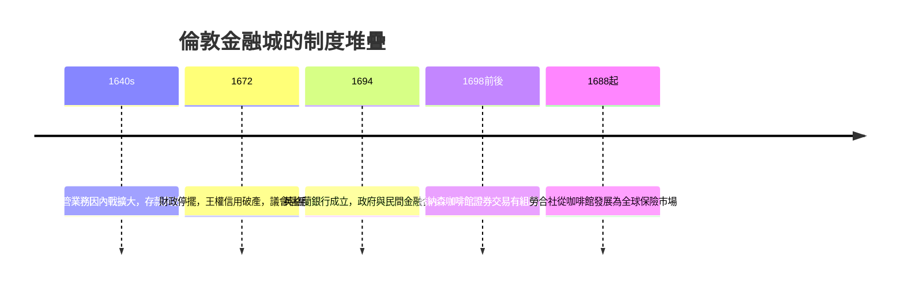

# 5.2 金匠銀行家與倫敦金融城：存款銀行的誕生（17 世紀 – 19 世紀）

## 內戰、金庫與金匠的生意

英格蘭銀行的故事講的是國家，這一章要看民間：現代商業銀行的直接祖先，是一群手藝人——金匠（goldsmiths）。

十七世紀初的倫敦，沒有正式的存款銀行。商人的資金調度依賴幾個管道：皇家造幣廠（但 1640 年查理一世強行「借用」存放在倫敦塔的商人金銀，嚴重打擊了這個管道）、以及少數外來的兌換商與放貸者。真正填補空白的是金匠：他們本來就擁有最安全的保管設施（鐵籠、地窖、秤與化驗技術），客戶把金銀交給他們保管，換取一張收據。

內戰與政治局勢把這門生意推上軌道。1640 年代以降的動盪讓人們更不願把金銀放在自家或造幣廠，金匠保管業務暴增。接著，關鍵的洞察出現了——與三千年前巴比倫神廟、與高台上的 trapezitai 如出一轍：存進來的金子不會全部被取走，沉澱的部分可以借出去。

## 三個決定性的發明

金匠銀行家在幾十年間完成了三項發明，每一項至今仍是銀行的基本零件：

1. 部分準備金。保管收據最初是全額憑證，金匠收取保管費。後來他們發現只需留一部分金子應付取款，其餘可以放貸收息，於是反過來向存款人支付利息。保管業務就此變成存款業務——銀行的本質（用別人的錢放貸）成形。
2. 收據的流通化。金匠的存款收據（即早期的鈔票）開始被持有人在市場上直接背書轉讓、用來支付，不必先兌回金子。「紙代替金」的支付革命在民間自發完成。
3. 帳簿劃帳。存款人開出書面指令（cash note 的後裔，即支票的前身），指示金匠把自己的存款劃給他人。金匠的帳簿成為清算中心——今天支付系統的遠祖。

但這套體系很快迎來它的第一次國家級風險。1672 年，查理二世為了對荷戰爭的財政窘迫，宣布「財政停擺」（Stop of the Exchequer）：暫停償付王室的借款，一批以金匠銀行家為主的債權人損失慘重，多家金匠行倒閉。這場事件像一記警鐘，重塑了此後三百年的金融政治：王權的隨意性是金融的天敵。它直接說明了為什麼 1694 年的英格蘭銀行要把借款人換成議會（見 5.1），也說明了為什麼倫敦金融城此後始終對王室借款保持制度性警惕。

## 金融城：一個政治實體的誕生

倫敦金融城（City of London）不是倫敦市，它是一塊自羅馬時代延續下來、由市政府（City of London Corporation）自治的獨立法域，擁有自己的市長（Lord Mayor）、自己的法庭與議會席位。商人行會（livery companies）掌握城市治理，其中就包括金匠行會。

這種自治地位成了金融的溫床：契約在城市的法庭執行、破產有城市的慣例、交易所與咖啡館聚集在城牆之內。十七世紀末，證券買賣從皇家交易所的廊柱下溢出，進入咖啡館——1680 年代，喬納森咖啡館成了股票與國債的交易中心；1698 年左右出現了有組織的證券經紀人。1773 年這些經紀人集資建了室內交易場所，後來的倫敦證券交易所；1688 年，愛德華·勞埃德在塔街開了他的咖啡館，船東與承保人在此交易海險——勞合社（Lloyd's of London）由此而生。一座城，同時誕生了證券市場、保險市場與商業銀行體系。

## 金本位：牛頓的意外遺產

貨幣制度也在這個世紀末定型。1696 年，鑄幣嚴重磨損與剪邊（clipping）引發貨幣危機，時任造幣廠督辦的牛頓主持了大重鑄（Great Recoinage）。1717 年，牛頓在評估金銀比價時，把黃金的鑄幣價格定在略高的位置，黃金因此持續流入、白銀流出，英國事實上滑向金本位；1816 年《鑄幣法》正式確立金本位，1821 年全面兌現。此後近兩百年，英鎊以黃金為錨，成為世界貨幣的基準——而維持這個錨的可信度，正是英格蘭銀行的核心任務。

## 最後貸款人的黎明

十九世紀，金融城的銀行體系反覆遭遇危機，而英格蘭銀行在回應中慢慢長出了中央銀行的本領。1825 年恐慌，銀行券兌現擠兌蔓延，英格蘭銀行一度只剩約 12% 的準備金，所幸大規模放款救市；1866 年歐沃倫-格尼公司（Overend, Gurney & Co.）——一家號稱「貼現行的王者」的貼現銀行——倒閉，引發恐慌，英格蘭銀行這次拒絕救助而放任其倒閉，但同時向市場大量提供流動性。

在這些經驗之上，記者白芝浩（Walter Bagehot）在 1873 年出版《倫巴底街》，寫下了中央銀行學的奠基原則：恐慌時，央行應以高利率、優質抵押品為條件，無限放款給有償付能力的機構——「借最後一筆錢（lender of last resort）」。這條「白芝浩法則」至今仍是每次危機中美聯儲與各國央行操作手冊的第一頁。而它的第一次世紀級大考，要等到 1907 年——但那時的主角，將換成大西洋彼岸的一個美國人：J.P. 摩根。
