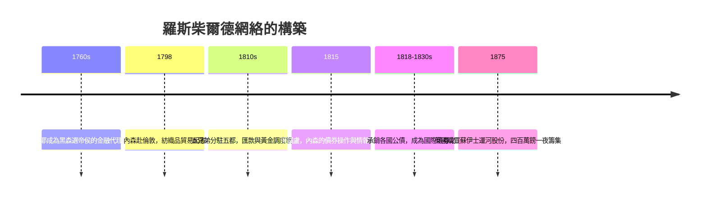

# 6.1 梅耶·羅斯柴爾德與五羽之箭：跨國情報金融網絡的誕生（1790s – 1870s）

## 法蘭克福猶太巷裡的錢幣商

1744 年，梅耶·阿姆謝爾·羅斯柴爾德（Mayer Amschel Rothschild）出生於法蘭克福的猶太巷（Judengasse）——一條有門有閘、夜間上鎖的隔離街區，猶太人被禁止置產、進入多數行業與大學。梅耶早年學徒於漢諾威一家銀行，回到法蘭克福後做起了古錢幣與徽章的買賣，並以此結緣於黑森的貴族圈。

他的關鍵一躍是成為黑森-卡塞爾選帝侯威廉九世的金融代理人。這位選帝侯靠出租士兵給英國（包括送往美洲鎮壓獨立戰爭的「黑森傭兵」）積累了巨額財富，需要有人替他投資、放貸與跨境調度資金。梅耶在法國大革命戰爭的動盪中替選帝侯打理資產、經手戰爭融資，積累了本錢、客戶與——最寶貴的——對跨國資金流動的理解。

## 五個兒子，五座城市

梅耶真正的天才在於組織。他與妻子葛特妮生了十九個孩子（十人存活），五個兒子被他安排到歐洲五個金融中心：阿姆謝爾留守法蘭克福，所羅門去維也納，內森到倫敦，卡爾姆去拿坡里，詹姆士在巴黎。家族紋章上是五支箭——出自《詩篇》「弓箭手射出的箭」，寓意五子合力、無堅不摧。

這個網絡的運作方式，在當時是革命性的：

- 內部通信系統。五兄弟之間以自家信使、加密商業書信往來，歐洲各市場的匯率、軍情、政治動向在數日內互通。在電報問世前，這是全歐洲最快的金融信息網絡。
- 跨國套利與匯兌。倫敦的內森替英國政府把補助金兌換成外幣、轉匯給歐陸的盟國軍隊（威靈頓半島戰爭的軍餉就是羅斯柴爾德匯去的），在黃金跨海調度中賺取巨額利潤——著名的「黃金跑腿」。
- 政府公債承銷。戰後各國重建與賠償需要融資，五兄弟聯手承銷普魯士、奧地利、法國、俄國的公債，成為十九世紀上半葉最大的國際債券承銷集團。他們的定價與配售能力，足以影響一國的融資成本。
- 家族信用一體。五兄弟之間相互擔保、資金自由調撥，任何一家的信用就是全家族的信用。

梅耶 1812 年去世前立下家訓：家族企業只傳家族、子女內部通婚以保財產（數代之內堂表親聯姻極多）、每個分行的合夥權由家族掌握。這套安排確保了網絡的統一，也埋下了日後封閉落後於現代公司制的隱患。

## 銀行家與梅特涅的世界

滑鐵盧之後，歐洲進入維也納體系的均勢時代。羅斯柴爾德家族與這個體系深度綁定：所羅門與奧地利首相梅特涅過從甚密，詹姆士成為法國波旁復辟與七月王朝的融資支柱。他們借款給各國政府，也借各國政府之力穩定市場——家族成為「歐洲第六強權」（時人譏語）。

他們也參與了十九世紀最龐大的跨國金融工程之一：英國 1833 年廢奴後向奴隸主支付兩千萬英鎊補償金，其中有羅斯柴爾德家族的融資參與；而奴隸貿易與種植園經濟的歷史債務，同樣滲透在此前後的許多跨大西洋金融往來中。銀行家的財富史從來不乾淨，這是我們必須誠實記下的一筆。

在生意上，家族隨著時代進化：資助了鐵路（法國北方鐵路、奧地利與義大利的多條幹線）、蘇伊士運河相關融資、水銀與銅礦（西班牙阿爾馬登水銀礦的壟斷性收購）。1871 年後，家族第三代首領里奧波德與那坦尼爾「那蒂」主持了英國對埃及股份的收購（1875 年，迪斯雷利借羅斯柴爾四百萬鎊現金購買蘇伊士運河公司股份，避免法國獨控運河）——一筆貸款改寫了中東地緣政治。

## 猶太人的解放與銀行家的政治

羅斯柴爾德的崛起與歐洲猶太人的處境改善互為因果。家族以實力與外交影響力為籌碼，推動了法蘭克福與奧地利的猶太人權利談判；維也納的所羅門、巴黎的詹姆士各自成為當地猶太社群的保護傘。反猶主義則把家族當成陰謀論的靶心——從「滑鐵盧暴利」的謠言到後來偽造的《錫安長老議定書》借其名散播。本書只記真實：家族靠的是信息、網絡與信用，不是神話，而針對他們的仇恨從未停歇，這份仇恨將在二十世紀釀成悲劇（奧地利分支在納粹吞併後財產被掠奪、家人流亡）。

## 小結

羅斯柴爾德家族把銀行家的比較優勢發揮到極致：他們賣的不是錢，是信息、速度與跨國的信任。在電報普及之前，他們幾乎是活體的金融互聯網。但是技術的進步終將拆散這種優勢——電報讓所有人同時知道消息，鐵路讓黃金跑得更快，股份制銀行讓資本池更大。家族在十九世紀後半逐漸讓出頭把交椅，而滑鐵盧那一戰的傳說與真相，值得用獨立的一章來講。
