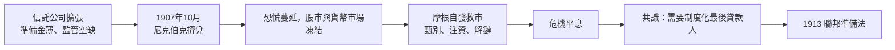

# 7.1 1907 年金融恐慌：一個人的救市（1907 – 1913）

## 沒有央行的美國

二十世紀初的美國是世界最大經濟體，卻是主要工業國中唯一沒有中央銀行的。內戰後的國民銀行體系分散而僵化：數千家獨立銀行、鈔票發行受國債擔保限制、準備金層層存放於紐約。經濟史學家因此記錄了幾乎每十年一次的金融恐慌：1873、1884、1893、1907。

恐慌的劇本千篇一律：某個環節失靈（一家銀行或信託公司倒閉、股災、農產品價格崩跌）→ 存款人擠兌 → 銀行互相抽緊頭寸、貼現率飆升 → 優質企業借不到錢、被迫拋售資產 → 連鎖倒閉。沒有最後貸款人，恐慌只能靠民間自組的救市（清算所協同、富戶注資）硬扛，或任其燒完。

## 導火線：尼克伯克信託

1907 年 10 月，危機的火星落在紐約的「信託公司」（trust company）身上。這種機構本來只管遺產與信託，卻在近年大舉擴張為準銀行，且準備金率遠低於國民銀行，又不受清算所紀律約束——影子銀行的古代版本。

10 月 16 日，F. 奧古斯塔斯·海因策與其兄弟試圖軋空聯合銅業公司（United Copper）股票失敗，其控制的銀行與經紀行接連倒閉。10 月 21 日，市場傳言與其往來的尼克伯克信託公司（Knickerbocker Trust）資產有險，次日尼克伯克被其清算所主席要求辭職，存戶聞訊湧上街頭。第二天上午，尼克伯克門前排起長隊，數小時內被提走八百萬美元，公司隨後停付。恐慌像野火一樣撲向其他信託公司與銀行，紐約股市崩跌，全國存款人提現，貨幣市場利率飆至 100% 以上的荒謬水準。

## 摩根登場

此時，七十歲的約翰·皮爾龐特·摩根（J. Pierpont Morgan）成為事實上的美國央行。他當時已是鐵路與鋼鐵業的整合者（合併卡內基鋼鐵組成美國鋼鐵），聲望、資金與人脈無人能及。危機爆發後，他把紐約主要銀行家召到自己麥迪遜大道的家中圖書館，連夜核定哪些機構該救、由誰出錢。

摩根的操作是一場教科書式的最後貸款人演習：

- 甄別與救助。他聯合清算所與銀行同業，對有償付能力但缺流動性的機構注資放款。尼克伯克停付後，他立即安排對美國信託公司（Trust Company of America）等機構的援助。
- 押上自己的錢。10 月 24 日，紐約證交所瀕臨停擺，摩根召集銀行家，要求他們在數分鐘內湊出二千五百萬美元貸給券商，並當場簽署承諾。據在場者回憶，他站在書桌後逐一看著銀行家簽字——「錢在這裡，時機就是一切」。
- 夜戰摩爾斯萊。11 月初，瀕危的摩爾斯萊公司（Moore & Schley）因質押田納西煤鐵公司股份而搖搖欲墜，其倒閉將連環引爆。摩根利用週末，把銀行家鎖在圖書館裡徹夜談判，以收購田納西煤鐵（併入美國鋼鐵）為條件解開質押鏈條——總統老羅斯福在危機壓力下同意不阻止這樁平時必然被反壟斷法挑戰的併購。
- 民間鈔票。現金嚴重短缺，清算所發行清算所憑證充當應急貨幣，各地出現私人代幣。摩根還安排黃金從歐洲流入，英格蘭銀行調低貼現率配合。

11 月中，恐慌消退。事後核算，危機期間紐約清算所及民間注資規模巨大，而 J.P. 摩根公司的聲望是這場自發救市的樞紐。摩根在圖書館那張著名的談判桌，至今仍被視為美國金融史的聖物。

## 一個人的央行，說明了什麼

1907 年的教訓清晰得刺眼：世界最大經濟體的金融穩定，竟然繫於一位七十歲銀行家的個人判斷與良心。這場危機的直接政治後果，就是央行議題重回主流：

- 危機後，參議員尼爾森·奧爾德里奇推動成立國家貨幣委員會（1908），研究歐洲央行制度；1910 年，奧爾德里奇與華寶、範德利普、諾頓等人秘密會於哲基爾島（Jekyll Island），草擬中央銀行方案。
- 民主黨人威爾遜 1912 年當選後，以民主黨版本通過《聯邦準備法》（1913 年 12 月），成立聯邦準備系統（Fed）——為了平息對「東部銀行家卡特爾」的疑慮，設計為十二家地區儲備銀行加華盛頓理事會的混合體，兼具公共與私人色彩。

## 摩根的黃昏與時代的轉折

危機救市成功並未給摩根帶來榮耀，反而帶來審視。1912 年，眾議院普喬委員會（Pujo Committee）調查「貨幣托拉斯」，聽證會上摩根說出他的著名信念：他放貸看的是人，「我不會把錢借給我一個品行不佳的朋友」。委員會的結論卻是：少數幾個金融寡頭控制了美國的信貸與資本，必須立法拆解。

歷史在此出現弔詭的分岔：1907 年證明了私人銀行家的不可或缺，1912 年的調查與隨後的立法卻要把私人銀行家關進制度的籠子。1913 年 3 月摩根去世；同年，美聯儲成立；次年，克萊頓反壟斷法通過。私人巨頭時代落幕，制度化央行時代開始。

而制度的第一場大考來得比誰都快：1914 年Fed 開業數月後，第一次世界大戰爆發，歐洲金本位停擺、紐約成為世界金融中心；1930 年代大蕭條則暴露了 Fed 幼年期的無能（見下章）。摩根用一個人的直覺做到的事，制度要花三十年才勉強學會——這正是「制度化的信任」比「個人的信任」更難、卻更必要的原因。
