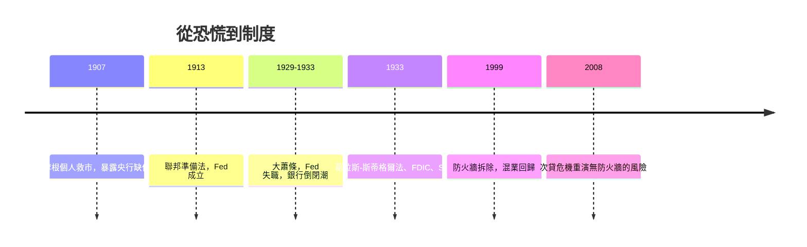

# 7.2 美聯儲成立與葛拉斯-斯蒂格爾防火牆（1913 – 1933）

## 一部妥協的央行法

1913 年 12 月 23 日，威爾遜總統簽署《聯邦準備法》。這部法律是三股力量的妥協：東部銀行家要一個歐陸式的集中央行，民粹派與中西部農業州要一個防止華爾街壟斷信貸的公共機構，而政治傳統反對任何過度集權的「央行」字眼。

最終的設計體現了美國式的分權智慧：十二家地區聯邦儲備銀行（由當地會員銀行持股，形成公私混合的所有權），華盛頓的聯邦準備理事會負責統轄，聯邦公開市場委員會（FOMC，稍後於 1920 年代成形）負責貨幣政策。Fed 的法定職責：發行聯邦儲備券（統一紙幣）、保管會員銀行準備金、擔任票據清算、以及在恐慌時充當最後貸款人（貼現窗口）——用制度化重演摩根在 1907 年的角色。

Fed 成立僅數月，第一次世界大戰爆發。歐洲停擺、黃金湧入紐約，美國從債務國翻轉為世界最大債權國，紐約接過倫敦的權杖。Fed 在戰時與戰後為政府融資、穩定匯率，在 1920 年代以公開市場操作調節經濟——當時紐約儲備銀行總裁斯特朗（Benjamin Strong）實際主持大局，被視為「事實上的世界央行行長」。

## 大蕭條：幼年央行的災難性考試

1929 年 10 月股市崩盤，接著是銀行倒閉潮。Fed 這次考砸了：

- 1930-1933 年，數千家銀行倒閉，存款人失去畢生積蓄，貨幣供給收縮約三分之一。
- Fed 非但沒有果斷注資，反而部分時刻收緊銀根（為維持金本位與防範投機），貼現率政策遲疑、公開市場操作分裂（斯特朗 1928 年去世後群龍無首）。
- 1931 年英國脫離金本位後，Fed 為防止黃金外流反而升息，加重了通縮。

貨幣學派的弗里德曼與施瓦茨在《美國貨幣史》中把大蕭條定性為「Fed 的失職」：不是市場自發崩潰，而是央行沒有履行最後貸款人職責，把普通衰退放大為浩劫。伯南克在成為Fed主席前的研究與演說也持同一結論，並在 2008 年以「我來自研究大蕭條的學派」為自我期許，堅決避免重蹈覆轍。

## 立法狂潮：1933 年的重建

大蕭條的憤怒轉化為立法。1933 年《銀行法》（史稱葛拉斯-斯蒂格爾法案，Glass-Steagall Act）進行了三項劃時代的建設：

1. 分業防火牆。禁止商業銀行（吸收存款、放貸）與投資銀行（承銷證券）混業。存款人的錢不得被拿去承銷股票、債券與投機。當時國會調查發現，銀行大量將不良貸款與承銷的劣質證券捆綁推銷給存款人，混業被認定為利益衝突的溫床。摩根財團被一分為二：J.P. 摩根（商業銀行）與摩根史坦利（投資銀行，1935 年開業）。
2. 存款保險。設立聯邦存款保險公司（FDIC），為存款人提供保險，從制度上終結恐慌性擠兌的基本盤——這是十九世紀以來銀行業最深刻的保險制度革命。
3. 利率管制。Q 規則限制存款利率上限，防止銀行為搶存款而追逐高風險資產。

同一時期，1933 年《證券法》與 1934 年《證券交易法》建立證券發行註冊與資訊揭露制度，設立證券交易委員會（SEC），首任主席是約瑟夫·肯尼迪。美國金融體系由「紳士俱樂部自律」轉向「聯邦監管」，《葛拉斯-斯蒂格爾法案》的防火牆維持了六十六年，直到 1999 年被《金融服務現代化法》拆除（見第 8、9 章）。

## 思想的分岔：凱因斯與哈耶克

制度的重建也伴隨思想的革命。1936 年凱因斯出版《就業、利息和貨幣通論》，論證經濟可能長期陷於需求不足的均衡，政府必須以財政與貨幣政策干預。凱因斯本人是投資者與保險精算的行家，他的理論直接挑戰了「市場自我修復」的古典信條。與之對壘的是哈耶克與奧地利學派，主張蕭條是過度投資與信貸擴張的必要清理，政府干預只會延長扭曲。1930-1970 年代凱因斯主義主導西方政策，1970 年代滯脹後新自由主義反攻——這場宏觀思想的鐘擺，將在第 8 章的放鬆管制與第 9 章的再監管之間繼續擺動。

## 銀行家角色的歷史性降格

從角色史的角度看，1933 年標誌著銀行家第一次被國家系統性地「去權力化」：發鈔權歸 Fed、存款靠 FDIC 擔保、投資與放貸分業、薪酬與投機受管。從漢摩拉比的泥板到摩根的圖書館，銀行家始終是信用體系的樞心；1933 年之後，他們成了被監管的公用事業經營者。

這種馴化持續了約四十年，並意外地成就了戰後西方的穩定增長。但人性與資本總在尋找出路：1970 年代起，通脹、匯率浮動、石油美元與電腦技術聯手瓦解了 1933 年體系的每一道閘門，把銀行家重新釋放為「風險工程師」。下一章，我們就走進那個衍生品與證券化的狂飆年代。
