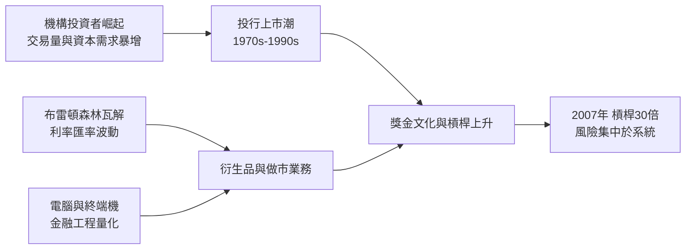

# 8.1 從合夥人到上市公司：投資銀行的激勵革命（1970s – 1990s）

## 合夥制的黃金時代

戰後的華爾街投資銀行（高盛、摩根史坦利、雷曼兄弟、所羅門兄弟、美林）都以合夥人制經營：合夥人以自有資本承擔無限或連帶責任，利潤由合夥人分享。這個制度自帶兩道閘門——

- 風險紀律。賭輸了賠的是自己的錢，合夥人天然保守，槓桿與頭寸受到自律約束。
- 長期主義。合夥人資格是一生的事業榮譽，考驗的是數十年的口碑與客戶關係。

但是時代在變。1960-70 年代，機構投資者（養老基金、共同基金）崛起，交易量暴增，投行的資本金需求隨之膨脹；1971 年布雷頓森林體系瓦解後，外匯、利率與商品的價格波動加大，做市與風險管理業務的資本占用更高。合夥人自有資本成為瓶頸——用別人的錢才能玩大。

## 上市潮：華爾街的資本主義化

1970 年，唐納森、勒夫金與詹雷特（DLJ）率先公開上市；1986 年美林上市；1994 年摩根史坦利上市；1998 年高盛上市（兩年前雷曼已被美國運通併購後分拆上市）。到 1990 年代末，主要投行幾乎全部由合夥制轉為公眾公司。

這個轉變帶來了激勵機制的根本變化：

- 合夥人時期：賺的錢留在合夥人中間分，離開時資本要抽回，風險長期自擔。
- 上市公司時期：股東出資承擔虧損，管理層與員工拿獎金，風險收益不對稱——賺了拿大頭獎金，賠了公司與股東扛。

經濟學家稱之為委託-代理問題的極端化。華爾街的口號從「跟客戶做長期生意」悄悄變成「槓桿化股東權益報酬率」。投行的槓桿率從 1980 年代的 15 倍上下，一路爬到 2007 年的 30 倍以上——每 1 元自有資本撬動 30 元資產，只要資產價值跌 3%，資本就歸零。

## 人才與文化的轉向

上市也重塑了人才結構。合夥人時代，交易員要熬十幾年才能入夥；上市後，二十八歲的明星交易員年薪數百萬，合夥人資格反而失去吸引力。文化從師徒制轉向業績制，從關係轉向交易。1987 年，電影《華爾街》中葛登·蓋柯喊出「貪婪是好的（Greed is good）」，成為時代註腳——電影靈感來自真實的惡意收購狂潮。

而這個時代的技術背景同樣關鍵：

1. 1971 年，雷曼兄弟與所羅門合作，把房地產投資信託（REIT）首次證券化上市——證券化的商業原型。
2. 1973 年，布萊克-斯科爾斯選擇權定價公式發表，芝加哥選擇權交易所（CBOE）開業，金融工程成為可計算的科學。
3. 同年，美林發明現金管理帳戶（CMA），繞開利率管制，宣告 1933 年體系的 Q 規則名存實亡。
4. 彭博終端機（1982 年起）與即時行情，把信息與分析能力平權化，交易從電話與人際關係轉向螢幕與演算法。

## 華爾街與華盛頓的共舞

激勵的轉向若無監管的配合，不會走得這麼遠。1980 年代雷根政府與撒切爾夫人掀起新自由主義浪潮，金融放鬆管制成為共識：1980 年《存款機構放鬆管制與貨幣控制法》解除利率上限；1982 年允許儲貸機構擴張投資權限，為 1980 年代末的儲貸危機埋下禍根；1999 年《金融服務現代化法》正式廢除《葛拉斯-斯蒂格爾法案》，商業銀行與投資銀行重新合業；2000 年《商品期貨現代化法》更把櫃檯衍生品（OTC derivatives）排除在監管之外。

哲學基礎由經濟學提供：效率市場假說（Fama）主張價格已反映全部信息；理性預期學派認為政府干預徒勞；著名的前提是「自利的經紀人會自我約束」。格雷爾敏（Alan Greenspan）執掌Fed十九年，是這套信條的化身——直到 2008 年他在國會聽證中承認，自己的世界觀有一個「我錯了」的漏洞。

## 雷曼兄弟的百年興衰

作為這個時代的縮影，看雷曼兄弟：1850 年由移民三兄弟在阿拉巴馬州以棉花貿易起家，歷經大蕭條倖存，戰後轉型為投行。1984 年被美國運通併購，1994 年分拆上市後由 Dick Fuld 主政，靠固定收益（債券）與不動產業務暴增，成為全美第四大投行——也是證券化狂潮中最大的不動產貸款證券化承銷商之一。2008 年 9 月 15 日，雷曼申請破產，負債六千一百三十億美元，創美國史上最大破產案，成為下一章的主角。

## 小結

從合夥人到上市公司，投行完成了從「用自己錢賺錢的手藝人」到「用股東錢槓桿化的上市公司」的蛻變。激励的轉向、衍生品的爆炸、監管的退場三股力量交織，鑄成了 2008 年的前夜。而讓這座槓桿金字塔真正崩塌的，是墊在塔基的那一層劣質資產——次級房貸。那是我們下一節的主題。
