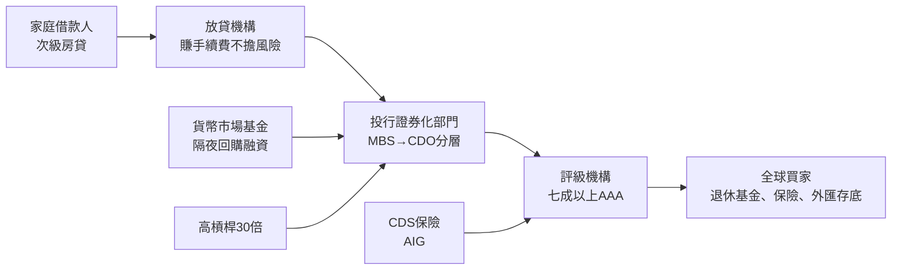

# 8.2 衍生品、證券化與影子銀行：銀行家成為風險工程師（1970s – 2007）

## 從中介到工程師

本章的主角是一種職業的自我重新定義。傳統銀行家是資金的中介：吸收存款、發放貸款、收取利差。1970 年代之後，一批華爾街的數學家與物理學家把銀行家改造成風險工程師——他們不再是搬錢的人，而是把風險拆解、打包、定價、再轉售的人。

## 衍生品的誕生：給風險定價

1973 年是金融工程的元年。布萊克與斯科爾斯發表選擇權定價公式（由默頓完善），第一次讓「不確定性」可以被精確計算與交易；同年芝加哥選擇權交易所開業。這個公式背後是隨機微積分（布朗運動、伊藤引理），把二戰後物理學的數學工具搬進金融。

衍生品的原始動機是對沖：1971 年布雷頓森林體系崩潰後，匯率自由浮動；1973 年起石油危機令通脹與利率劇烈波動。跨國企業與銀行需要工具鎖定成本。利率交換（interest rate swap，1981 年 IBM 與世界銀行完成首筆著名交易）、貨幣交換、遠期利率協議在 1980 年代爆發式增長，櫃檯（OTC）衍生品市場名目本金規模到 2007 年超過六百兆美元——是全球 GDP 的十倍以上。

## 證券化：把貸款變成債券

證券化是另一條革命路線。原理簡單：把成千上萬筆缺乏流動性的貸款（房貸、車貸、信用卡債）匯成一個池子，以池子的現金流為擔保發行債券，出售給投資人。

- 1970 年，吉利美（Ginnie Mae）發行首批房貸轉手證券；1971 年雷曼兄弟將商業不動產信託證券化上市；1977 年，所羅門兄弟的路易斯·拉涅利把民間房貸證券化推向主流，被稱為「證券化之父」。
- 1980 年代，衍生證券層級出現：擔保抵押債券（CMO）把房貸池的現金流切分為不同期限與風險的層級（tranche）；到 1990 年代，債務擔保憑證（CDO）把債券池再證券化，甚至出現 CDO²（把 CDO 再打包）。
- 信用違約交換（CDS）則是另一支：為債券違約買保險。1994 年由 J.P. 摩根的團隊（埃克薩姆著名的埃克森貸款風險轉移交易）發明，到 2007 年 CDS 名目規模超過六十兆美元。

理論上，這是一場雙贏的效率革命：銀行把風險賣給願意承擔的人，釋放資本繼續放貸；投資人依風險偏好選擇層級；評級機構給 AAA 標籤，保險公司與退休基金得以參與。數學模型的優雅（高斯關聯模型把房貸違約相關性算成一條公式）讓整個市場深信不疑。

## 影子銀行：沒有存款保險的銀行

但這套工程系統的動力來源，是一個在監管視線之外的龐大體系——影子銀行（shadow banking，2007 年由太平洋投資管理公司的麥卡利命名）。

影子銀行執行銀行的功能（期限轉換：把短期資金轉為長期資產），卻不叫銀行、不享存款保險、不受資本充足率約束。它的核心機制是回購（repo）：投行把債券押給貨幣市場基金，隔夜借入資金，次日續借。2007 年，美國五大投行槓桿率 30 倍以上，靠隔夜回購滾動融資——只要市場有一天不願續借，就要被迫拋售資產。貨幣市場基金本身則是 1970 年代繞開利率管制的發明，規模到 2008 年達三兆美元以上。

這張網的每個節點都在理性地賺取手續費或利差，卻沒有任何節點承擔最終風險——道德風險（moral hazard）在制度層面被結構化了。放貸機構賣掉貸款，不關心借款人能否還錢；投行賺承銷費，不關心 CDO 的長期品質；評級機構收發行方付費的評級費，有動機給出寬鬆的 AAA；買家相信模型與評級，不做獨立盡調。

## 預言與警告被忽略了

並非沒有人看見。2005 年，國際清算銀行的經濟學家警告全球信用泡沫；2006 年對沖基金經理約翰·保爾森與邁克爾·伯里分別做空次貸 CDO（保爾森基金賺逾一百五十億美元，電影《大賣空》的真實主角）；2007 年，經濟學家拉古拉姆·拉簡在傑克遜霍爾央行年會上警告金融創新正在製造系統性風險，被在場多數大行總裁譏為反動。機構投資人與監管者普遍的態度是：模型說了算，AAA 就是安全。

## 為何崩塌不可避免

2007 年 2 月，HSBC 與數家次貸機構率先暴雷；6 月，貝爾斯登兩檔次貸對沖基金崩潰；8 月，法國巴黎銀行凍結三檔基金，宣告全球貨幣市場對次貸資產的信任一夜蒸發——回購市場開始拒絕房貸抵押品。2008 年 3 月貝爾斯登被摩根大通收購；9 月 15 日雷曼破產；同日美林賣給美國銀行；9 月 16 日 AIG 獲Fed八百五十億美元緊急貸款（最終救助規模一千八百多億）。

崩塌的機制是教科書級的擠兌：影子銀行的資金來源是隔夜與極短期，資產是流動性最差的長期證券。當抵押品的市場價值被質疑，整個體系在幾天內自我瓦解——三百年前金匠銀行家面對的問題（見 5.2），以 CDO 的面目重演。

白芝浩 1873 年的原則在 2008 年被大規模測試：Fed 擴張資產負債表（量化寬鬆與各種緊急工具），美國財政部推出七千億美元問題資產救助計畫（TARP）。但這次與 1907 年不同：銀行家不再是救市的英雄，而是被救的罪人——Too Big to Fail 成為政治罵名。監管與社會契約的重寫，就是下一章的主題。
