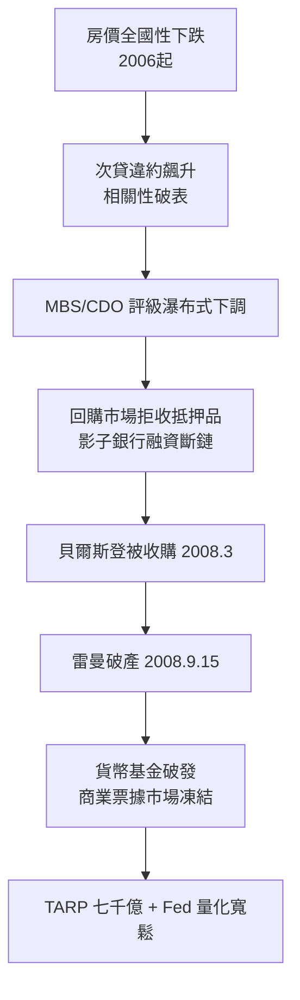

# 9.1 雷曼兄弟倒閉與 CDO 大破滅：Too Big to Fail 的代價（2008）

## 週末的六百億美元帳洞

2008 年 9 月 12 日（週五），紐約聯儲的會議室裡坐滿了華爾街的 CEO：美聯儲與財政部要求他們在週末之前為雷曼兄弟找出一條活路。雷曼持有巨額不動產相關資產，回購市場已拒絕為其融資，週一開市若無解決方案，破產是唯一結局。

週末的談判在兩個潛在買家（英國巴克萊與美國銀行）之間擺盪。巴克萊方案卡在英國金融監理當局不願承擔或然負債；美國銀行轉向收購美林（劉易斯 9 月 14 日深夜同意）；財政部長鮑爾森與紐約聯儲主席蓋特納明確表示：政府不會出錢救助雷曼——與三月救助貝爾斯登（由Fed擔保貝爾斯登部分資產促成摩根大通收購）形成鮮明對比。9 月 15 日凌晨，雷曼兄弟控股申請破產保護，負債六千一百三十億美元，資產六千三百九十億美元，是美國史上最大的破產案。

## 選擇不救的原因與後果

「為什麼救貝爾斯登卻不救雷曼」成為金融史最熱的爭論。當時的官方理由：雷曼缺乏合格抵押品，沒有私營買家願意接手，救助需要納稅人承擔明確損失，政治上不可行，且「任其倒閉」可重建市場紀律。事後的解讀多持批評：救助貝爾斯登已經誘發了「政府一定會救」的預期，雷曼的破產被市場解讀為政策急轉彎，動搖了對所有金融機構的信心——信任這個體系的基礎，恰是可預測性。

後果立竿見影，遠超決策者預期：

- 同日，美林以約五百億美元賣給美國銀行；美國國際集團（AIG）因賣出數千億美元的 CDS 保險，在雷曼破產後信用評級遭降，被要求追加抵押品而瀕臨崩潰，9 月 16 日Fed緊急提供八百五十億美元貸款（最終救助累計約一千八百二十億），政府持股近八成。
- 貨幣市場基金「破發」（Reserve Primary Fund 跌破 1 美元淨值），引發三兆美元貨幣市場的擠兌；商業票據市場凍結，通用汽車等產業巨頭瀕臨發不出工資的境地——金融恐慌開始重創實體經濟。
- 9 月 18 日，Fed 與各大央行聯手無限提供美元流動性；10 月，國會通過七千億美元問題資產救助計畫（TARP），由財政部直接向銀行注資；Fed 同時把利率降至零附近，並開啟量化寬鬆（QE）。

## 為什麼 CDO 會崩：數學模型的極限

要理解雷曼之死的深層原因，必須回到 CDO 的模型。評級機構（穆迪、標普、惠譽）使用高斯關聯模型（Gaussian copula）估算房貸池的違約相關性——這個模型把不同房貸之間的「一起違約」的機率，簡化為單一相關參數。全美房價自 1930 年代大蕭條以來從未全國性下跌，因此歷史數據給出的相關性偏低、違約率溫和，於是 CDO 的優先層被評為 AAA，與美國國債同級。

模型的致命假設：房價不會全國同跌。2006 年起美國房價全國性下跌（Case-Shiller 指數跌幅逾三成），違約相關性瞬間升至 1（所有人都同時違約），AAA 層級的損失遠超模型設想。評級機構 2007-2008 年下調數兆美元證券評級，持有這些「準國債」的機構（投行、貨幣基金、歐洲銀行、部分外匯存底）一夜之間資本蒸發。

這是本書反覆出現的主題的殘酷版本：科技給了金融前所未有的計算能力，但模型再精巧也無法預測「歷史上沒發生過的事」——奈特意義上的不確定性（Knightian uncertainty）不可被模型消滅。三千年前漢摩拉比法典規定災年免息，本質上就是承認這種不確定性的存在；2008 年的人類擁有超級電腦，卻把「歷史數據」當成了未來的保證。

## 道德風險與政治反彈

救助的代價不只是金錢。TARP 通過前，眾議院首輪表決否決方案，道瓊指數單日暴跌七百七十七點；通過後的三年內，美國失去約八百七十萬個工作崗位、家庭財富蒸發十兆美元以上，而華爾街的獎金在 2009 年就恢復到危機前水準——「私人獲利、公共買單」的憤怒催生了占領華爾街運動（2011），並重塑了此後十餘年的政治光譜（茶黨與進步派同時把矛頭指向大銀行）。

經濟學家萊因哈特與羅格夫在《這次不一樣》中統計了八百年來的金融危機，結論冷峻：危機前的故事永遠是「這次不一樣」，危機後的劇本永遠相似——信貸繁榮、資產泡沫、恐慌、救助、監管收緊，然後遺忘，再來一輪。2008 年之後的世界確實進入了嚴監管週期，但與此同時，貨幣寬鬆與低利率又為下一次信貸繁榮埋下火種——只是這一次，火種不再長在銀行的資產負債表上，而長在私募信貸、ETF、加密貨幣與科技公司的新形態裡。

## 後果之一：銀行家形象的永久改變

1907 年，摩根是救世的英雄；2008 年，銀行家是國會聽證上的罪人。這個形象反轉有實質的政策意義：它使嚴厲監管（多德-弗蘭克、巴塞爾協定 III，見下節）在政治上成為可能，也使「大而不能倒」成為此後每一屆政府必須回答的問題。而吊詭的是，救助與監管之後，美國銀行業反而更加集中——危機淘汰了雷曼、貝爾斯登、華互銀行，幸存者規模更大。這是所有監管者都尚未解開的悖論：防止倒閉的制度，同時在製造更大的機構。
