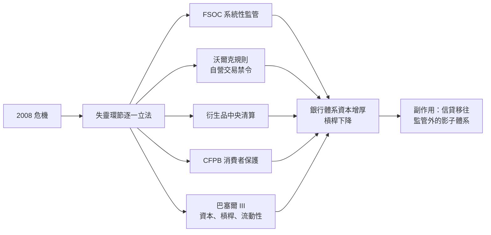

# 9.2 多德-弗蘭克法案與巴塞爾協定 III：給槓桿時代戴上鐐銬（2010 – 2020）

## 從憤怒到立法

2008 年的救助帳單（TARP 七千億、Fed 緊急工具規模逾兆）與失業潮，讓金融監管改革成為歐巴馬政府的首要立法。2010 年 7 月 21 日，總統簽署《多德-弗蘭克華爾街改革與消費者保護法》（Dodd-Frank Act），這是 1933 年以來最全面的金融改革。

## 多德-弗蘭克法案的骨幹

這部兩千三百頁的法律，針對 2008 年的每一個失靈環節各築一道牆：

1. 系統重要性機構監管。設立金融穩定監督委員會（FSOC），把「大到不能倒」的機構（資產五百億美元以上銀行、大型保險與清算機構）納入特別監管：更高的資本與流動性要求、年度壓力測試、生前遺囑（living wills，破產預案）。
2. 沃爾克規則（Volcker Rule）。以Fed前主席保羅·沃爾克命名，禁止銀行以自營名義交易，限制投資對沖基金與私募基金——把 1933 年的分業精神部分重建於衍生品時代。
3. 衍生品監管。要求標準化衍生品（CDS 等）進入中央清算與交易所報價，交易須申報至資料庫，結束 2000 年《商品期貨現代化法》的監管真空。
4. 消費者金融保護局（CFPB）。單一機構專責消費者金融產品（房貸、信用卡）的公平性，直接回應次貸濫售。
5. 有序清算權（Orderly Liquidation Authority）。授予FDIC關閉系統重要性非銀行機構的破產程序，取代「要麼救助、要麼混亂破產」的二選一。
6. 薪酬治理。要求金融機構揭露薪酬結構、設立追回（clawback）條款——虧損後追回已發獎金。

## 巴塞爾協定 III：全球銀行的體重管理

美國立法之外，國際層面由巴塞爾銀行監理委員會推動巴塞爾協定 III（2010 年公佈，分階段實施至 2019 年）。其核心是提高銀行抵禦損失的能力：

- 資本充足率加高：普通股一級資本（CET1）要求從舊制的 2% 提高至 4.5%，並加上 2.5% 的緩衝，系統重要性銀行另加 1-2.5% 附加。
- 引入槓桿率下限（不依風險加權的底線）——防止銀行用模型低估風險。
- 流動性覆蓋率（LCR）與淨穩定資金比率（NSFR）：確保銀行能撐過三十天與一年的流動性壓力，直接回應 2008 年回購市場斷鏈的教訓。
- 逆週期資本緩衝：景氣過熱時要求銀行多提資本，抑制信貸狂潮。

## 有效嗎：成績與代價

十年後回望，這套框架在防範「2008 式危機」上是成功的。2020 年新冠疫情恐慌中，銀行體系資本充足、接受壓力測試的機構未出現償付危機，Fed 與財政部的救助對象主要是企業與家庭而非銀行——與 2008 年的順序完全顛倒。這正是監管的成果。

但代價與副作用同樣真實：

- 信貸遷徙。監管讓銀行縮表、讓傳統貸款業務利潤變薄，資金流向監管較少的私募信貸（private credit，2024 年規模逾一點七兆美元）、私人股本與金融科技——風險沒有消失，只是搬家。這是金融史的老規律：漢摩拉比時代的利率上限把放貸推向法外之地，多德-弗蘭克把槓桿推向影子體系。
- 規模悖論。監管成本有利於大機構，美國社區銀行數量持續減少，銀行業集中度上升。2023 年矽谷銀行（SVB）與簽字銀行倒閉，正是影子銀行風險（利率風險、擠兌靠手機 App 即時爆發、存款超過保險上限）的新形態版本——證明監管是持續的貓鼠遊戲，不是終局。
- 政治鐘擺。2018 年《經濟增長、監管救濟與消費者保護法》已為中小銀行鬆綁（把系統重要性門檻從五百億美元提高到兩千五百億美元），SVB 之死恰與此鬆綁有關。鐘擺在 2008 收緊、2018 放鬆、2023 再收緊，與本書描寫的每一次監管循環同構。

## 白芝浩法則的全球化

Fed 在 2008-2020 年間的表現，是把白芝浩原則（見 5.2）推向全球規模：利率降至零、量化寬鬆累計數兆美元、設立多種緊急融資工具（商業票據、貨幣市場、公司債購買），2020 年疫情恐慌中兩週內推出這些工具，市場數日內止跌。伯南克、鮑威爾兩代主席的共同信條：恐慌時要果斷、夠量、夠快，寧可事後被批「做得太多」。

但貨幣寬鬆的另一面，是資產價格長期高漲與貧富差距擴大——持有資產的人受益，靠薪資儲蓄的人相對受損。這種分配效應成為 2010 年代民粹主義的經濟土壤之一，也成為下一章主題（數位貨幣、去中心化金融對央行的挑戰）的政治燃料。

## 小結

多德-弗蘭克與巴塞爾 III 是國家對金融權力的一次全面收編，其思想血緣可直追 1933 年葛拉斯-斯蒂格爾——分業、資本約束、存款人保護。而正如 1933 年體系在 1970 年代被技術與通脹瓦解，2010 年體系也正面對同樣的三重侵蝕：監管套利（影子銀行）、技術（AI 與區塊鏈）、以及一個不再信任中介的世代。下一章，我們就走進這場「去銀行化」的變局。
