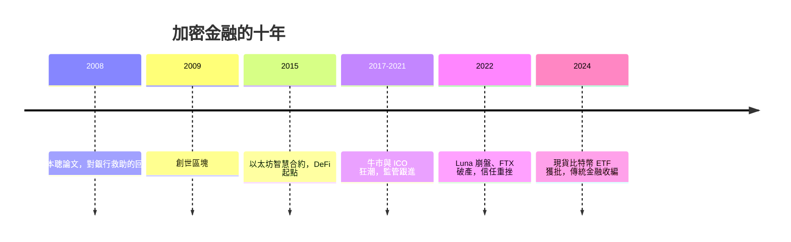

# 10.1 中本聰與比特幣：對銀行中介的終極挑戰（2008 – 至今）

## 創世區塊裡的一句話

2008 年 10 月 31 日，雷曼破產後六週，一個化名中本聰（Satoshi Nakamoto）的匿名作者向密碼學郵件列表發表了九頁論文《比特幣：一種點對點的電子現金系統》。2009 年 1 月 3 日，比特幣創世區塊誕生，區塊裡刻著一行字：泰晤士報當日頭條標題——「財政大臣正站在第二輪銀行救助的邊緣」。

這行字不是巧合，是宣言：這套系統的誕生動機，就是對 2008 年銀行救助的回應。論文的措辭同樣直接：「傳統貨幣的根本問題，是需要可信的第三方來運作……銀行必須被信任才能持有錢、才能不憑空造錢。」

## 要解決的問題：拜占庭將軍與雙花

在比特幣之前，數位現金的構想已存在二十年（David Chaum 的 eCash、亞當·貝克的 hashcash、戴維與斯澤的 b-money、芬尼的 RPOW），它們都卡在同一個難題：數位檔案可以被無限複製，如何防止持有人把同一筆錢花兩次（雙花）？傳統解法是引入中心帳本（銀行），而這正是比特幣想廢除的東西。

中本聰的突破是把三個既有技術焊接成一個系統：

1. 區塊鏈帳本。所有交易公開記錄、按時間串成鏈，任何人都可驗證——一本公開的複式簿記（見 4.2 章：這是帳簿思想的數學化極致）。
2. 工作量證明（PoW）。用雜湊算力競爭記帳權，篡改歷史需重算全部後續區塊，成本隨時間指數上升。
3. 經濟激勵。記帳（挖礦）成功者獲得新發行的比特幣與手續費，讓維護網絡的自利行為與系統安全合而為一。

這組合解決了分佈式系統的經典難題（拜占庭容錯）：在互不信任的參與者之間達成帳本共識，而不需要任何中間人。換言之，比特幣用密碼學與博弈論，替代了本書前三千年歷史的全部信任基礎——神廟的威懾、家族的信義、王權的法律、央行的保險。

## 去中心化金融（DeFi）：把銀行的每個職能代碼化

比特幣之後，以太坊（2015 年，Vitalik Buterin）引入智慧合約——在區塊鏈上自動執行的程式。自此，銀行的各項職能被逐一「代碼化」：

- 交易與兌換：去中心化交易所（如 Uniswap 的自動做市商演算法，以數學公式代替造市商）。
- 放貸：Aave、Compound 等協議，以抵押品比率與演算法利率代替信貸審核——無須知道你是誰，只看押什麼、押多少。
- 穩定幣：USDC 等法幣抵押型，與超額抵押型（DAI），試圖把美元的穩定帶進鏈上。
- 衍生品與資產代幣化：鏈上合成資產、債券與房地產代幣化實驗。

到 2021 年，DeFi 鎖倉價值一度超過一千八百億美元。這些協議 24/7 運行、無休息日、無地域歧視，其規模與速度對傳統銀行構成真實的示範效應。

## 現實的制衡：波動、詐騙與能源

但「取代銀行」的宣言遭遇了嚴峻的現實：

- 波動性。比特幣的價格劇烈震盪（歷史上多次腰斬以上），使其難以履行「現金」與「記帳單位」的職能——它更像投機資產而非貨幣。薩爾瓦多 2021 年把比特幣定為法定貨幣，實際採用率遠低於預期。
- 崩塌的樓閣。DeFi 複製了傳統金融的槓桿與鏈式風險：2022 年 TerraUSD/Luna 演算法穩定幣崩盤蒸發約四百億美元；FTX 交易所挪用客戶資產破產——中心化的看門人依然是最大的漏洞，中心化金融的問題沒有因為「鏈上」而消失。
- 能源與效率。比特幣工作量證明年耗電量一度超過中等國家，2022 年以太坊轉向權益證明（PoS）才大幅降低能耗。
- 監管反擊。各國證券與銀行監管相繼把交易所、穩定幣發行商納入規範；美國批准現貨比特幣 ETF（2024 年 1 月）則代表著另一種結局——傳統金融把加密資產收編為自己的新產品線，而非被它取代。

## 深層意義：一次思想實驗的勝利

拋開投機與泡沫，比特幣留下的思想遺產是確定的：它證明信任可以由數學與激勵結構產生，帳本可以無主而公開，價值轉移可以繞過中介。這套思想已滲入傳統金融的骨髓——銀行研究分散式帳本（DLT）做跨境結算，各國央行研究央行數位貨幣（CBDC，中國數位人民幣、歐洲數位歐元），證券結算（如美國 2024 年批准的代幣化基金）開始上鏈實驗。

從本書的視角看，這是第四次信任基礎的更替：神廟與君王 → 家族與信義 → 法律與央行 → 密碼學與演算法。但更替從來不是取代，而是層疊：山西票號沒有消滅錢莊，英格蘭銀行沒有消滅金匠，Fed 沒有消滅商業銀行——它們在新舊之間重新分工。比特幣與 DeFi 大概率也是如此：它們不會消滅銀行家，但會逼銀行家回答一個古老的問題——你存在的前提，究竟是壟斷帳本，還是價值本身？
