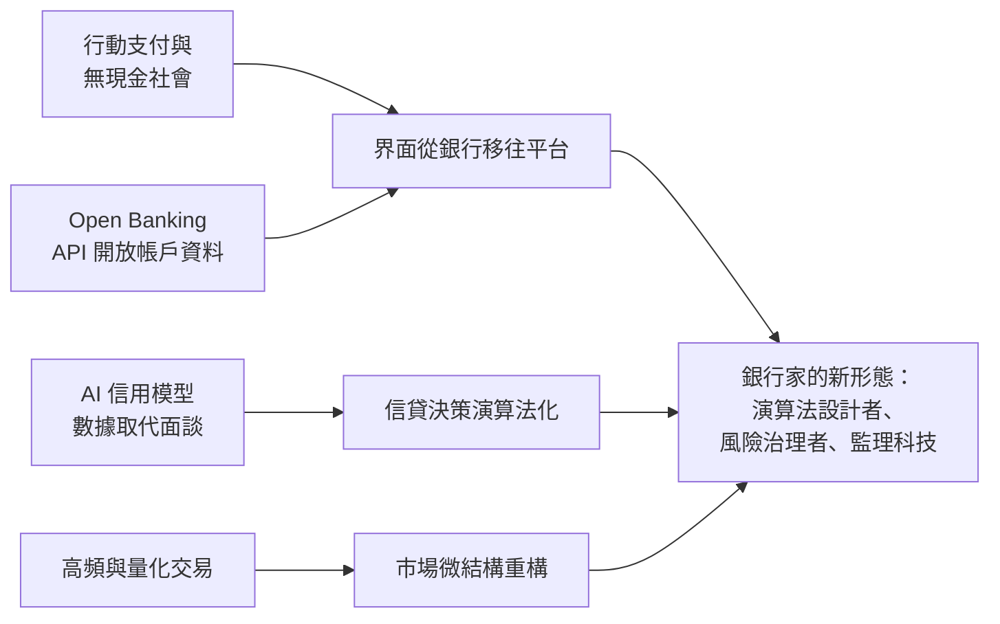

# 10.2 無現金社會與演算法銀行家：當 AI 決定誰能借錢（21 世紀至今）

## 銀行家的最後一次變形

本書的最後一章，講的是一種正在發生的消失：銀行家這個職業，正在被演算法、開放介面與平台公司重新分配。三千年前，放貸者坐在巴比倫神廟的門口等客戶上門；今天，貸款決策在毫秒之間由模型完成，客戶甚至不知道哪家機構提供了資金。銀行沒有消失，但「銀行家」的形態，正在經歷自漢摩拉比以來最徹底的抽象化。

## 三股力量的匯流

這場變形由三股力量同時驅動：

1. 支付的去現金化。行動支付（支付寶、微信支付、印度 UPI、非洲 M-Pesa）與即時清算系統，讓實體貨幣在數十年內從日常交易中退場——這是交子以來紙上信用的終極形態：連紙也不要了。2020 年代，中國零售支付中現金占比已降至個位數；瑞典接近無現金；歐洲央行與Fed分別推進數位歐元與研究數位美元。支付的主導權從銀行轉向科技公司與清算網絡。
2. 開放銀行（Open Banking）。英國 2018 年起強制銀行透過標準化 API 開放客戶授權的資料；歐盟 PSD2 法規推動全歐落地。銀行從「客戶關係的壟斷者」降格為「帳戶與合規的基礎設施」，而界面與體驗由第三方（新創、平台、超級 App）接管。用本書的話說：帳本還在銀行，但銀行家的臉消失了。
3. AI 信用風控。從 FICO 信用分到機器學習模型，放貸決策從面談、抵押品轉向數據：消費行為、通訊錄、手機型號、水電繳費、社群關係。螞蟻集團的 310 模式（三分鐘申請、一秒放款、零人工干預）是極端版本；美國的 Upstart、Klarna 等以模型承擔信貸決策。模型可以捕捉傳統徵信看不到的償還能力（如為無信用卡者放貸），也可以複製與放大偏見——美國公平放貸法規在演算法時代的適用，已成為監管前沿戰場。

## 高頻交易：演算法接管市場

市場交易端同樣被演算法接管。2005 年美國股市約八成交易由人工完成，今天九成以上由演算法執行；高頻交易（HFT）以微秒級速度套利，2010 年 5 月 6 日的「閃崩」（道瓊數分鐘內暴跌近千點後回升）成為演算法市場脆弱性的首次公演。2014 年，作家 Michael Lewis 的《快閃大對決》揭露了速度軍備競賽（鋪設芝加哥到紐澤西的直線光纖）——這是滑鐵盧信使的微秒版：信息優勢的戰場從天壓縮到百萬分之一秒，只是這次的信使是光。

本書第一次出現的「技術使優勢民主化」規律（見 6.2），在高頻交易身上達到邏輯極限：當所有參與者都以光速交易，速度優勢歸零，利潤轉向基礎設施的所有權（交易所、雲端、晶片）——這正是今日科技巨頭與金融基礎設施公司的新戰場。

## 央行數位貨幣：國家重新下場

無現金與加密貨幣的夾擊，把各國央行逼進了數位化競賽。央行數位貨幣（CBDC）的本質：央行直接對公眾發行數位負債，繞過商業銀行的存款壟斷。中國的數位人民幣自 2019 年起大規模試點，歐洲央行 2023 年決定推進數位歐元準備階段，巴哈馬、奈及利亞已發行。CBDC 對銀行體系是雙面刃：提升支付效率與政策傳導，卻可能抽走銀行存款（金融脫媒），在恐慌時甚至讓擠兌一鍵完成——央行設計時必須在便利與穩定之間取捨，這是 1694 年英格蘭銀行以來「政府與銀行信用分工」的又一次重新談判。

## 銀行家還會存在嗎

把本書的四大線索放在一起，可以給「未來的銀行家」一個答案：

- 業務形態：從持有資產負債表，轉向經營資訊流與風險定價——銀行成為 API、模型與合規的集合體。
- 信任基石：從機構品牌，轉向演算法透明度與數據治理——信任對象從「人」變成「系統」，但系統也需要被人信任，這正是新監理科技（RegTech）與演算法審計的職能。
- 與權力關係：銀行不再是權力的中心，平台與央行直接對峙；監管的前沿從資本充足率轉向數據主權、模型公平性與網絡安全。
- 工具：從泥板到量子電腦，但工具的每一次躍遷都重複同一個教訓——模型不能消除奈特意義的不確定性（見 9.1），漢摩拉比法典的災年免息條款，在任何時代都是必要的制度謙遜。

## 結語：三千年的一個問題

從烏爾商人杜穆茲-加米爾的泥板，到雷履泰的匯票密押，到帕喬利的複式簿記，到英格蘭銀行的議會信用，到摩根的圖書館救市，到 CDO 的數學模型，到比特幣的創世區塊——本書寫了三千年，其實只寫了一個問題：

陌生人如何相信陌生人對未來的承諾？

每一代人的答案都建立在當時最先進的技術與最強大的制度上，也每一次都被新的技術、新的貪婪與新的危機推翻。銀行家的故事不會結束，因為信用與權力、創新與監管、個體利益與系統穩定的拉鋸不會結束。下一次危機來臨時，坐在桌後的人（或演算法）會換，但巴比倫泥板上那個問題，依然會被刻進新的介質裡。
