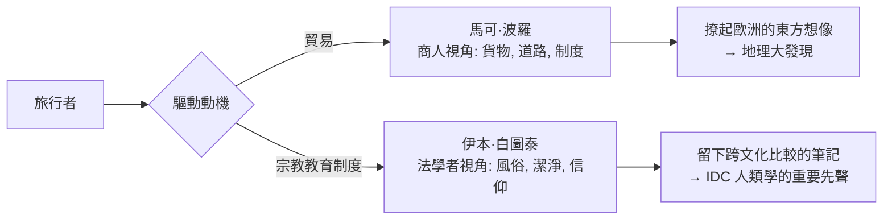

# 1.2 伊本·白圖泰與馬可·波羅：跨文化接觸的第一手筆記

繼希臘人之後，把「異族記錄」推上新高潮的是兩個商人與一個法官。

第一個故事屬於十三世紀末的威尼斯。馬可·波羅（Marco Polo，1254–1324）並不是探險家，而是絲綢之路商人家族的第三代。十三世紀的貿易背景是關鍵：蒙古帝國在成吉思汗及其繼承者的征服下，把從中國到黑海的一大片土地整合進「蒙古治世」（Pax Mongolica），驛站暢通、商隊受保護，這是國際貿易史上的重大紅利。沒有蒙古帝國的安全路網，威尼斯商人根本不可能平安穿越中亞，馬可·波羅也不可能在忽必烈的朝廷裡做官十七年。

《馬可·波羅遊記》是他在熱那亞監獄中口述完成（戰俘生涯，1298 年威尼斯與熱那亞的海戰）。書中共列了上千種物產、風俗與故事，從北京的石棉礦、雲南的竹、杭州的市場說到福建的印花布。今天讀它，最有趣的是一個商人的分類法：他描述各地時最關心三件事——貨物、道路、統治制度。這本身就是後來經濟人類學的雛形：文化差異不只表現在信仰與婚俗上，更表現在市場如何運作、價格如何形成、誰在分配。

歷史的譏刺在於，這本書對歐洲的最大影響不是增進了理解，而是撩起了欲望。哥倫布在西班牙航海靠岸的行囊中，帶著一本拉丁文的《馬可·波羅遊記》，邊頁上有他親手寫下的批註：香料、黃金、可汗的大都。書中介紹東方的財富，是十五世紀末地理大發現的精神火種之一——這條主線會在第 2 章爆發。

第二個故事屬於丹吉爾（Tangier）的伊本·白圖泰（Ibn Battuta，1304–1369）。他的身份更為奇特：熟習伊斯蘭法學的年輕法學者。在伊斯蘭世界，精英階層流動靠的不是國籍而是一套制度——烏瑪（Ummah，全球穆斯林共同體）與「進學旅遊」（rihla fi talab al-'ilm，為求學而遊學）。一個學者可以從摩洛哥走到印度，沿路在每一座學院找到同僚、食宿與婚姻，整個巨大網絡由共同的宗教教育制度支撐。這是中世紀世界最早的「全球化職業階層」。

白圖泰 1325 年二十一歲時離家朝覲麥加，此後的近三十年間他走了約十二萬公里，抵達東非、阿拉伯、波斯、印度、馬爾地夫、錫蘭、蘇門答臘與中國，晚年還深入西非的馬里。他的《旅行者的禮物》（Rihla）在他回國後由馬林蘇丹下令，由文士伊本·朱扎伊根據他的口述整理成書。

他最後到訪了中國的泉州與杭州，沿路所見是航運與市場繁榮的世界。

白圖泰的記錄比馬可·波羅更接近人類學：他描述各地婚俗、飲食、潔淨觀念、女性地位時常用比較的筆法。他對馬爾地夫以當地習俗替代伊斯蘭婚姻制度感到不安，對馬里人以抹泥洗身為潔大感詫異，也記下了君士坦丁拜占廷宮廷的儀式、東非海岸的城市生活與蘇門答臘蘇丹的慈悲。他既讚歎也震驚，但始終保持了一個關鍵的視角：他以伊斯蘭法的「潔淨與不潔」、「正當與不正當」為座標，記錄各地如何相似或偏離座標。這還不是文化相對論，但他留下了無比珍貴的跨文化比較筆記。

兩人的對比，道出了人類學一個持久的張力：

我還要提一個問題：如果這兩位記錄者已經如此出色，為什麼人類學不是在十三世紀誕生？

答案在於：他們的記錄是好奇心的碎片，還不是一門有方法的學問。他們缺少三樣最重要的東西——統一的比較架構、專業的訓練制度、以及可以把田野經驗轉化為理論的學院。而要等到歐洲突然發現了「全新的人」——不是絲路彼端的老熟人，而是美洲大陸上從未聽聞過的人——「他者」的問題才真正變成哲學與科學的問題。

那次發現，載於下一章。
