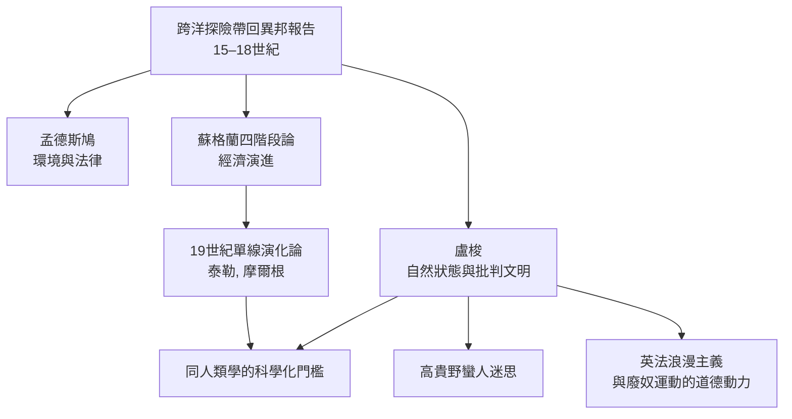

# 2.2 盧梭與啟蒙時代：「高貴野蠻人」的哲學思辯

1754 年，日內瓦出生的哲學家盧梭（Jean-Jacques Rousseau，1712–1778）寫下《論人與人之間不平等的起因與基礎》。開篇他立了一個方法上的門檻：要談人的「自然狀態」，必須先剝除一切由社會添加的東西——像剝掉樹皮找到樹幹一樣（這是他的比喻）。然後，在論證的關鍵處，他引用了當時歐洲所能得到的最豐富資料：美洲原住民與太平洋島民的旅行報告。

這份引用背後有一整套經濟與知識的驅動結構，值得拆開來看。

第一層是「時代的社會心理」。盧梭寫作時的巴黎，正處於路易十五治下的繁榮沙龍社會，商業與奢侈品消費飛速擴張，文人對「文明病」有自覺；貴族圈流行「自然」趣味，鄉村別墅、山水詩與「返璞歸真」是時髦。盧梭把這股時代的焦慮推向極點：他說人天生孤獨、健康、心平氣和；農業與私有財產出現後，人開始互相比較、嫉妒、掠奪，才有了不平等。社會不是文明的加冕，而是一場精心佈置的欺騙。

注意：盧梭並非說原住民真的完美無缺。他親筆寫過，當代人對野蠻人的真實樣態所知甚少。他使用旅行報告，是把它們當作「思想實驗的證據」，而非田野記錄。但矛盾就在這裡——讀者不會區分。伏爾泰、狄德羅與後世的殖民地官員、詩人與小說家，都把「高貴野蠻人」讀成了對真實人群的描述。

這是後世所以稱之為「高貴野蠻人迷思」的根源。實際上，這個說法由英國詩人德萊頓（John Dryden）1670 年代首次用於詩句，但真正發揚光大的是盧梭及其影響下的浪漫主義。十八與十九世紀的歐洲人為此分裂成兩個幻影：一邊是「殘酷的野蠻人」——不需教育就邪惡，只能被帝國馴服（霍布斯式的形象）；一邊是「高貴的野蠻人」——純淨、自由、未被腐化，是文明人失落的可能。兩個幻影都不是從原住民身上長出來的，而是從歐洲人的自我匱乏投射出來的。

這是本書第一個重要教訓：描述他者，往往是在書寫自己的鏡像。

另一邊，蘇格蘭啟蒙運動走的是另一條路。亞當·斯密（Adam Smith）與亞當·弗格森（Adam Ferguson）、約翰·米勒（John Millar）提出了「四階段論」：狩獵、遊牧、農耕、商業，社會依生產方式演進，並有其相應的法律與風俗。這是社會科學方法的不成熟前奏，也是十九世紀文化單線演化論的直系祖先。同時間，法國的孟德斯鳩在《論法的精神》（1748）中以氣候與地理解釋社會制度的差異——環境決定論的先聲。

有趣的是，雙方都在使用同一批美洲與太平洋資料。孟德斯鳩引旅行記、斯密引傳教士筆記、盧梭也引旅行記。相同的填料，不同的模型：一邊推出「文明進步」的演化史觀，一邊推出「文明墮落」的批判史觀。這一軸線至今未終結——今天關於「數位時代的人會不會更原始或更自由」的爭論，結構上酷似盧梭與蘇格蘭學派的回聲。

還要補一個常被遺忘的因果線：海地的革命。1791–1804 年海地奴隸起義成功建立共和國，其思想彈藥部分來自「人生而自由」的啟蒙原則。同時間，廢奴運動在英國以「非洲人同樣是人」的宗教與哲學論證推向議會（1807 年英國廢除奴隸貿易）。帝國的地理發現、啟蒙的哲學、奴隸的制度與反奴隸的運動——地理、思想與政治在十八世紀末攪在同一鍋裡。人類學將在這鍋湯的中間誕生，並且逃不開它的成分。

回望這一章，最值得記住的是：盧梭提出的不是一個人類學的事實，而是一個人類學的方法論難題。他要我們把「社會加在上面的」一層層剝掉；這是一百年後所有田野方法家的姿態原型（參與觀察、學會語言、放下成見，全是在做這種剝除）。但盧梭的悲劇是，他做了姿態而沒有出行動的田野——他一生沒有離開過歐洲。

走出書房、走進田野的路，要等到殖民帝國與印刷術把異邦研究的資料堆滿圖書館之後，才能在一個世紀後正式成形。
