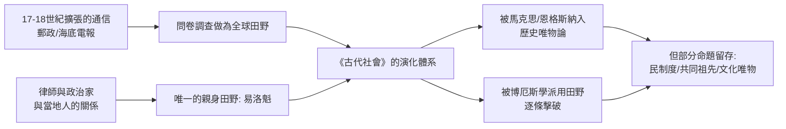

# 3.2 摩爾根與《古代社會》：親屬制度與演化階梯

路易斯·亨利·摩爾根（Lewis Henry Morgan，1818–1881）不是人類學科班出身——他是紐約州羅徹斯特的律師，兼鐵路投資人。他成為「美國人類學之父」的路徑，幾乎與法律與政治完全分不開，這正是十九世紀美版人類學的獨特起點。

故事從一個青年文學社團開始。1840 年代的羅徹斯特有一群律師與商人組成的秘密結社「大樹結」（Gordian Knot），抱著「本地印第安人將要滅絕」的獵奇熱情，決定研究易洛魁聯盟（Iroquois/Haudenosaunee）。摩爾根因此結識了塞內卡部落的青年伊萊繆斯·帕克（Ely S. Parker）——他祖父輩是易洛魁的酋長，他本人則受過完整英語教育，後來成為南北戰爭中格蘭特將軍的副官與聯邦印第安事務專員。摩爾根最初是想「捕捉」易洛魁的風俗當文學素材，但帕克帶他親眼看了實際的長屋、酋長冊封與喪禮祝禱，然後嚴正地指出：報紙上關於易洛魁的說法幾乎全是錯的。

於是摩爾根做了當時白人學者極少做的事：他住進了塞內卡部落，學習語言，參與生活。1851 年他寫出《易洛魁聯盟》（League of the Iroquois），第一部由親密田野得出、以被研究者的語言與結構為中心的民族誌。帕克本人後來在南北戰爭中立功。這段友誼貫穿終身——摩爾根甚至被易洛魁正式收養為塞內卡鷹氏族的一員。

真正的大發現來自 1850 年代。「法律遊學」到密西根半島的印第安保留區時，摩爾根觀察到一個奇怪的現象：歐及布威（Ojibwa）人對親屬的稱謂與英語完全不同——叔伯與父親共用一個詞，表姊妹與親姊妹共用一個詞。他把這份表帶回羅徹斯特，發現易洛魁的體系也一樣。於是他製作了兩三頁的問卷，透過史密森學會的友情渠道，寄到全世界：澳洲、印度、中國、日本、非洲、中南美洲，幾百份調查表湧了回來。1859 年起，他把這整整十年的寄出、彙整與核對，變成了《人類同族的血親與姻親制度》（Systems of Consanguinity and Affinity of the Human Family，1871）。

這是第一份真正全球規模的人類學問卷調查。而它的推理極為漂亮：

如果親屬稱謂在各大洲出現同樣的規律體系，就不可能是各自獨立「演化」的產物，只能說明親屬制度深受一項共同規範——婚姻與繼承規則——塑造。摩爾根由此推出社會的演化序列：從「雜亂婚」經過群婚、對偶婚，而後是父權家庭；社會組織也相應從以性別為組織核心的「氏族（克蘭）」，走向以財產與政治為核心的國家。1877 年，他把整套概念制度化為《古代社會》（Ancient Society）。

這部書把人類的社會發展一刀切為三段七期：蒙昧（savagery，又分低、中、高）、野蠻（barbarism，同樣三段）、文明（civilization），並為各期配上一項「技術指標」：用火、陶器、鐵器、文字。這是文化唯物論的先聲——他主張「人類的發明是社會進步的樞紐」，社會結構相應於生產技術的階段而變化。

歷史在此出現了一個誰也想不到的轉折。1881 年，彼得堡的流亡革命者卡爾·馬克思收到摩爾根的書，用筆做了大量筆記。翌年馬克思去世，恩格斯（Friedrich Engels）依據這些筆記寫成《家庭、私有制與國家的起源》（1884），把摩爾根的親屬演化論改寫為歷史唯物論的社會進化史。恩格斯說：這是「在實現我朋友（馬克思）的最後遺願」。此後，摩爾根在蘇聯與中國的人類學與馬克思主義學界被奉為經典；而二十世紀的英美主流人類學—博厄斯學派—將以具體資料一點一點地擊碎他的系列。

技術端的因果線也值得一看：摩爾根的問卷能寄到全球，靠的是十九世紀郵政系統與海底電報的基礎建設。他的「田野」本質上是靠官僚、律師、傳教士與商人握筆寫信，這決定了他資料的天花板：除了易洛魁，他從不曾親身在任一個非歐洲社會的全貌裡生活過。

回望十九世紀的這門未成年學問的畫像：

所以，到十九世紀末，人類學的處境是：概念與方法的第一套稿子已經寫好（文化的定義、比較法、親屬制度、演化序列），但整套結構懸在「人心同構」與「單線進步」這兩根支柱上。前者來自哲學的樂觀主義，後者來自宗教與殖民主義殘存的自我優越感。

要拆倒這兩根支柱，需要真正的田野、人體測量的量尺，以及一位不怕被整個歐美學界圍攻的移民。

但先讓一位不動身的旁觀者上場：弗雷澤，一位坐在書桌前的收集者，正要在蘇格蘭的大學圖書館裡，把全人類的神話與巫術搬進一片巨大的書架。
