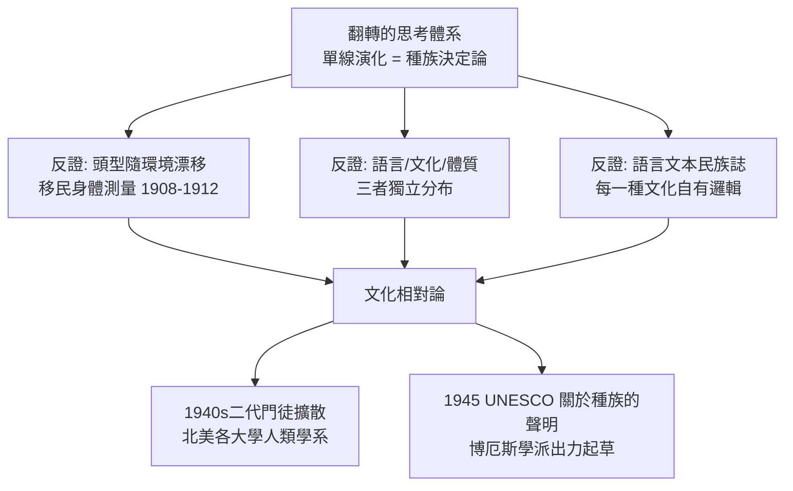

# 5.1 波亞斯：擊碎種族決定論

1886 年春天，二十八歲的年輕人法蘭茲·博厄斯（Franz Boas，1858–1942）做了一個大決定：放棄德國的教職機會，留在美國。此後的近六十年裡，他一個人改變了一整門學科的走向——改變了它的理論、它的方法，也改變了它在社會中的角色。

博厄斯是徹頭徹尾的德國產品：他生於明登（Minden），在柏林、海德堡與基爾讀大學，博士論文是心理物理學（點在三度空間中顏色的判斷研究），他的博士導師包括物理學家與生理學家，他自己是在實驗室裡訓練出來的科學家。大海航行、文化人類學與北美原住民，是他人生二次出發的偶然事業。1881 年他以《巴芬島海水顏色與溫度的研究》為博士題目，1883–1884 年親自到北極巴芬島調查洋流——原來他的「田野」一開始不是人，而是海水。就在北極的冰原上，他與因紐特人朝夕相處，轉而把研究對象由海水轉為人。這一次轉向，革命性地改變了人類學。

隨後，他有意識地把戰場轉向了美國。1886 年他到紐約後，先在費城與紐約的博物館擔任館員，寫作了《不列顛哥倫比亞北太平洋海岸諸部族》等民族誌。他有意識地把家安在紐約，1901 年起主持美國自然史博物館的民族學部，1899 年起在哥倫比亞大學出任人類學教授。這條路走的正是殖民地知識產業的金門——當時英國、德國、法國的人類學主要接在中產知識圈與帝國行政的交界處，而美國沒有海外大型殖民地，但它的「殖民地」其實在境內：被強迫置入保留地的北美原住民。博厄斯的民族誌由此從一開始就帶著一種政治緊張：他研究的族群不是在海外，而是就住在他居住國的內部，是被鐵路、礦業與傳教破壞文化存續的內部殖民對象。

第一次世界大戰爆發後，科學與政治的界線被一場爭執徹底燒穿了。1919 年，博厄斯在《民族》（The Nation）週刊發表一封公開信，指控幾位在戰時從事（墨西哥方向）間諜工作的人類學家，濫用了學術調查的名義為軍事服務。學界為此大怒，美國人類學協會正式對他譴責——這是該學會史上最著名的紀律案之一。這封公開信的深層意義，後人一看就懂：博厄斯把「人類學不應成為帝國工具」設定成了學術倫理的第一條硬界——而作為一戰時的德裔移民，每一句反帝國主義的話，都帶著強烈的自我風險。

他展開反擊的兩拳，分別打在體質人類學與民族誌兩面牆上。

第一拳是「移民研究」。1908–1912 年，他接受美國移民委員會的委託，主導一項大規模的體質測量調查。他與助手測量了上萬移民與其子女的頭型、身高與面形，結果令全歐與美洲的「體質優劣論者」大吃一驚：同一族群中在美國出生的世代，頭型與體型已經明顯變化——南義大利人、匈牙利人、蘇格蘭高地人也一樣，環境（營養、居住）改變了天生的身體指標。博厄斯在 1912 年發表報告並一再修訂（1919、1940 年代仍有新版），結論是：連頭的大小這種被認為種族天生的指標，都深受發育期的營養與環境所左右。這是二十世紀初期對「種族是固定生物品類」假設的第一份大規模實證反駁。這項研究一石二鳥：它不但打擊了以顱骨測量作為智慧等級的十九世紀傳統（莫頓式的顱骨分類學），也直接命中了 1920 年代美國移民限制法的種族優劣論證。早在 1890 年代，博厄斯就已經在《科學》週刊撰文批評頭型決定論的濫用；更重要的是，他對「種族、語言與文化」三者獨立性的洞察：這三者只是經常一起出現，卻不是因果相關（一個族群往往因歷史的偶然而同時具備某種語言、皮膚顏色與制度）。這是北美版文化相對論的第一塊理論基石。

第二拳是民族誌。回到巴芬島之後得來的教訓，博厄斯自 1886 年起每年夏天前往北太平洋海岸的不列顛哥倫比亞省，先是為博物館工作，然後轉而為美洲土著做調查。他與誇扣特爾人（Kwakiutl，今稱 Kwakwaka'wakw）、欽西安人（Tsimshian）、貝拉庫拉人（Bella Coola）等一起工作，記錄他們的語言文本、家族史、歌謠、祭祀與編織。他用當地人自己的母語轉寫，並訓練混血助手（如喬治·亨特）協助收集資料，培養了北美第一批原住民出身的人類學助手。他本人學會了多種北太平洋語言，而且早就有意識地推動「每一種語言都要用音位法嚴格轉寫」的原則。

博厄斯的重要方法突破是：他不只記「風俗」的清單，而是馬上記錄語言文本——照錄神話、講話、歌謠，做音位分析、詞根分析，把民族誌從「描述風俗」升上「描述語言結構」。這是歷史上第一次把沒有文字的文化的語言文本，用嚴格的音位方法系統記錄下來。這對二十世紀的語言學有巨大影響，也十足是文化相對論的實踐版：一種文化有其自身的邏輯，其語言本身就是其世界觀的證據。

1911 年，博厄斯的《原始人的心智》（The Mind of Primitive Man）出版，論點直截了當：白人與有色人種的智力沒有實證差異，文明或野蠻之別源於文化的歷史積累，而每一種風俗都要放回其自身的制度脈絡裡看。1942 年他去世後，聯合國教科文組織起草的 1950 年〈關於種族問題的聲明〉，正是以他的學派的研究為科學根據——他的反種族主義，最終寫進了戰後的國際規範。

回頭看，博厄斯本人似乎只是一位戴著眼鏡、著作不算多的學者。但他真正的力量在於門徒：1910–1930 年代，他訓練出克羅伯（Alfred Kroeber，加州柏克萊）、米德、本尼迪克特、薩丕爾（Edward Sapir）、洛威、赫斯科維茨等一代學者——日後北美各大學人類學系的多數奠基者，都出自哥倫比亞大學這張「門徒表」。可以這樣說：博厄斯用一個人加一群得意門生的方式，重建了一門學科。

這一切的前因，是一個縮小到一張書桌前的因果圖：

就這樣，在北美這片同時被種族法與移民工廠撕扯的土地上，人類學第一次成為一門徹底宣稱「所有文化平等」的學科。時間上的巧合也難以忽略：哥倫比亞大學的人類學講座在 1896 年交到博厄斯手上，翌年之大而奇特的年輪，是 1897–1902 年的大英帝國擴張、1898 年美西戰爭、菲律賓征服。人類學的「帝國幼年期」就這樣在同一年代結束了北美的事業，而它的「批判成年期」正在別處傷著成長。

在海洋的另一邊，一位波蘭年輕人正要乘坐輪船到達特羅布里恩群島。
