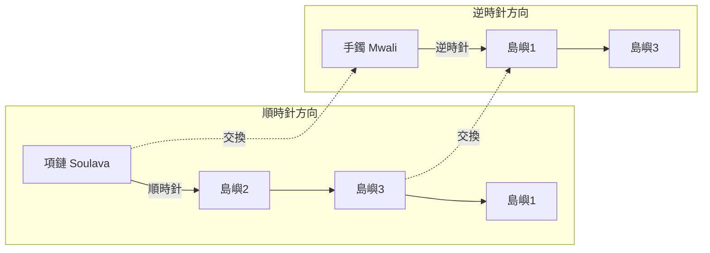

# 6.2 庫拉環：「原始人」的複雜經濟

在特羅布里恩群島，馬林諾斯基發現了一件令他大為震動的事：島民駕著獨木舟在島嶼間進行一種規模龐大的貝殼飾物交換。這些飾物——紅貝殼項鏈與白色貝殼臂鐲——不能提供任何實用價值，卻長年在海上按嚴格的路線與方向被傳遞。民俗學者把它視為無意義的迷信，經濟學者會算出一筆純粹的虧損。而馬林諾斯基花了兩年多時間，親身跟隨吃力的獨木舟航行、長途拜訪、財產堆放、預備儀式與政治談判，把研究寫成他一生最重要的著作——《西太平洋的航海者》——全書就獻給這個現象。

它的名字是「庫拉」（Kula）。

庫拉的規則簡潔而嚴格：兩種寶物沿相反方向在群島鏈條上流動——紅貝殼項鏈（soulava）順時針流動，白色貝殼臂鐲（mwali）逆時針流動。

任何庫拉寶物都不能被「擁有」太久：它屬於該社會的流通，而個人的榮譽不在於囤積財富，而在於他接觸與傳出過哪些著名的寶物。這條規則的意義十分深刻：庫拉不是商業，而是社會關係的網。它不屬於私人所有制的市場經濟，而是把「互惠贈與」、「契約債務」與「名譽貨幣」安置在一種環環相扣的制度之中。

在庫拉交易之外，當地還有一整套並行的社會經濟制度：

- 實用物的交換（gimwali）：芋頭、魚、工具——可以明碼計價，與庫拉交易嚴格分開；
- 生產的社會組織：獨木舟的建造由親屬集體勞動完成，船主以儀式性贈禮與收成分配來回饋；
- 巫術與航行禁忌：遠航前必有船首巫術與咒語，全程附隨禁忌（例如不可與妻子過夜）。

馬林諾斯基的解釋十分驚人。他認為庫拉是一條把整個環礁社會編織起來的大鏈：任何一個庫拉夥伴，都能在群島上找到可以去拜訪與信任的人家——這是一種將數千人級的跨海社會連接起來的制度。庫拉同時是外交、保險、貿易、結盟與榮譽體系。一言以蔽之，這種「贈禮經濟」與市場經濟一樣形式精妙，只是以「社會性關係」代替了「價格」作為交易媒介。

這項發現至少有三層後果：

第一，對演化論的哲學衝擊。「原始人不是野蠻的」。單線演化論中「野蠻人只有小規模簡單交易」的假定因此搖搖欲墜。特羅布里恩群島的居民，搆成一個跨海的社會網，其制度同樣精密，只是以他們自己的社會關係作為積蓄。

第二，理論上的新方法。「功能主義」（functionalism）就此成形：馬氏在《原始社會中的犯罪與習俗》（1926）主張，任何制度（包括巫術與迷信）都在社會中滿足某種功能與需要——這與舊理論的「殘存」形成了對決：記錄任何風俗，必須回答「它在什麼意義上有用」，而不是「它是哪個古老階段留下的」。

第三，嶄新的比較意識。1922 年，恰是《金枝》精簡版膾炙人口的同一年，馬林諾斯基提供了一條證明「原始人具有與現代人相同推理能力」的嶄新社會科學路徑。三年後，這條線被法國社會學家馬塞爾·莫斯（Marcel Mauss）接手，寫成《論禮物》（Essai sur le don，1925）：他把庫拉（馬林諾斯基的資料）、美洲西北岸印第安人的誇富宴（potlatch，博厄斯學派的資料）與古羅馬、日耳曼法中的贈與制度，統一成「贈禮交換」的一般理論。莫斯的結論——贈禮從不是無償，而是以榮譽、義務與互惠相連——成為二十世紀社會科學最常被引用的論文之一。

而下一章的舞台，一邊是巴黎的結構主義，一邊是太平洋上一位年輕的美國女性與薩摩亞的少女們。

庫拉至今仍在特羅布里恩群島運作。正如地球上的「原始」與「現代」從來不是一條路的兩端，而是彼此並行的軌道。
