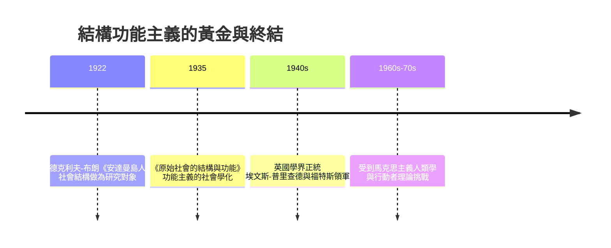

# 7.2 拉德克利夫-布朗與結構功能主義

同一個年代、同一片海洋上，還有另一個人正沿著完全不同的路徑前進：阿爾弗雷德·拉德克利夫-布朗（A. R. Radcliffe-Brown，1881–1955）。他與馬林諾斯基同被稱為英國社會人類學的兩大奠基者，但兩人的心路截然相反：馬林諾斯基自田野的「個人需要」入手，拉德克利夫-布朗則從社會的「結構功能」入手。

他早年先學數學與醫學，再轉人類學，1902–1911 年之間深受法國社會學派（涂爾幹 Émile Durkheim）的影響。涂爾幹的方法論為英國人類學提供了敲門磚：社會是一個自成一格的實體，要以社會自身的規則（而非個人心理）解釋社會現象。1906–1908 年，拉德克利夫-布朗在印度安達曼群島做田野，之後又赴西澳洲做一系列親屬制度調查；1910 年代起他輾轉多地的教育與行政職位（開普敦、悉尼、芝加哥）。這段經歷使他更貼近社會的「制度」層面，而非個人心靈。

1922 年，他出版《安達曼島人》（The Andaman Islanders）；1935 年出版表中最重要的《原始社會的結構與功能》（將各篇論文結集）。他的主張包括：

- 社會是一個有機體，成員如器官一樣彼此分工；
- 每項風俗的重要問題是：它在維持社會整體的存續上扮演什麼功能；
- 人類學的對象不是「文化的內容」，而是「社會結構」——人與人之間重複而規律的關係模式。

兩條路線的理論競賽由此開場：拉德克利夫-布朗主張「社會結構」，馬林諾斯基主張「文化與個人需要」。兩人在 1920–1940 年代的英國學界展開了長年的分岔。拉德克利夫-布朗的方法不重視田野中的個人情感，而重視系統化的親屬表格、組織圖譜、政治與祭祀的整體關係；他常以結構圖譜做田野筆記，用精確的形式標記一個社會的關係網。他的學生——如埃文斯-普里查德（E. E. Evans-Pritchard）、福特斯（Meyer Fortes）——成為英國戰後人類學的中堅；他本人先後在開普敦大學、悉尼大學、芝加哥大學與牛津大學執掌講座，把結構功能主義的火種帶到各大洲。

方法上的理論貢獻尤其值得細看：他把功能主義從心理學層次（風俗滿足個人需要）轉為社會學層次（風俗維持社會的連續），因而更嚴謹——一項風俗可以不對個人有益，卻在社會功能上有其作用。這正是《安達曼島人》的主題：安達曼人的火儀式、舞蹈與歌謠，在整體上看，是維持社會情感連結的「社會技術」，不能只從個人信仰或情感心理去理解。

第二次世界大戰之後，結構功能主義成為英國學界的正統。1940–1960 年代，這條學派在大英國協的大學網絡中迅速擴張，並在帝國落幕的時刻，肩負起研究殖民時代社會變動的角色。其理論骨架直到 1960 年代末，才被馬克思主義人類學、過程理論與行動者理論逐步取代。

但結構功能主義留下了一項持久的機構遺產：它在英國與其殖民地後來的每一個新國家大學中，播下了地方社會人類學的種子。印度、非洲與東南亞的當地學者，不少是在英式結構功能主義的教育下成長，其成果後來與北美的文化人類學正面接軌。

至此，兩條英式路線的匯流與分岔已清晰可見：一條講人的需要（馬林諾斯基），一條講社會的結構（拉德克利夫-布朗）；前者孕育了後來的經濟人類學與交換理論，後者則直接接上法國的結構主義。而在兩次大戰之間的另一端，美國的博厄斯學派則在做完全不同的事：不問「社會如何維持整體」，而問「文化如何塑造人格」。兩邊的合流，要等到二次大戰結束與冷戰時代的大學擴張。

下一章，我們將跟著一位法國人的行李，走進巴西的雨林與更深的思維結構。
