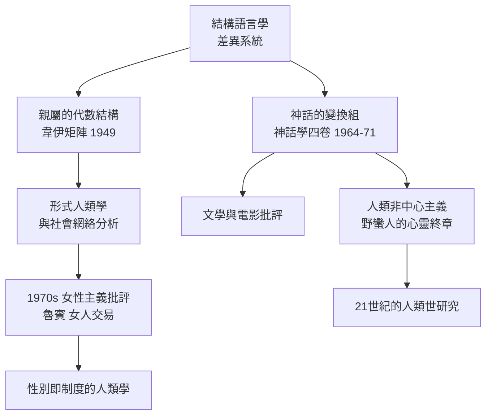

# 8.2 神話學與親屬結構的幾何美學

李維-史陀一生最具規模的工程，是四卷本的《神話學》（Mythologiques，1964–1971）：《生食與熟食》、《從蜂蜜到灰燼》、《餐桌禮俗的起源》、《裸人》。加上後續的《面具之道》、《嫉妒的陶匠之手》、《看聽讀》等，他試圖做一件事：證明人類的心靈，不論是亞馬遜雨林中的神話講述者，還是書房中的哲學家，都在同一套二元對立的機器上運作。本節帶讀者看這套工程的兩個最佳樣本——神話的「變換組」，以及親屬結構的幾何美學。

先看《神話學》的方法。四卷書由一個博羅羅人的神話開場，一路從巴西中部向北追蹤到北美洲西北岸：同一組神話母題（烹煮、敗壞、乾濕、鷹鴉）一路變形。他把每個變體的「核心句」排成縱列，看它們如何相互替換：如果只看兩兩相對的「差異」，整組神話就呈現出一個數學上所謂「變換群」的結構——同一組心靈運算，在不同社會與環境下，產生家族相似的神話。這幾乎是一場把全人類神話編成代數表的雄心。

這門工作有兩面：

正面，他示範了一種從「情節」到「心靈運算」的解讀法：讀神話不是為了知道它說了什麼，而是為了看它「調和」了什麼對立。這種解讀影響了二十世紀的文學與電影批評：再離奇的故事，都運行在一組相互牽引的對立上。

負面，證據基礎並不牢固。同行批評他使用的巴西神話資料是二手轉述，而且「變換組」的部份對應，是研究者自己「編排」出來的；他的數學比喻在嚴格意義上並不是真正的代數結構。1970–1980 年代，結構主義在英語人類學戰場上被政治經濟學轉向與馬克思主義取向取代，神話結構分析則退守到文學批評與電影研究的領域。

而親屬研究那一條線，則走向了十分不同的命運。李維-史陀的《親屬的基本結構》（1949）把親屬結構分為兩大類：以舅舅為紐帶的「一般化交換」（兩個通婚群之間的循環交換），以及「限制性交換」（交錯表親婚姻）。他的洞見是：一個社會只要以表親婚姻為樞紐，就能從數百條稱謂中提取出一套幾何規律——婚姻規則像文法，個人的婚姻像句子。

更驚人的是這本書的數學附錄：由著名數學家安德烈·韋伊（André Weil，布爾巴基學派的創始成員之一）執筆——當李維-史陀與他同在紐約流亡時，韋伊把通婚群（marriage class）制度的形式規則寫成矩陣與群論的變換，證明哪些規則組合能讓社會的婚姻循環自洽。這是全球最早把婚姻規則完全形式化的成果之一，後來延伸為二十世紀的「形式人類學」，並與社會網絡分析（如哈里森·懷特一支）在方法上遙相呼應。用田野資料為社會網絡建模——這條線的源頭，就在 1944 年前後紐約流亡者的餐桌上。

然而到 1970 年代，這條形式化的親屬分析遭遇了最嚴厲的挑戰，來自女性主義人類學。蓋伊·魯賓（Gayle Rubin）1975 年的經典論文〈女人交易中的賭注〉直接指出：「女人交換」的理論把女性視為可流通的符號——「女人」是交換的對象而非主體；這不是中性的語法描述，而是父權制度的學術映射。她主張把研究重心由「女人被誰交換」轉向「誰掌握交換的權力，以及交換如何生產性別本身」。魯賓的論文成為女性主義人類學與性別研究的奠基文獻之一，也開創了「性/社會體制」（sex/gender system）的理論。李維-史陀的幾何美學，就這樣最終被它的後代改寫成了一門權力分析。

李維-史陀本人在 1970 年代之後，逐漸把興趣轉向藝術、雕刻與音樂的美學（《面具之道》、《看聽讀》），也持續批判人類中心主義：《野蠻人的心靈》的終章說，世界不是為人類而造，人類存在與否不會影響宇宙的存續。這句話，是本書第五篇「多於人類的人類學」的最早先聲。

李維-史陀在他生涯的最後三十年，從自己引發的浪潮中退下，寫作藝術與音樂的美學隨筆；2009 年他以一百零一歲去世，是二次戰後人類學黃金時代的最後一位標誌性人物。在他身後，人類學的走向轉向了更溫熱的方向：不是冷卻的結構，而是活著的人的意義與權力。下一章，我們走進美國芝加哥的鬥雞場。
