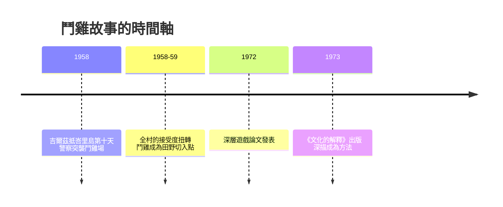

# 9.2 峇里島鬥雞：一部文化的文本

1958 年 4 月，吉爾茲與妻子希爾德剛搬到峇里島一個小村十天左右。由於嚴格的外人管理規定，村人雖已熟識他們，卻沒有人真正與他們交談。一天上午，一場未被批准的鬥雞在村廣場舉行，數百人圍觀；警察突然到來，人群一哄而散。就在那一瞬，一位村民拉著吉爾茲夫婦一起跑，讓他們閃進陌生人家的院子躲過清點。幾個小時後，全村對他們的態度突然扭轉：從「外來的觀察者」變成了「一起逃跑的同伴」。此後，村人樂於與他們長談，而話題的第一名，就是鬥雞。

——這是《文化的解釋》中著名的「深描」故事之一（長篇論文〈深層遊戲：關於峇里島鬥雞的注〉（Deep Play: Notes on the Balinese Cockfight），1972 年發表於 Daedalus 期刊）。一場逃跑，改變了兩位人類學家的田野：從那天起，鬥雞成為他們切入峇里社會的門。

鬥雞在峇里島，是一個節點性的社會制度。荷蘭殖民當局曾下令禁止，印尼中央政府也長期取締，村中卻仍在私下舉行。吉爾茲把它拆解為幾層意義：

1. 鬥雞是男人們的社會動員。在峇里島的象徵體系中，公雞是男性氣質的延伸物：養雞、愛雞、以雞為自我形象的一部分。鬥雞場上的勝敗，輻射到男人的地位競賽。
2. 淺層遊戲與深層遊戲。平日的村莊鬥雞，賭注小，遵循地位群的親屬分界；而在大場合（婚喪與節慶期間），賭注驚人，往往由家族等級的不同派系結盟推動。吉爾茲借用哲學家邊沁的「深層遊戲」（deep play）概念——賭注大到超出理性的收益計算——來指出：這些大賭注的意義不在錢，而在「誰敢上桌」的地位宣示。
3. 鬥雞是社會地位的敘事文本。他在文末給出一個被反覆引用的句式：一場驚險萬分的深層遊戲鬥雞，如同「一個正在上演的社會地位結構的身分敘事」——這是文化把階層關係做戲劇化的翻譯。用他自己的話說：峇里島人在鬥雞場這個小小的舞台上，閱讀自己的社會。

吉爾茲進一步把鬥雞連結到美學與生命觀：鬥雞的儀式性、血、勝與敗之間的陡然反轉，呼應峇里人對「拉別亞」（lebaya，威望與風度）的執著。這是一個社會把等級、威望、羞辱與榮譽，濃縮在十分鐘的雞爪相拼中的故事。這段文字，成為社會科學寫作史上最有名的「深描」典範之一。

鬥雞論文的方法層面，成為 1970 年代人類學寫作的一次突破，影響至少有三：

- 「文化即文本」（culture-as-text）的方法，被文學批評與文化研究直接借用；人類學與人文學科在 1970–80 年代大規模科際橫向。
- 它把機智的白描寫法帶進民族誌：先講一個時間線上的現場事件，再層層剝出其意義結構——民族誌開始自覺地要文學性地閱讀與寫作。
- 它也埋下了反彈：如果文化是文本，那這個文本被誰「讀」？被誰「寫」？本地人的聲音在哪裡？1980 年代的《寫文化》由此發動了全面的權力反思（第 10 章）。

1958 到 1973 的十五個年頭，不只是一位學者的個案，而是整門學科從「村落民族誌」走向「文化批評」的中年轉身。鬥雞本身，則成為一個經典的寓言：從一場小小的賭局，可以讀出一個社會如何向自己講述它自己是誰。而如果文化可以被這樣讀——那麼人類學自身這份文本，也必須被讀。

下一章，就從這裡接下去。
