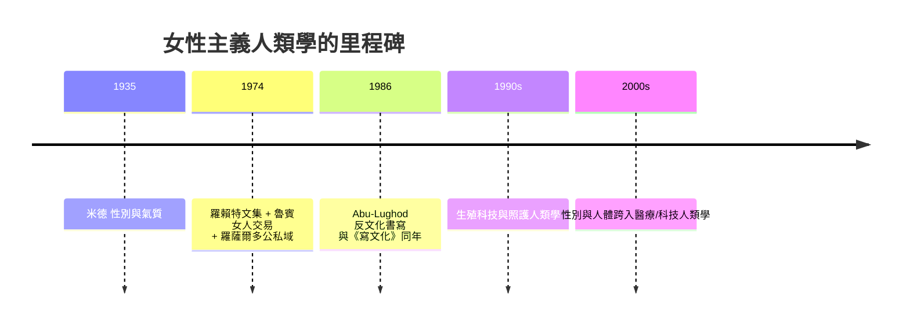

# 10.2 女性主義人類學：解構男性中心的田野

在《寫文化》引起的反思浪潮裡，有一支是更早、也更徹底的：女性主義人類學。它不只是「多用女性研究員」的問題，而是要回答一個方法論難題：如果整部人類學科學的資料，多數是由男性觀察者向男性報導人收集的，那麼這門學問怎麼可能聲稱在研究「人類」？

歷史的起點，可以拉回米德。她 1935 年的《三個原始社會中的性別與氣質》已是我們在第 7 章看過的里程碑：三個相鄰的巴布亞新幾內亞社會，性別角色彼此不同，且與歐美社會的兩性氣質完全不同組合。米德的結論——「許多被稱為男性氣質與女性氣質的特質，是文化深度的設計」——是「性別是文化的」這一命題在人類學中的首次系統提出。

二次大戰後的 1950–1970 年代，兩條支流的交匯孕育了這個領域。第一支流是人類學內部：結構功能主義把「社會結構」做成一張所有權與血緣的關係圖，其中婦女多數被當作「交換品或附屬物」；1960 年代末，人類學界開始追問，「婦女在這張圖上到底在哪裡？」。此時美國女性運動的第二次浪潮（貝蒂·弗里丹 1963 年《女性的奧秘》、全國婦女組織 1966 年成立）把社會科學整體推向「做性別」的現場。第二支流是政治：1960 年代的學生運動、反殖民運動與反戰運動——南越與阿爾及利亞戰場上的婦女組織與工作者——都顛覆了「婦女只在家中」的假設。

1974 年是這門學科的里程碑年。雷伊娜·羅賴特（Rayna Reiter，後改名 Rayna Rapp）主編的論文集《向著人類學中的婦女》（Toward an Anthropology of Women）出版，蓋伊·魯賓的〈女人交易中的賭注〉（The Traffic in Women，初版 1975）同年问世——魯賓以李維-史陀的親屬理論為切入，提出「性/社會體制」（sex/gender system）的概念：每個社會都有一整套把生理性別轉化成社會地位、規定欲望與婚配的制度機器。這一概念成為整個性別研究的理論支柱，至今仍在使用。同期刊發表了米歇爾·羅薩爾多（Michelle Rosaldo，人類學家、雷納托之妻）提出的「公/私領域」理論：多數社會把女性定位在「家庭内」與「公共外」的分界，而這一分界本身是可分析的歷史產物。1974 年的另一部合集《婦女、文化與社會》（Woman, Culture, and Society，羅薩爾多與路易斯·蘭菲爾主編）幾乎同時出版。

1970–1980 年代，這門學科完成了三次理論擴展。

第一次是「女性人類學」到「性別人類學」的重命名。學界意識到，把「婦女」當成補充的研究對象，只是把男性視角拿掉一半；真正的問題是「性別」這一整套制度如何在各個社會運作。1980 年代，「gender」逐漸取代「women」做為領域名稱，主要推手包括魯賓與英國人類學家瑪麗琳·斯特拉森（Marilyn Strathern）等跨學科學者。

第二次是田野方法的革命。「女性做為報導人」的困境——男性人類學家在多數社會難以接觸女性報導人——意味著：米德式的女性田野工作者不只「更容易打進女性生活」，她們還暴露了整個「『土著』做為一個整體」的虛構。1980 年代，如麗拉·阿布-盧霍德（Lila Abu-Lughod）在埃及的貝都因田野中提出「反詩學民族誌」（writing against culture）：不要只寫「文化規則」，要寫具體個人的日常實踐。這在方法論上，與《寫文化》同一年出發，但針對的問題不同——真正的人的形象，是具體的女人與男人，不是抽象的文化。

第三次是「身體與生殖」議題的崛起。1970–1990 年代，新生殖科技的全球擴散與生育政治的變動，推動了生殖科技人類學：如雷伊娜·拉普（Rayna Rapp）的《身體中的女人》（The Woman in the Body，1987），把懷孕、羊膜穿刺與美國階級文化串起來；羅伯塔·金斯堡（Faye Ginsburg）、莎拉·富蘭克林（Sarah Franklin）等人則開創生育與科技的人類學。到 1990 年代，這一線已成為當代城市與全球健康研究的重要基礎。

女性主義人類學也直接修改了演化的視角。1980 年代日益激烈的「採集—狩獵」辯論中，女性主義者指出：傳統「男人獵肉—女人採集」的兩性分工理論，被用來推出「女人天生依附」的結論；而靈長類與化石資料顯示，早期人類的食物資源與社會連結，很可能大量由女性主導。靈長類學家莎拉·布拉法爾·赫迪（Sarah Blaffer Hrdy）等人把性選擇與親代投資理論做了批判性的改寫，證明「競爭與策略」從來不是雄性專屬。

回望整條線，可以說：女性主義人類學的工作，是把人類學的核心「人性或社會結構」重新定義為「權力與身分的分配」。它把「誰被寫進民族誌」與「誰的視角被用作科學」這兩個政治問題，寫進了方法論的核心。當年的米德、魯賓、羅薩爾多、阿布-盧霍德，一路到今天的參與了 LGBT、照護與人體科技的田野，是同一連鎖的接力，而這條線在下一章，將在「疾病、貧窮與科學」的田野中，與醫療人類學攜手。

