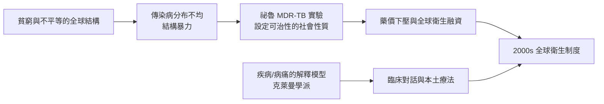

# 11.1 法默與醫療人類學：疾病是結構的產物

1990 年代起，一門新的子領域走進了全球公共衛生的最前線：醫療人類學（medical anthropology）。它的代表人物，是保羅·法默（Paul Farmer，1959–2022）——一位哈佛的醫生兼人類學家，也是全球健康組織「健康夥伴」（Partners In Health）的共同創辦人。

法默的故事充滿政治與經濟的因果。他生於美國馬薩諸塞州，在杜克大學讀書時第一次以志工與人類學研究者的身分前往海地。那正是海地最嚴峻的年代：杜瓦利埃家族的獨裁統治延續到 1986 年，農村的赤貧與「貧民窟經濟」早已把人口的健康水準壓到會致命的最低水位。1987 年，他與同伴（包括日後的吉姆·金 Jim Yong Kim 等人）在波士頓共同創立「健康夥伴」，在中海地的山村 Cange 展開全套健康工作。他們的實踐方法自此成形：病人的交通、住院與營養補助由組織提供；社區健康工作者上門送藥與陪伴；這不是一般慈善，而是一套「結構性補償」的制度——它的前提是：病人無法就醫的原因不是文化落後，而是貧窮的政治。

法默的學術突破，是「結構暴力」（structural violence）這一概念在醫療田野的完整展開（他繼承了和平研究學者加爾通 Johan Galtung 1960 年代的概念）。一個海地貧農的孩子死於結核病或艾滋病，不是「文化落後」的產物，而是世界銀行貸款規則、國際商品價格、軍政府與基礎衛生匱乏合力的結果。結構暴力的關鍵在於：它在單一病床的個案裡常常看不見，但它的因果鏈通向整個世界體系。他後來的兩代表作把這條線寫成制度上的理論——《傳染病與不平等》（Infections and Inequalities，1999）與《權力的病理學》（Pathologies of Power，2003）：後者把健康直接命名為一種不受市場否決的人權。

這條線由 1990 年代的兩大背景推動。第一是艾滋病：1980 年代起，艾滋在撒哈拉以南非洲與加勒比地區大規模擴散；1990 年代末，工業化國家已出現抗逆轉錄病毒藥物（ARV），但價格高昂，專利制度掌握著供給。第二是 1994 年的盧安達大屠殺及其後續的衛生危機，使全球衛生界開始正視「種族、戰爭與傳染病」的結構關聯。法默與同仁在 1990 年代中期轉赴秘魯，證明了一件當時被認為不可能的事：傳統上只能在富國治好的耐多藥結核病（MDR-TB），在貧民窟的條件下也能治癒——「可治性」不是病人的性質，而是社會的性質。世界衛生組織最終接受了這一方法（引出一項延展的短程化療與社區督導制度）；這次的成果，成為 2000 年代全球「藥價下壓」運動的科學根據之一，也催生了「全球基金」式的多邊衛生融資制度。法默本人後來先後任聯合國秘書長的埃博拉與發展顧問，並在哈佛直屬醫院主持全球衛生教學；他 2022 年 2 月在盧安達工作期間去世，享年六十二歲。

同年代，另有兩支醫療人類學的支柱，需要一併一提。

第一支是南希·謝珀-休斯（Nancy Scheper-Hughes）。她的《死亡的哭泣之外的拒絕》（Death without Weeping，1992）是巴西第一大貧民窟中的田野：在嬰兒高死亡率的貧社區，貧窮的母親常常不能為不足一歲的嬰兒投入所有的情感與資源；她指出，這不是「母性缺失」，而是貧窮結構在情感上的效果。1990 年代末，她再開創「器官人類學」（Organ Watch），追蹤巴西、印度與土耳其等地「器官與移植市場」的全球經濟——人體本身成為可循環的資產。這份追蹤性田野，正是上一章「多點民族誌」的實戰版本。

第二支是哈佛與社會醫學的「解釋模型」學派。亞瑟·克萊曼（Arthur Kleinman）——哈佛醫學院的醫生兼人類學家——提出：病痛的體驗與解釋是文化性的；醫師與病人各自持有不同的「解釋模型」（explanatory models），治療的效果取決於這兩套模型的對話。他的《苦痛的敘事》（The Illness Narratives，1988）至今是醫學院校中醫療人類學的入門書。這一派把「疾病（disease，生物狀態）」與「病痛（illness，人的體驗）」的分殊變成了臨床與研究的通用工具。

醫療人類學的政治意涵，是整條因果線的核心：

法默去世時被同行稱為「全球健康運動的定錨」。他一生最常說的，大意是：不平等是地球上最大的病理，而醫藥的作用不在技術本身，而在於是否把技術交到了被結構排除的人手上。他所用的方法——深入一地整年，同時把全球機構納入視野——正是下一節要去華爾街與矽谷的田野方法。
