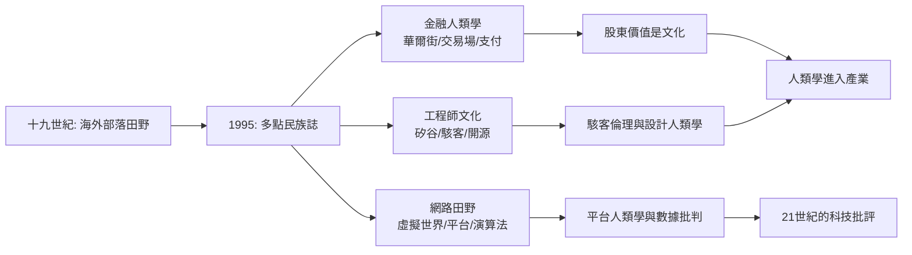

# 11.2 高科技田野：華爾街、矽谷與網際網路

如果說十九世紀的人類學田野是「海外部落」，二十世紀末的田野，則開始了「回到本部」——研究自己這一邊的人：交易員、工程師、駭客、玩家與整張網際網路。上一章的「多點民族誌」在方法上打開了這扇門：田野不再必須是一個村落，它可以是一樁交易、一種職業、一個平台。本節聚焦三條最經典的路徑——華爾街、矽谷與網路世界——看新田野如何重塑人類學。

第一條路：金融人類學，從華爾街開始。

邁克爾·何（Karen Ho）——普林斯頓人類學博士，畢業前曾任投資銀行分析員——把她自己的職場經驗轉為田野，寫成《清算：一個華爾街的民族誌》（Liquidated: An Ethnography of Wall Street，2009）。她的核心發現是：「股東價值」（shareholder value）不是一個中性的經濟理論，而是一套由華爾街的職業制度生產出來的信條。投資銀行家的職涯高度流動（裁員是常態），這種「隨時被解雇」的生涯使他們真誠相信：企業也應「隨時縮編」、「重組」、「瘦身」——於是裁員被道德化為治理的必修課。1990 年代的併購浪潮與企業重組，正是這套文化在世界經濟中的執行。一個經濟學術語的勝利，原是一次職業文化的勝利。

凱特琳·扎隆（Caitlin Zaloom）則把田野搬進芝加哥與倫敦的期貨交易所，寫成《走出交易坑》（Out of the Pits，2006），追蹤交易從人工喊價轉為電子撮合的十年。她的發現是：交易員不只是「理性計算的機器」，金融市場維持著一整套情緒與身體的管理技術——如何自持、如何承擔風險、如何面對虧損——而電子化不只改變了界面，改變的是這套心性經濟。這條線與行為經濟學的「情緒與決策」在方法上互相印證。

比爾·莫瑞爾（Bill Maurer）開創了「數位金融與貨幣人類學」：早年他在加勒比地區研究離岸金融（那些在論文上都寫不出名字的「紙上小島」，《分裂的美洲》Pious 之下），後來專注行動支付與區塊鏈——從肯亞的 M-Pesa 到加密貨幣的技術設計。他提出：貨幣從來不只是價格的符號，它總是技術、制度與親密關係的合成物；金融科技設計者把「信任」寫進代碼時，其實是在把一種特定的社會想像寫進世界。這條線直接連到 2008 年金融危機之後的「比特幣」社會學與「支付文化」研究。

第二條路：矽谷與工程師文化。

雪莉·特克爾（Sherry Turkle）在 MIT 的《屏幕上的生活》（Life on the Screen，1995）提出了「電腦文化如何改變人的自我觀」：當人們在線上「創造第二人格」，人的主體概念開始分裂。她後來的《孤獨在一起》（Alone Together，2011）追蹤機器人與社交媒體如何重排人與人、人與物的親密關係——這是一本在科技公司的產品路線圖上寫作的民族誌。

加布里埃拉·科爾曼（Gabriella Coleman）駭進了駭客社群：她的田野不是「進入系統」，而是加入 Debian（一個開源 Linux 社群）的郵件列表、IRC 與線下聚會，研究「駭客倫理」做為一種政治文化——《編寫自由》（Coding Freedom，2013）。她論證：自由軟體運動不只是技術斗爭，而是一場關於「知識應歸誰？」的政治哲學運動；駭客文化自成一種「共同物」的倫理。這條線後來延伸到揭露機構（data leaks）與加密政治的田野。

高科技公司本身也成了田野。1980 年代起，全錄帕克研究中心（Xerox PARC）的研究員（如露西·蘇克曼 Lucy Suchman）率先把民族誌觀察帶進人機互動研究；1990 年代起，微軟、英特爾、Google 相繼設立「用戶研究」職位，聘用人類學家；三星、英特爾還辦起「人類學實驗室」與產品設計合作。人類學由「批評資本」轉變成「設計資本」的一部分——這引發學界自身的反思辯論：當研究者的薪水來自被研究的公司，田野的倫理與批評的位置在哪裡？

第三條路：網際網路本身。網路田野經歷兩個階段。

第一階段（1990s–2000s）：「虛擬民族誌」。把論壇、聊天室、遊戲世界當成田野。湯姆·博爾斯托夫（Tom Boellstorff）在虛擬世界 Second Life 裡進行數年的人类學田野，寫成《在 Second Life 成年》（Coming of Age in Second Life，2008）——書名刻意致敬米德的《薩摩亞人的成年》。他的論證極為漂亮：虛擬世界不是「比真實更假」的地方，而是「真實人類在選擇如何生活」的另一個田野；所有的人類學範疇——親屬、身分、身體、財產——在虛擬社會中一樣存在。

第二階段（2010s–）：「平台與演算法的田野」。研究對象從「線上社群」轉為「平台的本體」：推薦演算法、內容審核、數據經濟、虛假訊息的跨國流動。代表成果包括塔爾頓·吉列斯皮（Tarleton Gillespie）對「平台」這個詞本身的政治史研究，《策展的力量》（Custodians of the Internet，2018）——「我們是一家科技公司，不是出版商」這句話如何成為平台規避媒體責任的修辭。這條線把吉爾茲式的「解釋模型」翻轉：現在，「模型」是字面意義上的機器學習模型，而文化是它訓練資料裡的偏見。

這條高科技田野線，為本書最後一章提出了一個關鍵鋪墊：當人類學研究技術時，就必然採取「技術是文化」而不是「技術是工具」的眼光——技術是生活方式的結構。而如果連技術都是文化的，那麼「人類」本身的邊界在哪裡？下一章，我們走進森林，聽聽植物的思考。
