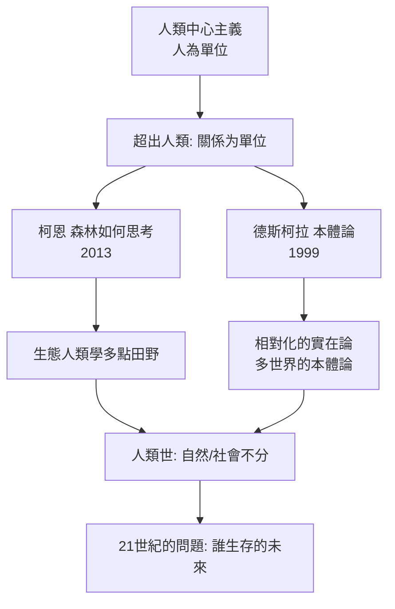

# 12.1 柯恩與《森林如何思考》：超越人類中心

2013 年，一位在厄瓜多爾亞馬遜雨林耕耘了近二十年田野的人類學家出版《森林如何思考：朝向人類之外的民族誌》（How Forests Think: Toward an Anthropology Beyond the Human）。作者是愛德華多·柯恩（Eduardo Kohn，加拿大麥吉爾大學教授）。這本書獲得 2014 年美國人類學協會的維克多·特納民族誌寫作獎，並被廣泛視為二十一世紀人類學「超出人類」（more-than-human）轉向的標誌性著作。

柯恩的田野在厄瓜多爾的魯納人（Runa，講克丘亞語與西班牙語的混血原住民族群）村莊。他追蹤的不只是人的活動，而是整片森林的關係網：獵人與犬與獵物（野豬、白唇西貒）的三角網、人與犬的對話、獵人夢中的動物訊息、森林中不斷往來的符號與回應。書中著名的一幕之一：一隻與人共處的獵犬被野豬咬死，而這起「家庭悲劇」在整個村落與樹林關係中成為真正的社會事件。柯恩問：如果我們研究「關係」，而關係網本身已超出「人」的範圍，那為什麼人類學要把「人」設為固定單位？

柯恩的方法接上了兩條之前的線。

第一條是符號學。他借用了美國哲學家皮爾士（Charles S. Peirce）的符號學理論：世界的關係由符號關係產生；符號不只是人類的語言，動物、植物以至整個生態系都在參與一種「符號過程」（semiosis）。一隻狗對其主人的「讀懂」、西貒群對獵人氣味的反應，都是意義的流動。柯恩由此提出一個大膽的論證：生命本身，就是一種符號過程——生物學與人類學在「意義」上重新接軌。

第二條是同年代的「本體論轉向」。法國人類學家菲力普·德斯柯拉（Philippe Descola）——李維-史陀的學生、曾在亞馬遜做阿丘瓦爾族（Achuar）的田野——2005 年出版《超越自然與文化》（Par-delà nature et culture）。他的核心論點是：西方人類學的「自然/文化」對立，只是眾多世界觀中的一種，而不是普世的心智結構。他提出四種本體論：自然主義（西方：自然與文化二分）、泛靈論（亞馬遜等地：萬物皆有與人相同的「內在」，但外在身形各異）、圖騰主義（澳洲：人與物種外在相似而內在相連）、類比主義（傳統中國與歐洲：世界由繁多成份的微妙對應構成）。這一「本體論轉向」意味著：理解一個社會，先要承認它居住在一個特定的「實在的樣子」之中，而這些「樣子」彼此不可翻譯成同種語言。

第三條線是新一種自然。2010 年代，「Anthropocene」（人類世）做為一個地質學概念在人文社會科學界引爆：一個由人類活動造成的地質年代。同年代的大事——氣候變遷、生態破壞、生物多樣喪失——推動了人類學新的問題場域：人類學必須重新設計自己的問題場域，因為「自然」已成了「社會」的一部分，一切修復、消費與行為都是政治與文化問題。2015 年後，「Anthropocene 人類學」成為人類學最活躍的領域之一。

本書最後一章，即是這條線的展開。

柯恩與德斯柯拉本人在他們不同但相互連接的基石上，便都達到了一個同樣的結論：要回答「人是什麼」，人類學必須要回到我們最老的問題——用共同的田野語言，去看「人類與非人類的實存關係網」。在下一節，我們把這一問題放到人類時代的行星尺度。
