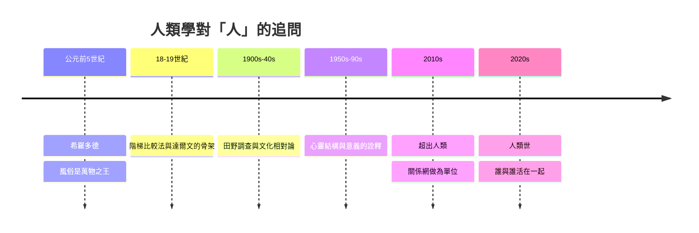

# 12.2 人類世：氣候變遷與未來的生存

2000 年，荷蘭大氣化學家保羅·克魯岑（Paul Crutzen，1995 年諾貝爾化學獎得主）在《自然》期刊的一封信中提出：我們已離開了「全新世」（Holocene），進入一個由人類活動主導的地質年代——人類世（Anthropocene）。這個提法的技術根據，是工業革命以來大氣二氧化碳濃度、氮循環與生物多樣性的巨變；2016 年，「人類世工作組」建議以 1950 年前後（核試爆的放射性塵降層）做為起始標記，正式的地質學劃年至今仍在爭論中。

對人文與社會科學而言，「人類世」不只是地質學新聞，而是一個判詞：自然與社會的邊界不存在。天氣不再是背景，而是經濟與政治關係的直接參與者——碳的流動跨過物種與國界，也被制度與權力切割。這一判詞，徹底改變了人類學的問題方式。2000 年代中期起，人類學家開始把這條線本身當成田野。

第一個方向：氣候、冰與「地方知識」。

朱莉·克魯克尚克（Julie Cruikshank）在加拿大西北部做了三十年的口述史田野，2005 年出版《冰川可曾傾聽？》（Do Glaciers Listen?）:在聖以利亞山（St. Elias Mountains）地區，原住民的敘事中冰川是有力量的行動者——會傾聽、會報復、會因人的不懂禮節而行動；氣候與冰川的變動，在這些社會裡從來不只是「自然事件」。她的論點是：原住民的環境知識不是「落後的觀察」，而是一整套與之相容的本體論。這一思路，開創了後來的「原住民氣候知識」人類學與傳統生態知識（TEK）研究。

第二個方向：多物種與「世界盡頭的蘑菇」。

2015 年，加州大學聖塔克魯茲分校的人類學家安娜·清（Anna Lowenhaupt Tsing）出版《世界盡頭的蘑菇》（The Mushroom at the End of the World）。她寫的不是一座自然保護區，而是全球化生產體系邊緣的一種世界最昂貴的菌菇——松茸：無法人工種植，只能在「冒犯資本主義種植邏輯」的生態中採集。美國西北部森林的松茸產業，聚攏了越戰後流亡的高棉、寮國採集者、鄉村人口與日本市場。清的方法是「多物種民族誌」：不是「人在社會中」，而是「生命在廢墟中仍以新的形式茁長」。她提出「接觸區」（contact zones）的田野方法與「毀壞中的生命」的視角——毀壞不必然是終結，反而常常滋生新的共存。這本書成為當代人類學影響最廣的著作之一，並獲得多個獎項。

第三個方向：政治本體論與「我要先落地」。

2010–2020 年代，對「人類世」本身也出現了一組批判。歷史學家傑森·摩爾（Jason Moore）提出「資本世」（Capitalocene）：把人類整體當作地質主體是誤導的，這一地質年代的主體是資本主義的組織。人類學家馬里索爾·德拉卡德納（Marisol de la Cadena，秘魯裔美籍）在安地斯的田野中，出版《大地存在者》（Earth Beings，2015）：安地斯的土著社群與「山」（apu）的政治關係是一種「宇宙政治」——山既是生態、也是靈與主權者；環保課題在這裡更直接地是一種本體論政治。唐娜·哈拉威（Donna Haraway，人類學最親密的人文鄰居）2016 年出版《與麻煩同在》（Staying with the Trouble），提出「奇魯紀」（Chthulucene）——與其把當前之年命名為「人類」（會以人類中心的名義再次自我原諒），不如直面問題：人與多物種『以不可簡單糾纏的方式去修復』。哲學家布魯諾·拉圖（Bruno Latour）——科學技術人類學的宗主——2017 年出版《面對蓋婭》，2018 年的《落地》（Down to Earth）指出：地球的地是一個有限的表面，人類的政治必須重新「扎根地方」，而不是在「全球」與「末世」之間搖晃。

這四條方向的共同問題是：如何在一個不以「人類」為中心的世界中，活下來？——這個問題，收攏了本書兩千年的整條線。本書開篇的希臘人希羅多德問：為什麼異族與希臘不同？——這一問題的兩千年長征，可以收成它如何一路演進：

回望兩千年，人類學的核心不是「風俗的百科」，而是一個不斷自我拆解的方法：既要在不同的人群與物種之間，學習別人怎樣問問題，又要隨時把問題回指給自己。它的未來，大概也不是一門「部落的研究」，而是一門關於「人與世界如何共在」的長程科學——從地中海的異族風俗，赤道的森林，到冰島與太平洋的冰川與蘑菇，它的「田野」始終就在我們個人的生活之中。

——本書到此。
